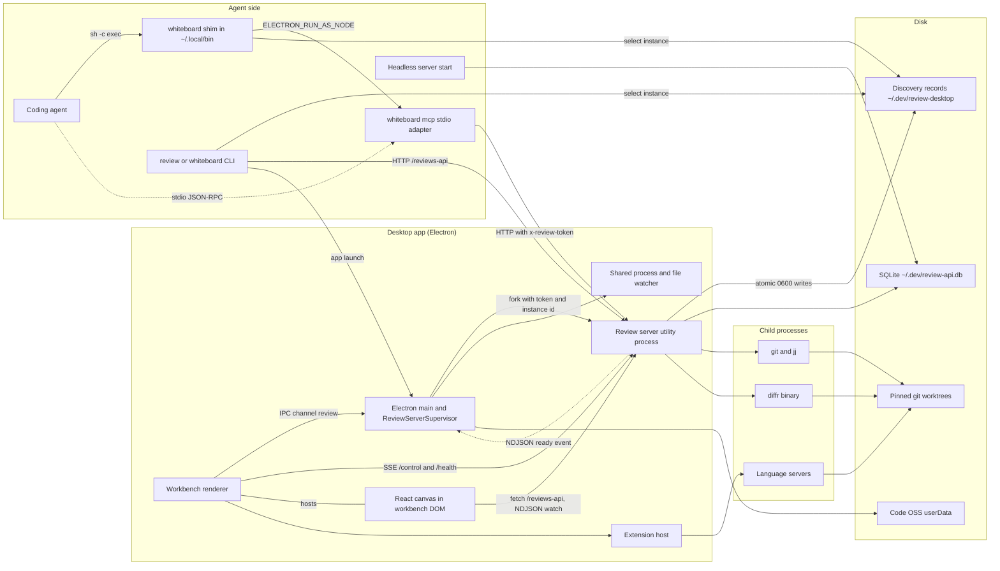

# Whiteboard on Linux

_Handoff for the team taking over the repository: how it is built, what already runs on Linux, what breaks, and the order to fix it in._

Commit `a226392` · 2026-09-24 · 15 analysts · 339 findings → 159 items · 170 verification verdicts · 6 distros run.

This is the in-repo copy of the research. An interactive HTML version with filters for the feature matrix and gap register was produced alongside it.

## 1. The short version

Whiteboard already runs on Linux x86-64. The source build, every test tier, Linux packaging and the Fedora RPM all work on Ubuntu 24.04, and the packaged app starts on Fedora 44, Ubuntu 24.04, Arch and openSUSE Tumbleweed. What remains is breadth and a set of feature gaps, not a port.

- Blocker**Older distros cannot start the app.** Native modules are compiled against the build host, so they need glibc 2.38 and GLIBCXX 3.4.31. On Debian 12 and Ubuntu 22.04 the logger, state database and keymap modules fail to load and the app exits. Build them against a glibc 2.28 sysroot, as upstream VS Code does, and gate symbol versions in CI.

- High**No aarch64 at all.** The curated-extension step rejects `linux-arm64`, `diffr` has no arm64 build, and packaging stops on anything but x86_64, so even `pnpm dev` fails on an arm64 laptop.

- High**Fedora is the only install target.** There is no .deb or apt repository, no tarball, and no sandbox plan for other formats (Ubuntu 24.04 restricts the user namespaces Electron's sandbox uses). Source builds on Ubuntu 23.10+ need a manual SUID step before they launch.

- High**Image uploads and image imports are switched off on Linux.** The guard is justified: in our probe sharp decoded correctly inside Electron but raised about 260 GLib CRITICAL assertions. Replace or isolate the decoder instead of removing the guard.

- Medium**Small fixes with large effects.** The npm or source CLI can only launch `/usr/bin/review-desktop`. The RPM installs `review`, but trace hooks call `whiteboard`. Closing the last window quits the embedded server and drops every agent's MCP connection. "Install whiteboard in PATH" creates `~/.bash_profile`, which hides `~/.profile` on Debian and Ubuntu. The canvas "Copy for Agent" shortcut is ⌘ only, and the uninstall dialog tells Fedora users to run apt or pacman.

- Medium**Linux tests stop at the source build.** Pull requests build and test the source tree on Ubuntu, but the packaged app is only exercised on manual releases. The Linux title-bar smoke is stale and not in any workflow, e2e journeys press Meta, and there is no Wayland lane.

By feature count: 115 of 137 user-facing features work on the Fedora RPM today (69 with run or test evidence, 46 supported in code but untested), 16 are degraded, 3 are broken, missing or unknown, and 2 are macOS-only by design (the native app menu and Squirrel updates). On aarch64, 87 are broken. Start with the guardrails and the glibc baseline. They are cheap, and they turn "works on Fedora" into "works on any current x86-64 distro". Everything else is in the gap register with evidence and a fix, and sequenced in the plan.

## 2. What we ran

### Build, package and test from source (Ubuntu 24.04 x86-64)

| Step | Result | Time | Notes |
|---|---|---|---|
| `pnpm install --frozen-lockfile` | pass | 5 s | Node 24.18.0, pnpm 11.1.2 |
| `REVIEW_DESKTOP_CI_FAST=1 pnpm desktop:build` | pass | 269 s | includes npm ci of Code OSS; native modules compiled on the host |
| `pnpm desktop:package:linux` | pass | 170 s | fetches diffr 0.1.3 (x86_64-unknown-linux-gnu), stages review-runtime |
| `app:package:linux:distributions (RPM)` | pass | 144 s | dev-fast-review-0.1.1-1.x86_64.rpm, 279 MB; warning: chrome-sandbox listed twice |
| `pnpm lint / pnpm typecheck` | pass | 3 s / 38 s |  |
| `pnpm test (all workspaces)` | pass* | 197 s | 3 legacy-fixture tests fail only as root (git safe.directory on tar-extracted uids); pass otherwise |
| `review-desktop script tests` | pass | 44 s |  |
| `canvas tests, node project` | pass | 14 s | 244 / 244 |
| `canvas tests, Vitest Browser Mode on Chromium` | pass |  | 273 / 273 |
| `smoke-launch-packaged.mjs as root` | fail |  | Electron refuses to run as root without --no-sandbox (expected) |
| `smoke-launch-packaged.mjs as a normal user, SUID chrome-sandbox, Xvfb` | pass | 2.6 s | renderer + Review server ready |
| `smoke-linux-ui.mjs as checked in` | fail |  | stale selectors: waits for "Review menu"; not run by any workflow |
| `smoke-linux-ui.mjs with current labels, Xvfb + openbox` | pass |  | native and custom title bars: F10 menu, actions, 700 px layout, maximize/restore/minimize/close, 1.25 scale |

### The packaged app across distributions

| Distro | glibc | Install | Native modules | Agent CLI | App launch |
|---|---|---|---|---|---|
| Fedora 44 | 2.43 | real dnf install of the built RPM | all 7 load | pass | pass, 1.5 s |
| Ubuntu 24.04 | 2.39 | packaged tree + apt runtime libs | all 7 load | pass | pass, 1.5 s |
| Arch Linux | 2.44 | packaged tree + pacman runtime libs | all 7 load | pass | pass, 2.1 s |
| openSUSE Tumbleweed | 2.44 | packaged tree + zypper runtime libs | all 7 load | pass | pass, 2.6 s |
| Debian 12 | 2.36 | packaged tree + apt runtime libs | 4 of 7 fail: sqlite3, parcel-watcher (GLIBC_2.38); spdlog, native-keymap (GLIBCXX_3.4.31) | pass | fail: app exits before its log exists |
| Ubuntu 22.04 | 2.35 | packaged tree + apt runtime libs | same 4 fail | pass | fail |

### Native binaries and their glibc floor

| Binary | Newest symbol versions | Used for |
|---|---|---|
| @parcel/watcher watcher.node | GLIBC_2.38, GLIBCXX_3.4.31 | file watching |
| @vscode/sqlite3 vscode-sqlite3.node | GLIBC_2.38, GLIBCXX_3.4.31 | workbench state database |
| node-pty pty.node | GLIBC_2.34 | terminals, tasks |
| native-keymap keymapping.node | GLIBC_2.34, GLIBCXX_3.4.31 | keyboard layout |
| review-runtime/bin/diffr | GLIBC_2.34 | structural diff engine |
| @vscode/spdlog spdlog.node | GLIBC_2.33, GLIBCXX_3.4.31 | main-process logging |
| review (Electron 42.10.0) | GLIBC_2.25 | the app binary itself |

### CLI, MCP and targeted probes

| Check | Result | Observation |
|---|---|---|
| `whiteboard server start / status --json` | pass | headless authoring server becomes ready without the desktop app |
| `whiteboard mcp (stdio)` | pass | initialize and tools/list answer; serverInfo name "whiteboard" |
| `Bundled CLI: app launch from an extracted tree` | pass | spawns its own Electron binary; instances --json then lists it |
| `Plain-Node CLI (npm or source): app launch` | fail | spawn /usr/bin/review-desktop ENOENT unless DEV_FAST_REVIEW_DESKTOP_COMMAND is set |
| `sharp decode (PNG, JPEG, WebP) inside Electron-as-Node` | warn | decodes correctly but prints about 260 GLib-GObject-CRITICAL assertions: the conflict image-decode.ts guards against is real |
| `curated-extensions.mjs --target=linux-arm64` | fail | unsupported target linux-arm64; expected one of darwin-arm64, linux-x64 |

## 3. Architecture

Whiteboard is a desktop app in which coding agents write structured code reviews ("whiteboards") and a person reads them next to the real source. It is an Electron app built from a pruned fork of Code OSS. At launch, the main process starts a local HTTP server, the Review server, which owns all review data in one SQLite file under `~/.dev`. The workbench and a React canvas render reviews from that server. Agents reach the same server through a CLI and a stdio MCP adapter, and both find the running app through discovery files on disk. Language features come from curated VS Code extensions running in the stock extension host. Structural diffs come from a bundled Rust binary, `diffr`.

### Process model

Fork source paths that start with `vs/` are relative to `apps/review-desktop/code-oss/src/`. All other paths are relative to the repository root.



**Startup and discovery.** The Electron main process creates `ReviewDesktopHost` (`vs/code/electron-main/app.ts:667`). Its supervisor mints a 32-byte token and an instance id once per launch (`vs/review/electron-main/reviewServerSupervisor.ts:219`) and resolves the user's login-shell environment. It then forks an Electron utility process of type `review-desktop-host`. That process imports the entry named by `DEV_FAST_REVIEW_SERVER_ENTRY` (`vs/review/electron-utility/reviewDesktopHostMain.ts:13`). A packaged app uses `<appRoot>/review-runtime/dist/server/desktop-host.js` (`vs/review/common/reviewDesktopBootstrap.ts:44-45`). A source run uses `packages/review/dist/server/desktop-host.js`. The server opens the SQLite profile and binds Hono on `127.0.0.1`, port 0 (`packages/review/src/server/desktop-server.ts:763`). It writes a 0600 discovery record to `~/.dev/review-desktop/instances/<key>.json`; stable also writes the legacy `server.json` (`desktop-server.ts:137`). Then it prints one NDJSON `ready` line on stdout (`packages/review/src/server/desktop-host.ts:117-118`). The supervisor checks the token, instance id and loopback origin in that line, then pins the port for restarts.

**Renderer, canvas and auth.** The renderer gets the URL and token only through the Electron IPC channel `review` (`vs/review/common/reviewDesktopBootstrap.ts:18`, registered at `vs/code/electron-main/app.ts:1250`). No credential travels through window config. The renderer polls `GET /health`, then holds one server-sent-events stream, `GET /control`. The server pushes verbs such as `focusWindow`, `openApiReview` and `captureScreenshot` down that stream, and the renderer answers with `POST /control/result`. The canvas calls `/reviews-api/*` directly and receives live updates as `application/x-ndjson` watch streams. Every route except `/health` requires the `x-review-token` header (or `?token=` on streams), compared with `timingSafeEqual` (`packages/review/src/server/hono-http.ts:92-101`).

**Agents, the CLI and multiple instances.** Agents never talk to Electron. The Claude Code, Codex, Cursor and OpenCode plugins all run `sh -c 'exec "$HOME/.local/bin/whiteboard" mcp'` (`packages/agent-plugins/claude/.mcp.json`). The shim picks an instance, then runs the Desktop's advertised `cliPath` under the app's own Electron binary with `ELECTRON_RUN_AS_NODE=1`. `whiteboard mcp` builds its tool catalog from `GET /reviews-api/authoring` and forwards each tool call over loopback HTTP. It never launches the app. The CLI bootstrap hands every command except `api`, `mcp`, `server` and `instances` to the running Desktop's bundled CLI (`packages/review/src/cli.ts:74`). `whiteboard server start` serves the same API headless, without `/control`, and publishes `<stateDir>/review-server/server.json`. The CLI, the MCP adapter and the shim all select an instance in the same order:`DEV_REVIEW_INSTANCE`, then `~/.dev/review-desktop/default-instance`, then the only healthy instance, then `stable` (`packages/review/src/desktop-discovery.ts:274`). Keys are `stable`, `preview` and `dev-<basename>-<sha12>` for a source checkout. All three kinds can run at once. Each has its own userData, single-instance socket, port, token and discovery record. They share the SQLite database (WAL, 5 s busy timeout, 250 ms `data_version` polling), the PATH shim (the last installer wins) and the review worktrees, which are tracked with leases.

**Lifecycle.** Main waits up to 30 s for the ready event. If the server exits, the supervisor restarts it after 250, 1000 and 2000 ms on the same port and token, then gives up (`vs/review/common/reviewReconnect.ts:6`). Renderers reconnect on the same schedule plus a 4 s step. On shutdown the supervisor posts `{type:'shutdown'}` over `parentPort`, waits 2 s, then kills the process. The server removes only discovery records that carry its own instance id and app pid. If main dies abruptly, the utility process sees it through a 5 s parent-pid poll (`apps/review-desktop/code-oss/src/bootstrap-fork.ts:170-179`) and exits. A stale record can remain, and readers skip it through the pid and health checks. On Linux, closing the last window quits the app and the server with it. On macOS both stay resident (`vs/platform/lifecycle/electron-main/lifecycleMainService.ts:306-309`). A second launch with the same userData connects to the first instance's socket and forwards its argv. That is how `--open-url` deep links reach a running app.

### Repository map

| Path | What it is | Runs in | OS sensitivity |
|---|---|---|---|
| `apps/review-desktop` | The desktop app package. Bash and Node glue in `scripts/` (build, run, package, smoke, e2e), the fork ledger `UPSTREAM`, and build outputs `VSCode-linux-x64/` and `dist/`. | Build time, CI, dev launcher | High: `OSTYPE` and `uname` branches, x86_64-only Linux packaging, macOS signing scripts. |
| `apps/review-desktop/code-oss` | Vendored, pruned Code OSS at `8a7abeba` with Electron 42.10.0. Built with npm and gulp. Not a pnpm workspace member. | Electron main, renderer, extension host, shared process; build time | High: native modules, sandbox, userData, update services, Linux gulp and RPM tasks. |
| `apps/review-desktop/code-oss/src/vs/review` | Review-owned layer of the fork: server supervision, IPC, workbench shell, title bars, canvas host, contributions. | Electron main, utility-process entry, renderer | High: menus and title bar, update UX, extension targets, settings import paths. |
| `packages/review` | `@dev.fast/review`: the CLI (`review` and `whiteboard` bins), the embedded Hono server, the SQLite review store, the MCP adapter, sharing and the PATH shim installer. | Electron utility process (Desktop); CLI under Electron-as-Node or Node 24; headless server | High: app launcher, PATH shim, sharp gate, diffr binary. |
| `packages/review/app` | `@dev.fast/review-canvas`: the React 19 canvas UI, built by Vite. Private; never shipped in the npm CLI. | Renderer, inside the workbench DOM | Low: a Meta-only shortcut, macOS glyphs and font stacks. |
| `packages/review-protocol` | zod contracts shared by the server, the canvas and the fork. `protocol-sync.mjs` concatenates them into `vs/review/common/reviewProtocol.ts`. | Shared code; build time | None. |
| `packages/review-share-protocol` | Share envelope schemas, GitHub remote normalization and the share-link format. | Server, CLI | None. |
| `packages/trace-core` | Agent trace capture, hook installers and storage backends. Also holds the shared file primitives: `devReviewHome()`, mkdir locks and 0600 atomic writes. | CLI, server, agent hooks | Low: `open` versus `xdg-open`, agent config paths, a hard-coded `~/.config/dev-trace`. |
| `packages/trace-protocol` | zod contract for the hosted trace store. | CLI | None. |
| `packages/local-vcs` | git and jj wrapper: revisions, diffs, a long-lived `cat-file --batch` reader, git notes. | Server | Low: needs `git` and optional `jj` on PATH. |
| `packages/json` | JSON value types and guards, also concatenated into the fork's protocol overlay. | Shared code | None. |
| `packages/agent-plugins/*` | Thin agent integrations. `claude`, `codex` and `cursor` each hold one MCP entry. `opencode` is an npm config-hook plugin. `pi` is a skill-only npm package. | Agent host | Low: all depend on POSIX `sh` and `$HOME/.local/bin/whiteboard`. |
| `tools/oxlint` | Local oxlint JS plugin (`anti-slop`) used by `pnpm lint`. | Build time | None. |
| `scripts/` | Root maintenance: `pnpm clean`, npm CLI pack, release and smoke, and the `review-latency` Python harness. | Build time, CI | Low: `review-latency` packaged mode assumes `/Applications/Whiteboard.app`. |
| `.github/workflows` | PR CI on `ubuntu-latest`; release and preview orchestration; the reusable Linux RPM build on `review_big_boy`; macOS sign and notarize on `macos-15-xlarge`; npm CLI release. | CI | High: every job is pinned to one OS and one architecture. |

`packages/progressive-review` holds a single empty tracked file (`tutorial/data.ts`) and has no manifest, so pnpm ignores it.

### The Code OSS fork

**Vendoring model.** The fork is Code OSS at upstream commit `8a7abeba` (`apps/review-desktop/UPSTREAM:4`), vendored as plain source without upstream git history. It builds with its own npm lockfiles, an exact Node (24.18.0) and gulp; pnpm does not manage it. `UPSTREAM` is the divergence ledger. It lists vendor-time exclusions such as `build/azure-pipelines/` and `extensions/copilot/` (`UPSTREAM:109`), 18 pruned built-in extensions (`:132`), the deleted Agents window (`:165`) and every intentional edit (`:207`). Removed native dependencies include `kerberos`, the Windows natives and `@vscode/policy-watcher`, with stub typings in `apps/review-desktop/code-oss/src/typings/removed-native-modules.d.ts`. Security fixes are cherry-picked by upstream commit without moving the pin, including Electron 42.10.0 and four September 2026 advisories (`UPSTREAM:7`, `:31`). `apps/review-desktop/scripts/vscode-security-backports.test.mjs` asserts those hunks stay present. The ledger has gaps for Linux. It does not list the fork's `build/linux/review-package.ts`, `build/gulpfile.vscode.linux.ts`, `vs/code/electron-main/main.ts` or `vs/platform/windows/electron-main/windowImpl.ts`. This checkout is also shallow and lacks the `code-oss-upstream-8a7abeba` tag, so the documented diff recipe cannot run here.

**What Review adds.** Review code lives in `vs/review` and follows the Code OSS layer rules. `common/` holds platform-neutral shared modules: the generated `reviewProtocol.ts`, the ready-event reader, reconnect delays and the import-free configuration defaults. `node/` holds main-process modules that run before bootstrap: settings import, the optional-extension installer and the crash reporter. `electron-main/` holds `ReviewDesktopHost`, `ReviewServerSupervisor`, the `review` IPC channel, the macOS menubar, update and crash telemetry, and background launch. `electron-utility/` is the server's utility-process entry. `electron-browser/review.main.ts` bootstraps Review windows. `browser/` holds the `ReviewWorkbench` grid, the title bars (including `ReviewLinuxTitlebar`), the canvas editor pane and the file tree. `services/` holds the loopback connection, review catalog, diff, embedded-editor and local language-feature services. `contrib/` holds extensions, install and uninstall, command palette, settings, sharing, telemetry, update and verbs. `vs/code/electron-browser/workbench/workbench.ts` loads `review.desktop.main` for empty windows. Workspace windows opened on pinned worktrees load `navigator.desktop.main`, the stock VS Code workbench. The stock extension host runs with a pruned main-thread API. The pty host, terminal, chat and web-content extractor are not registered.

**Main-process rule and canvas hosting.** `apps/review-desktop/code-oss/src/main.ts` evaluates its static imports before `bootstrapESM()` installs the NLS message table. In a packaged build, a `localize()` call reached from there throws `NLS MISSING` into a modal before any window or log exists. `pnpm dev` cannot reproduce this because unbuilt output keeps string keys. Review Desktop 0.0.4 shipped with this bug and could not launch (`apps/review-desktop/README.md:459`). So `vs/review/node/**` and `vs/review/electron-main/**` must not import `vs/nls.js`, the platform registry or the configuration registry. Setting keys live in the import-free `reviewConfigurationDefaults.ts`. `apps/review-desktop/scripts/main-bootstrap-imports.test.mjs` walks the import graph to enforce the rule. The canvas (`packages/review/app`) is built by Vite. `apps/review-desktop/scripts/copy-canvas.mjs` copies it into `out/vs/review/canvas` with a generated `canvas-loader.js`. `ReviewCanvasEditorPane` imports that loader over `vscode-file://` through the `reviewCanvas` Trusted Types policy (`vs/review/browser/parts/canvas/reviewCanvasPart.ts:1000-1004`). It then mounts React directly into the workbench DOM. It is not an iframe, although `apps/review-desktop/README.md:426` says it is. The workbench CSP allows `connect-src http://127.0.0.1:*`. The canvas embeds real Monaco editors for code peeks and diffs.

### State on disk

| Location | Contents | Owner |
|---|---|---|
| `~/.dev/` (override: `DEV_REVIEW_HOME`) | Review home for every Review process. A fixed path under `$HOME`, not XDG (`packages/trace-core/src/trace-home.ts:12-19`). Its mode depends on which writer creates it first. | All Review code, through `devReviewHome()` |
| `~/.dev/review-api.db`, `review-api.db.workspaces` | SQLite through built-in `node:sqlite`, WAL mode: reviews, versions, resources, repositories and authoring leases. The second file holds workspace environments and leases. | Review server (Desktop or headless) |
| `~/.dev/reviews/` | Legacy one-directory-per-review store. The JSON cutover reads it once when the profile opens and leaves it untouched (`packages/review/src/review-import/json-cutover.ts:94`). | Migration code |
| `~/.dev/review-desktop/instances/.json`, `server.json`, `default-instance` | Discovery records (URL, token, pids, `appPath`, `cliPath`, `cliRuntimePath`), mode 0600. Stable also writes the legacy `server.json`. `default-instance` holds the machine default. | Written by the Desktop server. Read by the CLI, shim and MCP adapter. `whiteboard instances use` writes the default. |
| `~/.dev/review-desktop/state/` | `cli-install.json` and `cli-install-updated` (shim consent and fingerprint). Source builds also keep their Code OSS `user-data/` and `extensions/` here (`apps/review-desktop/scripts/run.sh:93-94`). | Server `/install/*` routes; `run.sh` |
| `~/.dev/review-tools//` | Server-private rust-analyzer copy, staged per platform and arch from the installed extension. | Review server |
| `~/.dev/shared-reviews/`, `auth.json`, `preferences.json`, `telemetry/`, `tutorial/`, `trace/`, `trace-search/`, `opencode-traces/`, `repos/` | Imported shares; the hosted-store bearer token (plain 0600 JSON, no keychain on any OS); preferences; the PostHog queue; tutorial data; trace config including S3 keys; trace caches; per-repository storage. | Server, CLI, trace-core |
| `/review-server/server.json`, `/headless-server.lock` | Headless discovery record and lock. `stateDir` defaults to `~/.dev`. | `whiteboard server start` |
| `/dev-fast/reviews//{base,head}/` | Detached git worktrees pinned per review (`packages/review/src/review-checkout-paths.ts:17`). The same `dev-fast/` directory holds `notes.lock` and `trace-hooks/`. Lives inside each user repository. | Review server; trace-core for hooks |
| Code OSS userData: `$XDG_CONFIG_HOME/Whiteboard` (default `~/.config/Whiteboard`; preview `Whiteboard Preview`). macOS: `~/Library/Application Support/Whiteboard`. | Workbench settings and state, `logs/` (server output goes to `main.log`), `review-crashes/` minidumps, `optional-extensions/cache`, `User/.review-import.json` (`vs/platform/environment/node/userDataPath.ts:95-99`). | Electron main (Code OSS) |
| `~/.dev-fast-review/` (preview: `~/.dev-fast-review-preview/`) | Installed extensions and `argv.json` for packaged builds. Upstream rule: `$HOME/`, not XDG (`vs/platform/environment/common/environmentService.ts:101,147`). | Code OSS |
| `$XDG_RUNTIME_DIR/vscode---main.sock` | Single-instance IPC socket, keyed by userData. macOS, and Linux without `XDG_RUNTIME_DIR`, use the temp dir (`vs/base/parts/ipc/node/ipc.net.ts:904-905`). | Code OSS main |
| `~/.local/bin/whiteboard`; PATH block in `~/.zprofile` or `~/.bash_profile` | POSIX sh shim that agents and users run. Its location is fixed. | Server `POST /install/apply` |
| `~/.claude/settings.json`, `~/.codex/config.toml`, `${XDG_CONFIG_HOME:-~/.config}/opencode/plugins/review-trace.ts`, `~/.pi/agent/extensions/review-trace.ts`, `~/.config/dev-trace/` | Trace-capture hooks per agent, written only when trace capture is enabled. The legacy trace config and repository registry in `~/.config/dev-trace` ignore `XDG_CONFIG_HOME` (`packages/trace-core/src/trace-repository-hooks.ts:398`). | trace-core hook installer |
| `~/.config/Review/` | Not used by current code. Only the Fedora container test creates it, as an uninstall-retention sentinel (`apps/review-desktop/scripts/linux/verify-fedora-container.sh:29`). The real Linux userData is `~/.config/Whiteboard`, so that check does not cover it. I found no code that migrates a Review-named folder. | None |

**XDG status.** Only four things honor XDG variables: the Code OSS userData and the VS Code settings importer (`XDG_CONFIG_HOME`), the single-instance socket (`XDG_RUNTIME_DIR`) and the OpenCode hook (`XDG_CONFIG_HOME`). `~/.dev`, `~/.dev-fast-review`, `~/.local/bin/whiteboard` and `~/.config/dev-trace` are fixed paths under `$HOME`. No Review code reads `XDG_DATA_HOME`, `XDG_STATE_HOME` or `XDG_CACHE_HOME`.

### Build and release pipeline

```mermaid
flowchart LR
  subgraph srcs["Source"]
    ws["pnpm workspace packages"]
    fork["code-oss fork, npm and gulp"]
  end
  subgraph lnx["Linux runner review_big_boy"]
    build["build.sh"]
    pkgl["package-linux.sh"]
    tree["VSCode-linux-x64 tree"]
    rpmb["package-linux-distributions.sh and review-package.ts"]
    rpm["RPM signed with rpmsign"]
    repo["Signed DNF repository"]
    verify["Fedora 43 and 44 container checks"]
    payload["compile-darwin-payload.sh"]
    tarball["darwin-payload.tar.zst"]
  end
  subgraph mac["macOS runner macos-15-xlarge"]
    pkgm["package-macos.sh"]
    notar["notarize-macos.sh"]
    dmg["DMG, Squirrel zips, latest.json"]
  end
  subgraph pub["Distribution"]
    r2["R2 bucket"]
    worker["install and update Worker, external repo"]
    ghr["GitHub Release"]
    clients["Installed apps and dnf"]
  end
  ws --> build
  fork --> build
  build -->|"CI_FAST compile"| pkgl
  pkgl --> tree --> rpmb --> rpm --> repo --> verify
  verify -->|"publish-linux-repository.py"| r2
  rpm --> ghr
  build -->|"COMPILE_ONLY, darwin-arm64 VSIXs"| payload
  payload --> tarball
  tarball -->|"artifact handoff"| pkgm
  pkgm --> notar --> dmg
  dmg -->|"zips first, latest.json last"| r2
  dmg --> ghr
  r2 --> worker
  worker -->|"update feeds and repo files"| clients
```



**Linux-to-macOS handoff.** Linux builds everything that does not depend on the target OS, including the JavaScript of the macOS app. In a release, the `compile` job on the self-hosted `review_big_boy` runner runs `compile-darwin-payload.sh`. The runner is Ubuntu 24.04 or newer, inferred from its apt package names. The script calls `build.sh` with `REVIEW_DESKTOP_COMPILE_ONLY=1` and `REVIEW_DESKTOP_CURATED_EXTENSION_TARGET=darwin-arm64`, which runs a full gulp compile and downloads the darwin-arm64 VSIXs. It then runs `gulp vscode-darwin-arm64-min-prepare` and packs the result as `dist/darwin-payload.tar.zst` (`apps/review-desktop/scripts/compile-darwin-payload.sh:24-49`). The macOS job on `macos-15-xlarge` extracts it and sets `REVIEW_DESKTOP_PRECOMPILED=1`. It installs the Code OSS native modules for darwin, then runs `package-macos.sh` and `notarize-macos.sh`: gulp packaging, codesign, notarization, a DMG built with `hdiutil`, and one Squirrel zip per bundle name. It uploads the zips to R2 before `latest.json`, so clients never see a manifest whose payload is missing (`.github/workflows/review-desktop-release.yml:580-611`). It also attaches the DMG to the GitHub Release. The macOS build job waits for the Linux job, and Linux publishing waits for the macOS build.

**Linux RPM path.** The Linux leg is the reusable `.github/workflows/review-linux-build.yml` on the same runner. It runs `pnpm desktop:build`, then `pnpm desktop:package:linux`. `package-linux.sh` refuses anything but x86_64 (`apps/review-desktop/scripts/package-linux.sh:17`). It materializes the linux-x64 VSIXs, runs the unminified `gulp vscode-linux-x64` task, copies the canvas and extensions, fetches diffr for `x86_64-unknown-linux-gnu`, and stages `review-runtime` into `VSCode-linux-x64/resources/app`. The workflow makes `chrome-sandbox` SUID and smoke-launches the tree under Xvfb. `package-linux-distributions.sh` then runs the gulp RPM tasks, which hand off to `apps/review-desktop/code-oss/build/linux/review-package.ts` because `product.reviewVersion` is set. That script writes `/usr/bin/review` (the CLI under Electron-as-Node), `/usr/bin/review-desktop`, the main and URL-handler `.desktop` files, metainfo, one 512px icon and a 4755 `chrome-sandbox`. `build-linux-repository.py` signs the RPM, builds `createrepo_c` metadata with a detached-signed `repomd.xml`, and seals the result. `verify-repository.sh` installs, upgrades, removes and tamper-tests it in Fedora 43 and 44 containers, without a GUI launch. `publish-linux-repository.py` uploads immutable objects to R2, swaps the channel's `current.json` pointer, and checks the Worker's `linux-x64` update feed. The Worker behind `install.dev.fast` and `update.dev.fast` lives outside this repository. Native modules are compiled against the runner's own glibc (`apps/review-desktop/code-oss/.npmrc:6`), so the RPM requires `GLIBC_2.38`. PR CI never builds the packaged tree or the RPM.

### Where the operating system matters

- **Native Node modules.** Every Electron native module is compiled from source against the build host (`apps/review-desktop/code-oss/.npmrc:4-6`): macOS builds them on the macOS runner, while Linux links them to the Ubuntu runner's glibc and libstdc++ with no sysroot, so the RPM requires `GLIBC_2.38` and Debian 12, Ubuntu 22.04 and RHEL 9 cannot load those modules.

- **Chromium sandbox.** `app.enableSandbox()` runs on every OS (`apps/review-desktop/code-oss/src/main.ts:59`), but only Linux needs a root-owned SUID `chrome-sandbox` or unprivileged user namespaces: the RPM sets 4755 (`review-package.ts:180`), a source build needs a manual `chown` and `chmod` that only CI performs (`.github/workflows/review-desktop-ci.yml:174-175`), and Ubuntu 23.10+ AppArmor blocks the user-namespace fallback.

- **Data locations and settings import.** Code OSS userData is `~/Library/Application Support/Whiteboard` on macOS and `$XDG_CONFIG_HOME/Whiteboard` on Linux (`vs/platform/environment/node/userDataPath.ts:95-99`), and the VS Code settings importer follows the same split (`vs/review/node/reviewUserConfigImport.ts:142-143`); `~/.dev` and `~/.dev-fast-review` are identical on both.

- **Quit on last window.** On macOS the app and its server keep serving agents after the last window closes, while on Linux closing the last window quits both and MCP tool calls get only recovery answers until relaunch (`vs/platform/lifecycle/electron-main/lifecycleMainService.ts:306-309`).

- **App launch from the CLI.** On macOS `whiteboard app launch` uses `open -b dev.fast.review` or `open -a <appPath>`, while on Linux it spawns `DEV_FAST_REVIEW_DESKTOP_COMMAND`, the CLI's own Electron, or the hard-coded `/usr/bin/review-desktop` and ignores the recorded `appPath` (`packages/review/src/review-app-launcher.ts:20,259-281`).

- **URL scheme.** macOS delivers `dev-fast-review://` links through the `open-url` event, while Linux depends on an `x-scheme-handler` `.desktop` entry that runs `review-desktop --open-url -- %U`, which only the RPM installs (`vs/platform/url/electron-main/electronUrlListener.ts:22-26`, `review-package.ts:117`).

- **Update service.** macOS uses Squirrel to download, stage and restart, while Linux gets the stock notify-only `LinuxUpdateService` that polls the `linux-x64` feed and tells the user to run the package manager (`vs/code/electron-main/app.ts:1101-1103`, `vs/platform/update/electron-main/updateService.linux.ts:38`).

- **Window chrome and menus.** macOS gets a native application, Edit and Window menu plus the About panel, while Linux clears the application menu and draws a hamburger "Whiteboard menu" (F10) with optional custom window controls in the renderer (`vs/review/electron-main/reviewMenubar.ts:146-149`, `vs/review/browser/parts/reviewTitlebarPart.ts:153-154`).

- **Keyboard modifiers.** Fork keybindings use `KeyMod.CtrlCmd` (Cmd on macOS, Ctrl on Linux, e.g. `vs/review/browser/parts/canvas/reviewFind.contribution.ts:29`), but the canvas Copy for Agent shortcut checks `metaKey` only (`packages/review/app/src/agent-selection.tsx:205`), and on Linux the Ctrl bindings collide with the bundled Vim and Emacs keymaps.

- **PATH shim and shell profile.** The installer appends the PATH block to `~/.zprofile` on macOS and to `~/.bash_profile` for bash (`packages/review/src/cli-install.ts:753-758`), which on Debian and Ubuntu shadows `~/.profile`; the RPM also ships `/usr/bin/review` but no `whiteboard` command.

- **Agent config paths.** Agent hooks and plugins use the same `$HOME` paths on both OSes, but browser sign-in uses `open` on macOS and `xdg-open` on Linux, OpenCode honors `XDG_CONFIG_HOME` (`packages/trace-core/src/agent-trace-hooks.ts:53-58`), and Cursor deeplinks need a registered `cursor://` handler on Linux.

- **Image decode.** On Linux under Electron, which covers the Desktop server and the RPM's CLI, image uploads and imports are refused before sharp loads because Electron's GLib conflicts with sharp's, while macOS decodes normally (`packages/review/src/review-api/image-decode.ts:6-10`).

- **diffr binary.** The fetcher pins only `aarch64-apple-darwin` and `x86_64-unknown-linux-gnu` (`node_modules/@dev.fast/diffr/bin/fetch.mjs:10`), so Apple Silicon and x86-64 Linux get structural diffs, while aarch64 or musl Linux get none and `run.sh` aborts.

- **Curated extension targets.** `supportedTargets` is `darwin-arm64` and `linux-x64` (`apps/review-desktop/scripts/curated-extensions.manifest.mjs:275`), so an aarch64 Linux source build stops before compiling and the runtime optional-extension installer refuses that host.

- **File watching.** The server's live-worktree tracker calls `fs.watch` with `recursive: true` on the checkout and the git common dir (`packages/review/src/review-api/local-data.ts:594-596`), which is native on macOS, but on Linux Node emulates it by crawling the tree and adding a watcher per entry, and navigator windows can hit the inotify `ENOSPC` limit through `@parcel/watcher`.

- **Window focus and background launch.** macOS force-focus calls `app.focus({steal: true})` (`vs/platform/windows/electron-main/windowImpl.ts:363`), while Linux relies on `win.focus()`, `showInactive()` and the window manager's focus-stealing rules, which on Wayland require xdg-activation and are untested.

## 4. Setting up a Linux development machine

These steps built, packaged, tested and launched the app in this session on Ubuntu 24.04 x86-64. Where a step was not run here, it says so. Work as a normal user: Electron refuses to start as root, and three tests fail under root because `tar` keeps archived file owners.

### 1. System packages

Build headers for the Code OSS native modules, plus the runtime libraries the dev Electron needs. `xvfb`, `dbus-x11` and a window manager are only for headless runs.

```sh
sudo apt-get install -y build-essential python3 git curl pkg-config \
  libx11-dev libxkbfile-dev libkrb5-dev libsecret-1-dev \
  libgtk-3-0t64 libnss3 libasound2t64 libgbm1 libnotify4 \
  xvfb dbus-x11 openbox rpm zstd
```

Not run here, derived from the same package list: Fedora `gcc-c++ make python3 libX11-devel libxkbfile-devel krb5-devel libsecret-devel`; Arch `base-devel libx11 libxkbfile krb5 libsecret`. Runtime libraries on each distro were confirmed in containers: Arch `gtk3 nss alsa-lib libxkbfile libsecret libnotify mesa libxss libxtst`; openSUSE `libgtk-3-0 mozilla-nss libasound2 libgbm1 libxkbfile1 libsecret-1-0 libnotify4 libXss1 libXtst6`.

### 2. Node and pnpm

The root wants Node 24; the fork wants exactly the version in `apps/review-desktop/code-oss/.nvmrc` (24.18.0) and switches with `fnm` or `nvm` when the active Node differs. Using 24.18.0 everywhere avoids the switch. pnpm must be 11.x (`packageManager` pins 11.1.2).

```sh
fnm install 24.18.0 && fnm use 24.18.0      # or nvm
corepack enable && corepack prepare pnpm@11.1.2 --activate
```

### 3. Build and run from source

```sh
pnpm install --frozen-lockfile
REVIEW_DESKTOP_CI_FAST=1 pnpm desktop:build   # 269 s on 4 vCPU; plain `pnpm desktop:build` does a full compile
# Ubuntu 23.10+ restricts unprivileged user namespaces, so give the dev Electron a SUID sandbox helper (CI does the same):
sudo chown root:root apps/review-desktop/code-oss/.build/electron/chrome-sandbox
sudo chmod 4755 apps/review-desktop/code-oss/.build/electron/chrome-sandbox
pnpm desktop:run                              # or `pnpm dev` for the fast rebuild loop
```

The sandbox step is repeated after anything that re-downloads Electron (`pnpm clean`, an Electron bump). Never work around it with `--no-sandbox`.

### 4. Package and install locally

```sh
pnpm desktop:package:linux                                        # -> apps/review-desktop/VSCode-linux-x64
pnpm --filter @dev.fast/review-desktop app:package:linux:distributions   # -> apps/review-desktop/dist/linux/*.rpm (needs rpm)
sudo chown root:root apps/review-desktop/VSCode-linux-x64/chrome-sandbox
sudo chmod 4755 apps/review-desktop/VSCode-linux-x64/chrome-sandbox
```

On Fedora, `sudo dnf install ./dev-fast-review-*.x86_64.rpm` pulls every runtime dependency and gives you `/usr/bin/review` (agent CLI), `/usr/bin/review-desktop` and the `dev-fast-review://` URL handler. The plain-Node CLI (npm package or `pnpm review` from source) only finds the app at `/usr/bin/review-desktop`; for any other install, export `DEV_FAST_REVIEW_DESKTOP_COMMAND=/path/to/VSCode-linux-x64/review`.

### 5. Checks to run before a pull request

```sh
pnpm lint && pnpm format:check && pnpm typecheck
pnpm test                                               # not as root
pnpm --filter @dev.fast/review-desktop test
pnpm --filter @dev.fast/review-canvas exec playwright install chromium --only-shell
pnpm --filter @dev.fast/review-canvas test:browser
xvfb-run -a node apps/review-desktop/scripts/smoke-launch-packaged.mjs --app apps/review-desktop/VSCode-linux-x64   # needs pgrep (procps)
```

`scripts/smoke-linux-ui.mjs` exercises the Linux title bar, but it still waits for the pre-rename "Review menu" label and needs a window manager (for example `openbox` inside `xvfb-run`). With the labels changed to "Whiteboard", both title-bar modes passed here.

## 5. Feature parity

### Desktop shell

| Feature | Fedora RPM | Other modern x86-64 | Source build | aarch64 | Note |
|---|---|---|---|---|---|
| Desktop app with embedded Review server | works | degraded | degraded | broken | GUI smoke PASS on Fedora 44/Ubuntu 24.04/Arch/openSUSE TW (Xvfb). Off-RPM trees and Ubuntu source builds need a manual SUID chrome-sandbox. arm64: no package; source build aborts. |
| Linux title bar and hamburger 'Whiteboard menu' (F10) | works | works | works | broken | Native and custom modes, F10, menu actions, maximize/restore/minimize/close passed by hand under Xvfb+openbox. smoke-linux-ui.mjs is stale and unwired; Wayland unvalidated. |
| macOS native application menu | macos-only | macos-only | macos-only | macos-only | Deliberately macOS-only. The Linux hamburger covers most entries; Uninstall and Restart to Update are palette-only, and Edit-menu copy/paste falls back to upstream DOM handling (untested). |
| About Whiteboard dialog | degraded | degraded | degraded | broken | Opens from the hamburger (verified), but the Linux workbench dialog prints the Code - OSS base version (1.129.x), not the Whiteboard release shown on macOS. |
| Curated Command Palette | works | works | works | broken | Reached from the Linux hamburger and Ctrl+Shift+P in the manual Xvfb run; platform-neutral code. |
| Theme selection and OS light/dark auto-detection | works-untested | works-untested | works-untested | broken | Themes are platform-neutral. Following a GNOME/KDE dark-mode switch depends on Electron's portal/GTK detection; no Linux test (the UI smoke turns auto-detect off). |
| Background launch without stealing focus | works-untested | works-untested | works-untested | broken | showInactive is unit-tested with fakes only; CI Xvfb has no window manager. On Wayland the compositor decides activation. |
| Bring Whiteboard to the foreground (focus) | degraded | degraded | degraded | broken | Only macOS adds app.focus({steal:true}). GNOME/KDE Wayland need an xdg-activation token and X11 focus-stealing prevention may turn it into an attention hint (inferred; untested). |
| Community (Discord) invite | works-untested | works-untested | works-untested | broken | Uses openerService -> xdg-open (RPM Requires xdg-utils). No Linux test; e2e harness does not match the renamed dialog. |
| Responsive layout, narrow widths and HiDPI scaling | works | works | works | broken | 700 px layout and 1.25 scale passed under Xvfb. Wayland fractional scaling is still a pending manual check. |

### Canvas views

| Feature | Fedora RPM | Other modern x86-64 | Source build | aarch64 | Note |
|---|---|---|---|---|---|
| Home tab | works | works | works | broken | Renders in the packaged app (Ubuntu 24.04) and in Linux CI e2e (source build). ~/.dev mode depends on first writer; recursive fs.watch is costly on big repos. |
| Welcome / Agent Setup tab (onboarding) | works-untested | degraded | degraded | broken | Renders in the packaged app. On Ubuntu the PATH step creates ~/.bash_profile (shadows ~/.profile) and readiness uses stale env; source builds bake checkout paths into the shim. |
| Settings tab | works | works | works | broken | Opened by hand via hamburger and Ctrl+,; rows untested (e2e presses Meta+,). No in-app way to change title-bar style or open settings.json. |
| Whiteboard (session document) view | works | works | works | broken | Canvas browser tests 273/273 on Linux Chromium; LSP e2e opens reviews on the source build; canvas mounts in the packaged tree. |
| Trace view | works-untested | works-untested | works-untested | broken | Platform-neutral canvas code; browser tests pass on Linux. No Desktop-level Linux test. |
| Map view (Software Map, experimental) | works-untested | works-untested | works-untested | broken | Unit/browser tests pass on Linux. Touchpad pinch-zoom is ~10x slower off macOS (xyflow); Inter Tight is not bundled. |
| Source tab (pinned tree browsing) | works | works | works | broken | LSP e2e on Ubuntu CI covers live Source tabs. Non-UTF-8 filenames are mangled; recursive fs.watch adds an inotify watch per file. |
| Scratchpad (experimental) | works-untested | works-untested | works-untested | broken | Server test scratchpad-preference passes on Linux; requires a running Desktop; no Desktop UI test. |
| Interactive tutorial | works-untested | works-untested | works-untested | broken | check:tutorial and desktop-server-tutorial tests run on Linux CI; the Desktop flow has not been exercised on Linux. |
| Legacy MDX review import | degraded | degraded | degraded | broken | Text imports work. Images fail under the Electron-hosted server on Linux and are committed as alt text, so they do not return once fixed. A system-Node import keeps them. |

### Canvas interactions

| Feature | Fedora RPM | Other modern x86-64 | Source build | aarch64 | Note |
|---|---|---|---|---|---|
| Canvas find (Ctrl/Cmd+F) | works-untested | works-untested | works-untested | broken | CtrlCmd resolves to Ctrl; Home Ctrl+F has a browser test on a mocked Linux platform. Find-in-session untested (e2e presses Meta+F); Vim/Emacs keymaps shadow Ctrl+F. |
| File tree toggle (Ctrl/Cmd+B) | works-untested | works-untested | works-untested | broken | Ctrl+B is bound correctly, but the canvas hint hard-codes '⌘B toggles the tree'; Vim/Emacs keymaps shadow Ctrl+B. |
| Live authoring presence and draw animation | works | works | works | broken | Canvas browser tests (authoring-activity, draw-queue) pass on Linux Chromium. |
| Table of contents and heading navigation | works | works | works | broken | Platform-neutral canvas code with passing Linux browser tests. |
| Side peek panel | works | works | works | broken | Platform-neutral; browser tests pass on Linux. |
| Diagram guided tour | works | works | works | broken | Platform-neutral; browser tests pass on Linux. |
| Copy for Agent (selection to clipboard) | degraded | degraded | degraded | broken | Popover button works, but the shortcut fires only on Meta(Super)+Shift+C (usually taken by GNOME/KDE) and the badge shows ⇧⌘C; Wayland copy-after-await unverified. |
| review-source code links | works | works | works | broken | Exercised by the LSP e2e on Linux CI (peeks and definitions). Agent-markdown local-path detection misses Linux roots such as /opt, /nix. |
| Version history and restore | works | works | works | broken | LSP e2e on Linux: historical versions keep their source after repin and restore; node:sqlite store loads under Electron 42. |
| Viewed marks and attention states | works | works | works | broken | Unit tests (viewed-coverage, review-attention) pass on Linux; platform-neutral. |
| Branch range header | works | works | works | broken | Unit tests pass on Linux; git-backed and platform-neutral. |

### Canvas block types

| Feature | Fedora RPM | Other modern x86-64 | Source build | aarch64 | Note |
|---|---|---|---|---|---|
| Block type: markdown | works | works | works | broken | JSON schema (Node) and React rendering are platform-neutral; Node tests and Linux Chromium browser tests pass. |
| Block type: section | works | works | works | broken | JSON schema (Node) and React rendering are platform-neutral; Node tests and Linux Chromium browser tests pass. |
| Block type: callout | works | works | works | broken | JSON schema (Node) and React rendering are platform-neutral; Node tests and Linux Chromium browser tests pass. |
| Block type: code | works | works | works | broken | JSON schema (Node) and React rendering are platform-neutral; Node tests and Linux Chromium browser tests pass. |
| Block type: code_peek | works | works | works | broken | JSON schema (Node) and React rendering are platform-neutral; Node tests and Linux Chromium browser tests pass. LSP inside peeks is e2e-tested on the source build only. |
| Block type: divider | works | works | works | broken | JSON schema (Node) and React rendering are platform-neutral; Node tests and Linux Chromium browser tests pass. |
| Block type: flow_diagram | works | works | works | broken | JSON schema (Node) and React rendering are platform-neutral; Node tests and Linux Chromium browser tests pass. |
| Block type: sequence | works | works | works | broken | JSON schema (Node) and React rendering are platform-neutral; Node tests and Linux Chromium browser tests pass. |
| Block type: call_stack_diff | works | works | works | broken | JSON schema (Node) and React rendering are platform-neutral; Node tests and Linux Chromium browser tests pass. |
| Block type: database_lens | works | works | works | broken | JSON schema (Node) and React rendering are platform-neutral; Node tests and Linux Chromium browser tests pass. |
| Block type: software_map | works | works | works | broken | JSON schema (Node) and React rendering are platform-neutral; Node tests and Linux Chromium browser tests pass. |
| Block type: trace_quote | works | works | works | broken | JSON schema (Node) and React rendering are platform-neutral; Node tests and Linux Chromium browser tests pass. |
| Block type: tutorial | works | works | works | broken | JSON schema (Node) and React rendering are platform-neutral; Node tests and Linux Chromium browser tests pass. |
| Block type: image | degraded | degraded | degraded | broken | Stored images render, but uploads and legacy imports are refused whenever the server runs on Electron on Linux (sharp/GLib clash). Only a system-Node npm CLI decodes images. |

### Code navigation & languages

| Feature | Fedora RPM | Other modern x86-64 | Source build | aarch64 | Note |
|---|---|---|---|---|---|
| Code navigator window | works-untested | works-untested | works | broken | The Linux LSP e2e (source build) opens this window; packaged mode never does. On Linux it likely shows the stock in-window menubar; inotify cost on big repos. |
| Embedded Go to Definition / Show References (F12 / Shift+F12) | works-untested | works-untested | works | broken | Linux CI LSP e2e (source build) covers definition, references, types, implementations. Packaged Linux builds get no LSP e2e (--app accepts only a macOS .app). |
| Show References in Source | works-untested | works-untested | works-untested | broken | Platform-neutral; no dedicated Linux test. |
| TypeScript/JavaScript language service in diffs, peeks and source | works-untested | works-untested | works | broken | LSP e2e on Linux CI (source build) covers cross-file definitions and hover. Same extension ships in the packaged tree but is not exercised there. |
| Python language support (ty + Ruff, bundled) | works-untested | works-untested | works | broken | linux-x64 ty/ruff ship in the packaged tree; 'real bundled Python language server' passes in source-build CI. No linux-arm64 VSIX; needs python3 on PATH. |
| Go language support (optional group) | works-untested | works-untested | works-untested | broken | Universal VSIX; login-shell PATH is resolved on Linux. lsp-go journey presses Meta+, so it cannot pass on Linux; optional installer rejects linux-arm64. |
| Rust language support (optional group) | works-untested | works-untested | works-untested | broken | linux-x64 pin exists; needs cargo/rust-src from the user. lsp-rust journey uses Meta+, and assumes rustup. linux-arm64 is rejected. |
| Swift language support (optional group) | works-untested | works-untested | works-untested | broken | Universal VSIXs, but the installer still accepts only darwin-arm64/linux-x64. Swiftly prompt disabled and LLDB DAP inert; no Linux test. |
| C# language support (optional group) | works-untested | works-untested | works-untested | broken | linux-x64 pin exists; needs dotnet on PATH; no arm64 Linux build; no Linux test. |
| Built-in grammars and light language features | works | works | works | broken | 66 built-in extensions in the packaged Linux tree, no native code; exercised in Linux CI e2e. |
| Pinned base/head language environments and dependency preparation | works | works | works | broken | LSP e2e on Linux covers prepare, invalidation, retry and recovery. Prepare runs under /bin/sh (dash on Ubuntu, so bashisms fail); 'dubious ownership' errors are swallowed. |
| Curated bundled extensions (fixed catalog, no marketplace) | works | works | works | broken | Present in the linux-x64 tree and used by source-build CI. linux-arm64 aborts the build even with DEV_REVIEW_EXTENSIONS=none; offline builders cannot fetch. |
| Manage Extensions (optional language groups) | works-untested | works-untested | works-untested | broken | Reached from the Linux hamburger; linux-x64 target supported. Downloads untested on Linux (lsp-go/lsp-rust journeys press Meta+,). Other arches throw. |

### Diffs & lenses

| Feature | Fedora RPM | Other modern x86-64 | Source build | aarch64 | Note |
|---|---|---|---|---|---|
| Diff view | works | works | works | broken | LSP e2e on Ubuntu CI covers rendered diffs and hover (source build); diffr runs on all tested x86-64 distros. Packaged-mode hover not exercised. |
| Commits view | works-untested | works-untested | works-untested | broken | Component browser tests and git-core tests pass on Linux; no Desktop-level Linux test. |
| Diff layout control (inline or side-by-side) | works | works | works | broken | Browser test diff-layout-control passes on Linux. |
| Structural diffs (diffr) | works | works | works | missing | diffr 0.1.3 x86_64-gnu runs on all six tested distros; CI integration test. No linux-arm64 or musl build (run.sh and staging hard-fail on arm64); needs FHS glibc. |
| diffr summarizer and plugin configuration | works-untested | works-untested | works-untested | missing | Plugins run inside diffr (wasmtime embedded), so they are as portable as diffr. diffr-settings e2e journey presses Meta+, and cannot pass on Linux. |
| Diff-view file lenses | works | works | works | broken | Unit, API and browser tests pass on Linux; platform-neutral. |
| Changed-files tree and multi-diff editor | works-untested | works-untested | works-untested | broken | Platform-neutral workbench code; no Linux test. |

### CLI

| Feature | Fedora RPM | Other modern x86-64 | Source build | aarch64 | Note |
|---|---|---|---|---|---|
| CLI install and naming (whiteboard shim, /usr/bin/review, npx) | degraded | degraded | degraded | degraded | RPM ships only `review`; docs, hooks and plugins expect `whiteboard` (Desktop shim only). Ubuntu: shim installer creates ~/.bash_profile. arm64: npm CLI only. |
| Standalone CLI delegation to the Desktop-bundled CLI | works | works | works | works-untested | CLI tests pass on Linux (Node 24). Ubuntu 24.04 apt ships Node 18, so standalone use needs a newer Node or the Desktop shim. kill(pid,0) liveness breaks across PID namespaces. |
| whiteboard app / app launch [--focus] | works | degraded | degraded | broken | Electron-hosted CLI (RPM wrapper, shim) relaunches its own binary. Plain-Node CLI spawns hard-coded /usr/bin/review-desktop (ENOENT off-RPM). Preview selection ignored; --focus weak on Wayland. |
| whiteboard app pick [--session <uuid>] [--focus] | works-untested | degraded | degraded | broken | Works against a running Desktop over HTTP; a cold start inherits `app launch` limits (ENOENT from plain-Node CLI off-RPM). e2e no-stray-launch check is vacuous on Linux. |
| whiteboard info [--all \| --session] | works | works | works | works-untested | Unit tests pass on Linux; git-backed. |
| whiteboard version [--verbose] | works | works | works | works-untested | Platform-neutral. |
| whiteboard instances / instances use <key> / instances clear | works | works | works | works-untested | File-based discovery with 0600 records; tests pass on Linux. PID liveness is wrong across containers/Flatpak namespaces. |
| whiteboard server start / status (headless authoring) | works | works | works | works-untested | CI-smoked (npm tarball, no DISPLAY) and verified from the packaged tree. Image uploads fail when run via Electron (RPM `review`, shim); work under system Node. Not on NFS homes. |
| whiteboard connect <claude\|codex\|cursor\|opencode\|pi\|all> | works | works | works | broken | Connect-prompt tests pass on Linux; prompts use xdg-open. Without the Desktop-written shim it only says to install it in Desktop, so headless/arm64 boxes cannot complete it. |
| whiteboard migrate apply [--force] | works | works | works | works-untested | Tests pass on Linux; 3 legacy fixture tests fail only when run as root (tar keeps archived uids, git 'dubious ownership'). |
| whiteboard login / logout / whoami | works-untested | works-untested | works-untested | works-untested | Opens the browser with xdg-open; a missing opener is tolerated and the URL printed; --no-browser for SSH. No keyring needed on Linux. |
| whiteboard api <tool> <json> | works | works | works | works-untested | Used by the Linux CI telemetry journey and the npm CLI smoke on ubuntu-latest. |
| Global CLI options (--json events, --state-dir) | works | works | works | works-untested | cli.test.ts passes on Linux. |

### MCP & agent integrations

| Feature | Fedora RPM | Other modern x86-64 | Source build | aarch64 | Note |
|---|---|---|---|---|---|
| whiteboard mcp (stdio MCP server) | works | works | works | works-untested | Verified from the packaged tree (initialize, tools/list). Plugins launch it via ~/.local/bin/whiteboard; headless servers need --state-dir. Closing the last window takes it offline. |
| MCP tool: whiteboard_status | works | works | works | works-untested | Served by the embedded or headless server; review-api tests pass on Linux and Linux CI e2e drives the JSON API. |
| MCP tool: session_capabilities | works | works | works | works-untested | Served by the embedded or headless server; review-api tests pass on Linux and Linux CI e2e drives the JSON API. |
| MCP tool: session_get_instructions | works | works | works | works-untested | Served by the embedded or headless server; review-api tests pass on Linux and Linux CI e2e drives the JSON API. |
| MCP tool: session_create | works | works | works | works-untested | Served by the embedded or headless server; review-api tests pass on Linux and Linux CI e2e drives the JSON API. arm64: headless only (open:false). |
| MCP tool: session_activity | works | works | works | works-untested | Served by the embedded or headless server; review-api tests pass on Linux and Linux CI e2e drives the JSON API. |
| MCP tool: session_edit | works | works | works | works-untested | Served by the embedded or headless server; review-api tests pass on Linux and Linux CI e2e drives the JSON API. |
| MCP tool: session_rename / session_delete / session_attention | works | works | works | works-untested | Served by the embedded or headless server; review-api tests pass on Linux and Linux CI e2e drives the JSON API. |
| MCP tool: session_set_target / session_repin / session_restore / session_history | works | works | works | works-untested | Served by the embedded or headless server; review-api tests pass on Linux and Linux CI e2e drives the JSON API. |
| MCP tool: session_list / session_get / session_open | works | works | works | degraded | Served by the embedded or headless server; review-api tests pass on Linux and Linux CI e2e drives the JSON API. session_open needs Desktop, so arm64 gets list/get only. |
| MCP tool: session_environment / session_workspace_cleanup | works | works | works | works-untested | Served by the embedded or headless server; review-api tests pass on Linux and Linux CI e2e drives the JSON API. |
| MCP tool: session_register_repository / session_resolve_pins | works | works | works | works-untested | Tests pass on Linux. 'Dubious ownership' (containers, bind mounts) surfaces as 'Choose a Git or jj repository'; git >= 2.31 needed but undeclared. |
| MCP tool: session_source / session_file / session_tree / session_diff / session_commits | works | works | works | works-untested | Served by the embedded or headless server; review-api tests pass on Linux and Linux CI e2e drives the JSON API. Non-UTF-8 filenames are mangled. |
| MCP tool: session_upload | degraded | degraded | degraded | works-untested | Trace and map uploads work. Image uploads are refused by any Electron-hosted server on Linux (Desktop, RPM `review`, shim); a system-Node npm server accepts them. |
| MCP tool-catalog hot reload and offline recovery | works | works | works | n/a | Platform-neutral; MCP tests pass on Linux. Linux quits (and drops the server) when the last window closes, so agents hit the recovery path more often than on macOS. |
| Claude Code plugin | works-untested | works-untested | works-untested | broken | POSIX sh and home-relative, so it works once the Desktop shim exists; agent-plugins tests pass on Linux. No end-to-end run with a real agent; no headless/arm64 path. |
| Codex plugin | works-untested | works-untested | works-untested | broken | Same shim-based launch as Claude Code; CODEX_HOME honoured only when reading. No end-to-end Linux run. |
| Cursor MCP deeplink | works-untested | works-untested | works-untested | broken | Uses xdg-open; the Desktop 'Install in Cursor' button needs a registered x-scheme-handler/cursor (often missing for AppImage Cursor) and has no fallback. |
| OpenCode plugin | works-untested | works-untested | works-untested | broken | Hooks honour XDG_CONFIG_HOME; the Desktop plugin text and legacy-skill scan hard-code ~/.config/opencode. No end-to-end Linux run. |
| Pi package | works-untested | works-untested | works-untested | broken | Home-relative ~/.pi paths; the skill tells agents to run `whiteboard`, which RPM-only installs lack. No end-to-end Linux run. |
| Agent detection, CLI and skill install, silent re-sync after app update | works-untested | works-untested | n/a | broken | Platform-neutral apart from the shell-profile edit (Ubuntu ~/.bash_profile shadowing). Disabled for unbuilt source runs. npm-global ~/.local/bin/whiteboard blocks it. |
| GitHub pull-request sessions | works-untested | works-untested | works-untested | works-untested | Prompts disabled; SSH remotes need the session's SSH_AUTH_SOCK, taken from the resolved login shell. Untested on Linux. |
| Jujutsu (jj) repository support | works-untested | works-untested | works-untested | works-untested | Platform-neutral execFile, but no workflow installs jj, so ~15 jj tests are skipped in every Linux CI run. jj must be on the resolved PATH. |

### Trace capture

| Feature | Fedora RPM | Other modern x86-64 | Source build | aarch64 | Note |
|---|---|---|---|---|---|
| whiteboard trace status [--session] / trace sessions | works | works | works | works-untested | trace-core tests pass on Linux; platform-neutral. |
| whiteboard trace install / uninstall-hooks | degraded | works | works | works-untested | CI smoke runs install/uninstall on Ubuntu. Via RPM `review` before the shim exists, hooks get a bare `whiteboard` and fail silently. Unparseable ~/.claude/settings.json is overwritten. |
| whiteboard trace enable / disable / repair [path] | degraded | works | works | works-untested | POSIX sh hooks; tests pass on Linux. From the RPM `review` CLI without the shim, hooks embed a bare `whiteboard` and end in `\|\| true`, so capture silently stops. |
| whiteboard trace allow / deny / store create\|delete\|info | degraded | works | works | works-untested | Tests pass on Linux. `review trace allow .` on an RPM install without the shim writes hooks with a bare `whiteboard`. |
| whiteboard trace list / show / pull / blame | works | works | works | works-untested | trace-read-cli tests pass on Linux; git-backed. |
| whiteboard trace sync / hook / git-hook (internal) | works | works | works | works-untested | Tests pass on Linux. Reached only if the installed hook command resolves (see RPM naming). OpenCode sessions exported via `opencode export`. |
| whiteboard trace storage use <s3\|hosted> / trace config migrate | works | works | works | works-untested | Tests pass on Linux. The S3/R2 backend shells out to an undeclared `aws` CLI (not in RPM Requires). State ignores XDG dirs, as on macOS. |
| Trace capture setup (Settings > Experimental > Trace capture) | works-untested | works-untested | works-untested | broken | trace-core tests pass on Linux; Desktop flow untested. S3 needs an undeclared `aws` CLI. Enabling before the shim exists writes a bare `whiteboard` (as on macOS). |
| Agent session lifecycle hooks (Claude Code, Codex, Pi, OpenCode) | degraded | works | works | works-untested | agent-trace-hooks tests pass on Linux. RPM installs without the shim get hooks that call a missing `whiteboard` and fail silently. Config writes are non-atomic. |
| Git hook dispatcher and Agent-Session commit trailers | degraded | works | works | works-untested | POSIX sh, mktemp and git only; tests pass on Linux. The baked executable is a bare `whiteboard` when installed from the RPM `review` CLI without the shim. |
| Hosted trace store | works-untested | works-untested | works-untested | works-untested | Platform-neutral Node fetch; token in a 0600 file. No Linux end-to-end run. |
| Trace search corpus and FFF MCP | unknown | unknown | unknown | unknown | Corpus code is platform-neutral, but whether the curl\|bash FFF installer ships linux-x64/arm64, glibc/musl or NixOS builds cannot be checked from this repo. |
| Trace archaeology agent workflow | works-untested | works-untested | works-untested | works-untested | CLI parts work on Linux; FFF availability unknown; instructions say `whiteboard`, which RPM-only installs lack. |

### Sharing

| Feature | Fedora RPM | Other modern x86-64 | Source build | aarch64 | Note |
|---|---|---|---|---|---|
| Custom URL scheme handler (dev-fast-review://) | works-untested | missing | missing | broken | RPM url-handler .desktop is registered (xdg-mime verified on Fedora 44); cold/warm dispatch untested. Extracted trees and source builds register nothing (Electron self-registers only on Windows). |
| Share button (canvas) | degraded | degraded | degraded | broken | Sign-in opens via xdg-open with URL fallback. Private repos fail preflight unless an HTTPS git credential helper is set (stock Linux git has none); untested on Linux. |
| whiteboard share / share revoke <share-id> | degraded | degraded | degraded | degraded | headless-sharing tests pass on Linux. Private repos need an HTTPS git credential helper (none by default on Linux; SSH-only users fail). RPM command is `review share`. |
| Open Shared Session (share links) | works-untested | degraded | degraded | broken | Palette 'Open Shared Session' is platform-neutral. Browser-link handoff only where the RPM url-handler is installed. Private repos need an HTTPS credential helper. |

### Settings & extensions

| Feature | Fedora RPM | Other modern x86-64 | Source build | aarch64 | Note |
|---|---|---|---|---|---|
| Vim / Emacs keymaps | degraded | degraded | degraded | broken | Universal VSIXs, untested on Linux. With Ctrl as CtrlCmd, Vim/Emacs bindings shadow Whiteboard's Ctrl+F/Ctrl+B (and Emacs Ctrl+W, Vim Ctrl+Q) in embedded editors. |
| VS Code settings and keybindings import | works | degraded | works | broken | XDG paths with a Linux unit test. Misses Arch's Code - OSS and Flatpak VS Code/VSCodium; imported titleBarStyle is not blocked; empty XDG_CONFIG_HOME searches cwd. |
| Review configuration keys | works | works | works | broken | Platform-neutral application-scope settings. |
| Hardened workbench defaults | works | works | works | broken | Network blocklist enforced on the Linux packaged smoke. Linux still honours VS Code's /etc/vscode/policy.json; keyring-less sessions fall back to basic secret storage. |

### Updates & install

| Feature | Fedora RPM | Other modern x86-64 | Source build | aarch64 | Note |
|---|---|---|---|---|---|
| Check for Updates and update notifications | degraded | degraded | n/a | missing | Notify-only toast (no Skip, static menu item). App polls update.dev.fast but CI verifies the linux-x64 feed only on install.dev.fast. Disabled in source builds; no arm64 feed. |
| Install CLI in PATH command | works-untested | degraded | degraded | broken | Fedora skel already has ~/.bash_profile and ~/.local/bin on PATH. Ubuntu: creates ~/.bash_profile, shadowing ~/.profile. Source builds bake checkout paths into the shim. |
| Uninstall Whiteboard Desktop command | broken | broken | broken | broken | Cleanup steps are platform-neutral, but the Linux text says apt/pacman remove dev-fast-review (neither exists), omits dnf and preview, and runs for source builds. Palette-only. |
| Fedora RPM package and signed DNF repository | works | missing | n/a | missing | dnf install verified on Fedora 44; signing and tamper tests in CI. No .deb, AUR, tarball, AppImage, Flatpak or arm64. Needs glibc >= 2.38; built only on release dispatch. |
| Preview channel side-by-side install | works-untested | missing | n/a | missing | No overlapping paths; coexistence never tested with both installed. An Electron-hosted CLI launching the other channel starts its own binary instead. |
| macOS DMG and Squirrel auto-update | macos-only | macos-only | macos-only | macos-only | Deliberately macOS-only. Linux counterpart is the signed DNF repo plus a notify-only toast; AppImage/Flatpak would need their own update story. |

### Telemetry & diagnostics

| Feature | Fedora RPM | Other modern x86-64 | Source build | aarch64 | Note |
|---|---|---|---|---|---|
| Report a bug dialog | works-untested | works-untested | works-untested | broken | Screenshot uses webContents.capturePage (no portal or PipeWire); dialog browser tests pass on Linux; no distro/session-type metadata. |
| Anonymous usage telemetry with opt-out | works-untested | works-untested | works | degraded | Contract journey runs on the source build under Xvfb in CI (source builds send nothing without a key). Packaged delivery smokes run only on macOS. No distro/session fields. |
| Automatic error reports | works-untested | works-untested | works | degraded | Cleaner handles Linux paths; unit tests pass on Linux. The packaged error-telemetry smoke supports Linux layouts but runs only on macOS. |
| Crash reports (Crashpad minidumps) | works-untested | works-untested | works-untested | broken | chrome_crashpad_handler ships in the tree and RPM; dumps go to ~/.config/Whiteboard/review-crashes. Never exercised on Linux; GPU-crash volume unhandled. |
| Hang, open-timeout and session lifecycle telemetry | works-untested | works-untested | works-untested | broken | Platform-neutral Electron events; no Linux test. |
| Update telemetry | missing | missing | n/a | missing | LinuxUpdateService never reaches Ready, so no 'updated to X' record or started/completed events after dnf upgrade; a meaningless macOS ShipIt path is computed. |
| Language-feature telemetry | works-untested | works-untested | works-untested | broken | Platform-neutral; no Linux test. |

### Developer workflow

| Feature | Fedora RPM | Other modern x86-64 | Source build | aarch64 | Note |
|---|---|---|---|---|---|
| Multi-instance (stable, preview, dev-<checkout>) | works | works | works | broken | File-based with tests on Linux; stable and preview RPMs use separate trees and data folders. PID liveness fails across PID namespaces; state ignores XDG dirs. |
| Source builds and dev workflow | n/a | n/a | degraded | broken | desktop:build OK on Ubuntu 24.04 (269 s) and PR CI. Launch needs a manual SUID dev chrome-sandbox; exact Node 24.18.0 pin; Debian-only prereq docs; arm64 aborts. |

## 6. Gap register

### [critical] Packaged native modules need glibc 2.38 / GLIBCXX_3.4.31, so the packaged app fails to start on Debian 12, Ubuntu 22.04 and RHEL 9

`glibc-native-modules-host-baseline` · status **broken** · area glibc baseline · effort m · verification verified

Native modules are compiled by `npm ci` against the build host glibc/libstdc++ instead of a sysroot (code-oss/.npmrc:6 forces source builds; scripts/code-oss-dependencies.sh:56 runs npm ci with the host toolchain). objdump on VSCode-linux-x64: @parcel/watcher and @vscode/sqlite3 need GLIBC_2.38 + GLIBCXX_3.4.31; node-pty and native-keymap GLIBC_2.34 (native-keymap also GLIBCXX_3.4.31); @vscode/spdlog GLIBC_2.33; review-runtime/bin/diffr GLIBC_2.34; Electron itself only GLIBC_2.25; sharp/libvips 2.17/2.28. The RPM auto-Requires record GLIBC_2.38 (rpm -qp --requires), so DNF refuses install on old glibc rather than failing at runtime. Upstream sysroot tooling is present but unused: build/linux/debian/install-sysroot.ts:138 is reached only from the deb branch of dependencies-generator.ts:70-71, which the Review RPM path skips (gulpfile.vscode.linux.ts:153-156); libcxx-fetcher.ts:58 has no caller; the upstream pipeline that exported VSCODE_SYSROOT_DIR/CC/CXX (build/azure-pipelines) was excluded when vendoring (UPSTREAM:117). The builder (review_big_boy) is an Ubuntu 24.04-era host, inferred from t64 package names in .github/workflows/review-linux-build.yml:26,58. Empirical cross-distro matrix: Fedora 44, Ubuntu 24.04, Arch, openSUSE TW load all native modules and pass the GUI smoke; Debian 12 (2.36) and Ubuntu 22.04 (2.35) fail sqlite3 + parcel-watcher (GLIBC_2.38) and spdlog + native-keymap (GLIBCXX_3.4.31) and the GUI smoke FAILS (spdlog dlopen error, state.vscdb cannot open, keymap null, main log never created). node-pty, native-watchdog and sharp load there. Source builds are unaffected because build and runtime host are the same.

**Fix:** Pick and document a glibc floor (2.28 matches upstream and the pinned sysroots). Then take one of two toolchain routes. (a) Mirror upstream: Chromium clang with --gcc-toolchain and --sysroot pointing at the checksum-verified glibc-2.28 sysroot (install-sysroot.ts / vscode-sysroot.txt), linking Electron's libc++ from libcxx-fetcher.ts (-nostdinc++, -stdlib=libc++, _LIBCPP_ABI_NAMESPACE=Cr). (b) Build `npm ci` inside an AlmaLinux 8 / manylinux_2_28 container with gcc-toolset-13 or newer, whose libstdc++_nonshared keeps the GLIBCXX floor at the EL8 base. Do not rely on the sysroot's gcc 10.5 or a Debian 11 container; gcc 10 is likely too old for Electron 42's C++20 headers (inferred, verify with one native module first). Build diffr for glibc 2.28 or as musl-static. Add the ELF-version gate (glibc-floor-ci-gate) and a launch smoke in a Debian 12 / Ubuntu 22.04 container. Once the natives are rebuilt the RPM auto-Requires drop automatically.

**Evidence:** `.github/workflows/review-linux-build.yml:26`; `.github/workflows/review-linux-build.yml:58`; `apps/review-desktop/dist/linux/dev-fast-review-0.1.1-1.x86_64.rpm`; `apps/review-desktop/UPSTREAM:117`; `apps/review-desktop/code-oss/.npmrc:6`; `apps/review-desktop/scripts/code-oss-dependencies.sh:56`; `apps/review-desktop/code-oss/build/linux/debian/install-sysroot.ts:138`; `apps/review-desktop/code-oss/build/checksums/vscode-sysroot.txt:6`

### [high] Curated extension tooling rejects linux-arm64: source build/dev launch abort and runtime optional installs fail on aarch64

`aarch64-curated-extensions-target` · status **broken** · area aarch64 · effort m · verification verified

Build time: detectTarget() returns linux-arm64 and main() throws on the supportedTargets check (curated-extensions.mjs:49,527; manifest.mjs:275) before any group filtering, so even DEV_REVIEW_EXTENSIONS=none / --only=none fails; build.sh:42-50 (set -euo pipefail) always runs it and run.sh:65-70 calls it whenever the stamp differs. Even with the gate removed, selectExtensions() throws for ty/ruff (curated-extensions.mjs:121-123), and rust-analyzer and csharp also have only darwin-arm64/linux-x64 pins (manifest has 7 linux-x64 pins, 0 linux-arm64). REVIEW_DESKTOP_CURATED_EXTENSION_TARGET=linux-x64 (build.sh only; run.sh ignores it) would stage x86-64 language servers that cannot run. Runtime: reviewOptionalExtensionInstaller.ts:71-117 rejects the host before checking for a universal pin, so even universal Go, Swift, LLDB-DAP and .NET-runtime VSIXes fail with 'Optional extensions do not support linux/arm64'; the picker still lists every group and optionalDownloadSize() maps any Linux host to linux-x64 sizes (reviewCuratedExtensions.contribution.ts:213, 697); background upgrades hit the same IPC. Universal bundled groups (vim, emacs, swift, lldb-dap, python, go, dotnet-runtime) would otherwise work. Verified by reading code; not executed on aarch64. Intel macOS is affected the same way.

**Fix:** Same fix list, done in this order. (1) Build-time: check target support only for the selected extensions, so `none` works on any host, and honour a target override in run.sh (or write the stamp when build.sh used one). (2) For the bundled python group on an unpinned target, stage ms-python.python (universal) and skip ty/ruff with a loud warning in dev builds instead of failing. (3) Pin linux-arm64 URLs and sha256 for rust-analyzer, csharp, ty and ruff after confirming Open VSX publishes them at the pinned versions. (4) At runtime, resolve universal pins before the host check, share one target helper between reviewOptionalExtensionInstaller.ts and optionalDownloadSize(), and hide groups with no pin for the running target. Treat the runtime part as a prerequisite for an arm64 package (aarch64-packaging-release-ci), not as a separate user-facing bug today.

**Evidence:** `apps/review-desktop/scripts/curated-extensions.manifest.mjs:275`; `apps/review-desktop/scripts/curated-extensions.mjs:527`; `apps/review-desktop/scripts/curated-extensions.mjs:49`; `apps/review-desktop/scripts/build.sh:42`; `apps/review-desktop/scripts/run.sh:70`; `apps/review-desktop/scripts/curated-extensions.manifest.mjs:79`; `apps/review-desktop/scripts/curated-extensions.mjs:121`; `apps/review-desktop/scripts/build.sh:50`

### [high] No aarch64 Linux packages, update feed or CI lane: packaging, RPM, repo builder and verification are hard-wired to x86-64

`aarch64-packaging-release-ci` · status **missing** · area aarch64 · effort l · verification verified

Every workflow runs on ubuntu-latest, review_big_boy (amd64) or macos-15-xlarge. Hard-coded x86_64/linux-x64: package-linux.sh:7,17-20 (VSCode-linux-x64 path and uname guard); package-linux-distributions.sh:7,11,16; review-package.ts:53 (.x86_64.rpm), 59, 69 (rejects non-x86_64), 145 (BuildArch), 190; build-linux-repository.py:76,79,92; verify-repository.sh:16-20 (amd64 digests); review-linux-build.yml:60-61,122; publish-linux-repository.py:114 (feed check); the Worker publishes no /api/update/linux-arm64 feed or repos/rpm/aarch64 route, while LinuxUpdateService (updateService.linux.ts:38) would query linux-arm64. The staged runtime is `pnpm deploy` of host-installed optional natives (stage-review-runtime.mjs:112) and pnpm-workspace.yaml sets no supportedArchitectures, so an arm64 builder is required (inferred). Reusable pieces exist: gulp vscode-linux-arm64 tasks (gulpfile.vscode.linux.ts:290-294), rpm/dep-lists.ts aarch64 and debian arm64 reference lists, and the aarch64 glibc-2.28 sysroot checksum. scripts/linux/README.md:5-6 documents x86-64-only as a deliberate scope limit. Curated extensions and diffr blockers are tracked in aarch64-curated-extensions-target and aarch64-diffr-missing.

**Fix:** As proposed: thread one REVIEW_LINUX_ARCH through package-linux*.sh, review-package.ts, the repo builder, verify scripts and publisher, and start with an arm64 lane (ubuntu-24.04-arm or self-hosted) running pnpm test and the canvas tiers. In addition: (a) build the arm64 natives against the aarch64 glibc-2.28 toolchain from the start, using whatever fixes the x64 baseline, not the runner's host glibc; (b) decide which arm64 audiences get which format. RPM covers Fedora/Asahi; Raspberry Pi OS and Ubuntu arm64 need a .deb or tarball. (c) Add and verify the linux-arm64 update feed in the Worker (outside this repo) before shipping. Land aarch64-curated-extensions-target and aarch64-diffr-missing first, since packaging depends on both.

**Evidence:** `apps/review-desktop/scripts/package-linux.sh:17`; `.github/workflows/review-linux-build.yml:60`; `apps/review-desktop/scripts/linux/README.md:5`; `apps/review-desktop/scripts/stage-review-runtime.mjs:112`; `apps/review-desktop/code-oss/build/linux/review-package.ts:69`; `apps/review-desktop/scripts/build-linux-repository.py:92`; `apps/review-desktop/scripts/linux/verify-repository.sh:20`; `apps/review-desktop/scripts/curated-extensions.manifest.mjs:275`

### [high] No linux-arm64 diffr release: structural diff unavailable, run.sh/packaging hard-fail and diffr tests fail on aarch64

`aarch64-diffr-missing` · status **missing** · area aarch64 · effort m · verification verified

diffr-fetch (@dev.fast/diffr 0.1.3) maps only darwin-arm64 and linux-x64 (node_modules/@dev.fast/diffr/bin/fetch.mjs:10,32; pins.json:3-4) and throws on an unknown target before the --required check, so even a plain `ensure:diffr` exits 1. run.sh:77 (set -euo pipefail) calls it with --required unless REVIEW_DIFFR_BINARY is set, so aarch64 source builds (and Intel Macs) stop there; stage-review-runtime.mjs:47 requires bin/diffr. At runtime a missing binary becomes an error event on /:id/structural-diff (packages/review/src/server/structural-diff.ts:29 falls back to REVIEW_DIFFR_BINARY or PATH); the canvas has a manual textual-mode setting (packages/review/app/src/review-lenses.tsx:95). Tests: runtime-bundler.test.mjs:191-201 asserts /missing or not diffr/ but gets 'no diffr release for linux-arm64' (inferred, not executed). Workaround: build diffr with cargo and set REVIEW_DIFFR_BINARY. The rest of the VCS layer and sharp (@img/sharp-linux-arm64 in the lockfile) have aarch64 builds.

**Fix:** As proposed: publish aarch64-unknown-linux-gnu diffr (ideally built against glibc 2.28 or musl), add it to fetch.mjs/pins.json, and bump the exact 0.1.3 pins in packages/review and review-protocol. Make fetch.mjs fail on unknown targets only with --required/--check, make the runtime-bundler test platform-aware, and fall back to textual diff automatically when diffr is reported missing. Fix this together with the curated-extensions linux-arm64 target (supportedTargets and curated-extensions.mjs:527), because run.sh:70 and build.sh:50 fail on arm64 before the diffr step. Unblocking the source-build dev loop needs both fixes, or a documented REVIEW_DIFFR_BINARY + REVIEW_DESKTOP_CURATED_EXTENSION_TARGET workaround.

**Evidence:** `node_modules/@dev.fast/diffr/bin/fetch.mjs:10`; `node_modules/@dev.fast/diffr/bin/fetch.mjs:32`; `node_modules/@dev.fast/diffr/pins.json:3`; `apps/review-desktop/scripts/run.sh:77`; `packages/review/src/server/structural-diff.ts:29`; `apps/review-desktop/scripts/stage-review-runtime.mjs:47`; `node_modules/@dev.fast/diffr/pins.json:4`; `apps/review-desktop/scripts/curated-extensions.manifest.mjs:275`

### [high] Image uploads and legacy image imports are hard-disabled whenever the server runs on Electron on Linux (Desktop, source build, RPM CLI, shim)

`image-ingest-disabled-under-electron-linux` · status **macos-only** · area Images · effort m · verification verified

decodeImage (packages/review/src/review-api/image-decode.ts:6-9) refuses on Linux whenever process.versions.electron is set, because sharp's bundled libvips/GLib conflicts with Electron's GLib; the gate is deliberate and covered by image-decode.test.ts:7. It trips in the Desktop's embedded server (Electron utility process), `review server start` via the RPM's /usr/bin/review (ELECTRON_RUN_AS_NODE; review-package.ts:90), the ~/.local/bin/whiteboard shim running cliRuntimePath (cli-install.ts:655; reviewServerSupervisor.ts:124) and any CLI delegated to the Desktop runtime; so review-api/local-data.ts:1526 (upload) and review-import/import-review.ts:804,831 (legacy import) fail. An analyst probe of the packaged sharp under ELECTRON_RUN_AS_NODE printed sharp's 'SharpElectronLinux' warning and 49 GLib-GObject-CRITICAL assertions yet decoded a 1x1 PNG, so the conflict is real. The legacy importer turns undecodable images into italic alt text and records the import, so images do not come back once the gate is lifted (inferred). Viewing stored images and shared-snapshot imports do not use sharp. @img/sharp-linux-x64 and libvips are still staged but unused on Linux (pnpm-lock.yaml:733; review-runtime/node_modules/sharp/dist/sharp.mjs:104). Only a system-Node npm CLI decodes images on Linux (see image-ingest-headless-works). macOS is unaffected.

**Fix:** In stage-review-runtime.mjs, for Linux: deploy with the wasm32 CPU target, or post-install @img/sharp-wasm32, and omit @img/sharp-linux-x64 and sharp-libvips-linux-x64 so sharp resolves wasm32. A pure WASM PNG/JPEG/WebP decoder is the alternative. Then remove the Electron-Linux gate in image-decode.ts and replace the rejection test with a positive decode test run under the built Electron-as-Node on Linux CI. Benchmark the 20 MP bound under wasm32 memory. Until then, make legacy import fail or defer its images instead of committing alt-text replacements, and tell users in the canvas upload UI. Drop the plain-Node, nativeImage and system-Node stopgap options: they do not work for the RPM or the embedded server.

**Evidence:** `packages/review/src/review-api/image-decode.ts:6`; `packages/review/src/review-api/image-decode.ts:9`; `apps/review-desktop/code-oss/src/vs/review/electron-main/reviewServerSupervisor.ts:124`; `packages/review/src/cli-install.ts:655`; `packages/review/src/review-import/import-review.ts:831`; `packages/review/src/review-api/local-data.ts:1526`; `apps/review-desktop/code-oss/build/linux/review-package.ts:90`; `packages/review/src/review-api/image-decode.test.ts:7`

### [high] Only a Fedora RPM is shipped: no .deb/apt repository for Ubuntu/Debian (the largest Linux desktop base) and no other distro package

`no-deb-apt-package` · status **missing** · area Packaging & distribution · effort l · verification verified

scripts/linux/README.md:3,41 documents Fedora-only distribution; README.md:10 and apps/review-desktop/README.md:106 vs :510 are inconsistent. Ubuntu/Debian users can only build from source. Only the RPM path is Review-aware (gulpfile.vscode.linux.ts:153; review-package.ts:80); the stock deb task is a hazard (see upstream-deb-snap-tasks-hazardous). A proper .deb needs, in order: (1) the glibc 2.28 baseline (glibc-native-modules-host-baseline) or Ubuntu 22.04/Debian 12 cannot load native modules; (2) a reviewDebPackage next to review-package.ts reusing identity, /usr/bin wrappers, desktop entries, metainfo and icon, with a control file from debian/dep-lists.ts:8 or dpkg-shlibdeps against the sysroot plus git and xdg-utils; postinst refreshes caches, makes chrome-sandbox root 4755 and installs/loads an AppArmor profile, and must not enroll any repository or register editor alternatives; build with fakeroot dpkg-deb; Debian sorts '~preview' like RPM; (3) build-linux-repository.py:60 extended with apt-ftparchive or reprepro (Packages, Release, signed InRelease/Release.gpg with the same key, Acquire-By-Hash); (4) generalize the pointer/health format 'rpm' (publish-linux-repository.py:54,74; review-desktop-release.yml:89; review-linux-backfill.yml:58) and add Worker routes (out of repo) for a deb822 .sources file with Signed-By; (5) Ubuntu 22.04/24.04 and Debian 12 container acceptance tests incl. an AppArmor-restricted launch; (6) update uninstall and update toast text. Arch, atomic desktops and universal formats are tracked separately (AUR, tarball, AppImage, Flatpak items).

**Fix:** Keep the plan but reorder it. (a) Extract the format-agnostic staging from review-package.ts (identity, wrappers, desktop files, metainfo, icon, and a single file manifest, which also fixes the 'chrome-sandbox listed twice' warning). Add a dpkg-deb back end: Depends from dpkg-shlibdeps plus git, ca-certificates and xdg-utils; Recommends bubblewrap and socat; chrome-sandbox root:root 4755 plus the AppArmor profile for both channels; no apt-source enrollment and no editor alternatives. Ship it first for Ubuntu 24.04+/Debian 13+. (b) Add the signed apt repository and generalize the 'rpm' pointer/health format and the Worker routes. (c) Widen to Ubuntu 22.04/Debian 12 once the glibc 2.28 sysroot baseline lands. (d) Add container install tests for each target, plus one AppArmor-restricted GUI launch on a real Ubuntu 24.04 VM or runner host. (e) Update the uninstall and update-toast text.

**Evidence:** `apps/review-desktop/scripts/linux/README.md:3`; `apps/review-desktop/scripts/linux/README.md:41`; `apps/review-desktop/README.md:106`; `README.md:10`; `apps/review-desktop/code-oss/build/gulpfile.vscode.linux.ts:153`; `apps/review-desktop/code-oss/build/gulpfile.vscode.linux.ts:45`; `apps/review-desktop/code-oss/resources/linux/code.desktop:3`; `apps/review-desktop/code-oss/resources/linux/debian/postinst.template:8`

### [high] Source builds on Ubuntu 23.10+/24.04 fail to launch: dev chrome-sandbox is not SUID root and only CI fixes it

`source-build-chrome-sandbox-ubuntu` · status **broken** · area Sandbox & security · effort s · verification verified

run.sh:10-11,128 execs .build/electron/review with the Chromium sandbox on (code-oss/src/main.ts:56-59). The extracted chrome-sandbox is owned by the building user without the setuid bit; with kernel.apparmor_restrict_unprivileged_userns=1 Chromium can neither create a namespace sandbox nor use the helper and aborts before any window or server exists. Both Linux workflows fix it with sudo chown root:root + chmod 4755 (.github/workflows/review-desktop-ci.yml:172-175; review-linux-build.yml:71-73), which confirms the requirement on ubuntu-latest; no script or README prerequisite does (apps/review-desktop/README.md:26). Any Electron re-download (version bump, cache mismatch, `pnpm clean`, npm run electron, preLaunch) rimrafs .build/electron and silently loses the fix (build.sh:61; build/lib/electron.ts:274). run.sh takes no arguments, so --no-sandbox cannot be passed; `disable-chromium-sandbox` in ~/.dev-fast-review-dev/argv.json is applied after Chromium starts and is unverified for the Linux zygote. A checkout on a nosuid mount cannot use the SUID route. The packaged RPM is unaffected (review-package.ts:134,180 set 4755). Empirical fact 6: with a SUID root helper as non-root the packaged smoke passes; status inferred from the CI workaround, not reproduced on an AppArmor-restricted host.

**Fix:** As proposed (fail fast with remediation, document it, add an Ubuntu 24.04 non-root source-launch lane). For developer machines, prefer an AppArmor profile (`userns,`) scoped to the checkout's absolute .build/electron/review path. Unlike the SUID bit, it survives Electron re-downloads because the path does not change, and it works on nosuid mounts. Offer the SUID chown/chmod as the fallback, optionally via a scripts/linux/setup-dev-sandbox.sh.

**Evidence:** `.github/workflows/review-desktop-ci.yml:174`; `apps/review-desktop/scripts/build.sh:61`; `apps/review-desktop/code-oss/build/lib/electron.ts:274`; `apps/review-desktop/scripts/run.sh:10`; `apps/review-desktop/code-oss/src/main.ts:56`; `apps/review-desktop/code-oss/src/main.ts:494`; `.github/workflows/review-desktop-ci.yml:172`; `apps/review-desktop/scripts/run.sh:128`

### [medium] No supported way to connect agents on a headless Linux box: only Desktop can install the shim and plugins cannot select a headless server

`headless-agent-connect-gap` · status **degraded** · area Agent integrations · effort s · verification verified

Headless authoring exists (`whiteboard server start --state-dir`) and RECOVERY recommends it (review-api/recovery.ts:2), but (a) the owned ~/.local/bin/whiteboard shim can only be written through the Desktop server's /install/apply (desktop-server.ts:498) and applyCliInstall has no CLI caller (cli-install.ts:644); (b) `whiteboard connect` without an owned shim only says to install the command in Desktop (connect-prompts.ts:92); (c) the fixed plugin launch cannot pass DEV_REVIEW_SERVER_DIR, and without it the MCP adapter looks only for Desktop instances (agent-client.ts:58,78). Headless users must hand-write MCP config (e.g. `whiteboard --state-dir <dir> mcp`). The gap exists on every platform, but headless use is mainly a Linux scenario.

**Fix:** Cheapest first step: when no Desktop instance is healthy and DEV_REVIEW_SERVER_DIR is unset, have connectReviewInstance fall back to the default headless discovery (reviewServerStateDir(env) = devReviewHome, review-server/server.json). A plain `whiteboard server start` plus the stock plugins then work. Then add a CLI command that writes the managed ~/.local/bin/whiteboard shim from an npm or packaged install (reusing writePathShim/applyCliInstall), so `connect` and the plugin manifests work without Desktop.

**Evidence:** `packages/review/src/server/desktop-server.ts:498`; `packages/review/src/connect-prompts.ts:92`; `packages/review/src/review-api/agent-client.ts:58`; `packages/review/src/review-api/agent-client.ts:78`; `packages/review/src/review-api/recovery.ts:2`; `packages/review/src/cli-install.ts:644`; `packages/agent-plugins/claude/.mcp.json:5`; `packages/review/src/cli-runner.ts:288`

### [medium] "Install whiteboard in PATH" creates ~/.bash_profile on Linux, shadowing Debian/Ubuntu ~/.profile, and never reaches non-login terminals

`cli-path-setup-bash-profile-shadowing` · status **degraded** · area CLI & launcher · effort s · verification verified

When the server's resolved PATH lacks ~/.local/bin (early return at packages/review/src/cli-install.ts:747) and SHELL is bash, ensureShellProfilePath appends the export to ~/.bash_profile and creates it if missing (cli-install.ts:752-772; zsh gets ~/.zprofile). The existing-entry check reads only that file, never ~/.profile or ~/.bashrc. Debian/Ubuntu (and openSUSE, inferred) skeletons ship ~/.profile but no ~/.bash_profile, and ~/.profile adds ~/.local/bin only if it existed at login, so a fresh Ubuntu home takes this branch. Bash login shells read only the first of ~/.bash_profile, ~/.bash_login, ~/.profile, so the new two-line file stops ~/.profile (which sources ~/.bashrc and sets PATH/umask) for ssh, tty and login-shell desktop sessions (inferred from bash semantics; code path verified). GNOME Terminal/Konsole start non-login shells that read ~/.bashrc/~/.zshrc, so the toast 'New terminals can use the whiteboard command' is false until re-login. Uninstall removes only the block and leaves an empty ~/.bash_profile, so the shadowing persists (cli-install.ts:787). Fedora/Arch ship ~/.bash_profile and Fedora's ~/.bashrc already adds ~/.local/bin, so they are mostly unaffected. MCP launches and trace hooks use the absolute shim path and do not need PATH. cli-install.test.ts:285-293 only asserts file content (macOS-centric). The action itself (reviewCliInstall.contribution.ts:97-101) is not platform-gated and adds a second command name next to the RPM's /usr/bin/review (see cli-command-names-review-vs-whiteboard).

**Fix:** On Linux never create ~/.bash_profile: append to ~/.profile when ~/.bash_profile is absent (or, if one must be created, start it with `[ -f ~/.profile ] && . ~/.profile`), also add the line to ~/.bashrc/~/.zshrc for non-login terminals, handle fish via ~/.config/fish/conf.d, optionally ~/.config/environment.d for systemd sessions. Treat an existing .local/bin entry in ~/.profile/~/.bashrc as configured; delete a Review-created ~/.bash_profile that uninstall leaves empty; make the toast say a re-login may be needed. Replace the content-only tests with behavioural ones that spawn `bash -lc 'command -v whiteboard'` and `bash -ic` in a temp HOME.

**Evidence:** `packages/review/src/cli-install.ts:752`; `packages/review/src/cli-install.ts:768`; `packages/review/src/cli-install.ts:772`; `packages/review/src/cli-install.ts:747`; `packages/review/src/cli-install.test.ts:285`; `apps/review-desktop/code-oss/src/vs/review/contrib/install/reviewCliInstall.contribution.ts:101`; `packages/review/src/cli-install.ts:56`; `packages/review/src/cli-install.ts:787`

### [medium] A system-Node CLI can only start the Desktop from hard-coded /usr/bin/review(-preview)-desktop; non-RPM installs fail with ENOENT

`cli-linux-desktop-launcher-hardcoded` · status **broken** · area CLI & launcher · effort s · verification verified

On macOS a system-Node CLI asks LaunchServices (`open -b dev.fast.review`, or `open -a <record appPath>`). On Linux packages/review/src/review-app-launcher.ts:17-24,242,258-285 spawns DEV_FAST_REVIEW_DESKTOP_COMMAND (dropped once an instance is selected), else release.linuxLauncher /usr/bin/review-desktop or /usr/bin/review-preview-desktop. Discovery records the raw Electron executable as appPath (reviewServerSupervisor.ts:132-133; desktop-discovery.ts:163), but the launcher uses appPath only when it ends in .app. Empirical fact C: the plain-Node CLI (packages/review/dist/cli.js) `app launch` fails with `spawn /usr/bin/review-desktop ENOENT` and advises 'Open Review Desktop once, then run review app launch again', which does not help on Linux; it works when DEV_FAST_REVIEW_DESKTOP_COMMAND points at the app binary. The RPM wrappers also hard-code /usr/share/<app> (review-package.ts:91). The Linux branch correctly strips ELECTRON_RUN_AS_NODE/VSCODE_DEV/VSCODE_CLI and passes the background marker (review-app-launcher.test.ts:418-535, electron:false only). Source-build (dev-*) instances are refused on both platforms by design. A CLI running on Electron (RPM wrapper, shim) takes a different, working path (see cli-launch-electron-hosted-works).

**Fix:** Keep the original recommendation. Drop 'session_create/open auto-start' from the feature impact. Optionally make the MCP 'not running' error on Linux name the concrete launcher (`/usr/bin/review-desktop` or the record's appPath) instead of only `whiteboard app launch`.

**Evidence:** `packages/review/src/review-app-launcher.ts:17`; `packages/review/src/review-app-launcher.ts:261`; `packages/review/src/review-app-launcher.ts:275`; `packages/review/src/review-app-launcher.test.ts:527`; `apps/review-desktop/code-oss/src/vs/review/electron-main/reviewServerSupervisor.ts:133`; `packages/review/src/review-app-launcher.ts:20`; `packages/review/src/review-app-launcher.ts:24`; `packages/review/src/review-app-launcher.ts:242`

### [medium] Linux launches spawn Electron as a child of the caller: inherited env/cgroup/sandbox, no activation token, DISPLAY required

`cli-launch-direct-spawn-session` · status **degraded** · area CLI & launcher · effort s · verification verified

A macOS system-Node CLI hands the start to LaunchServices (clean env, outside the caller's process tree, proper activation). On Linux every path spawns the Electron binary directly with the caller's full environment (review-app-launcher.ts:248,269,309); only four variables are stripped, so the shim's DEV_FAST_REVIEW_CLI_NO_DELEGATE/DELEGATED (cli-install.ts:649) and agent variables leak into Desktop, its server and terminals. Inferred consequences (no test): (a) from SSH/tmux/systemd-run agents without DISPLAY/WAYLAND_DISPLAY Electron exits and the user sees 'the launch process exited with code N'; (b) under an agent sandbox (bubblewrap/landlock/containers) Desktop inherits its filesystem/network restrictions and Chromium's sandbox may fail in nested user namespaces; (c) Desktop lives in the terminal's systemd scope, so a cgroup kill of the agent session kills Desktop; (d) no DESKTOP_STARTUP_ID/XDG_ACTIVATION_TOKEN is provided. The macOS shim path also spawns directly, so (b) partly applies there.

**Fix:** Quick fix (xs): also delete DEV_FAST_REVIEW_CLI_NO_DELEGATE and DEV_FAST_REVIEW_CLI_DELEGATED in launchDesktopApplication. Then, on Linux, prefer `gio launch`/`gtk-launch` of the desktop entry, or `systemd-run --user --scope`, with an env allowlist that mirrors open(1) (DEV_FAST_REVIEW_DESKTOP_BACKGROUND, DEV_FAST_REVIEW_DESKTOP_STATE_ROOT, DEV_REVIEW_HOME). Before spawning, check for DISPLAY/WAYLAND_DISPLAY and print an actionable error when both are missing.

**Evidence:** `packages/review/src/review-app-launcher.ts:269`; `packages/review/src/review-app-launcher.ts:309`; `packages/review/src/review-app-launcher.ts:248`; `packages/review/src/cli-install.ts:649`; `packages/review/src/review-app-launcher.ts:242`; `packages/review/src/review-app-launcher.ts:281`; `apps/review-desktop/code-oss/src/vs/review/electron-main/reviewServerSupervisor.ts:106`; `packages/review/src/cli-install.ts:632`

### [medium] On Debian/Ubuntu the ~/.bash_profile created by 'Install whiteboard in PATH' also strips ~/.profile and ~/.bashrc from the Desktop's own resolved shell environment

`critic-bash-profile-strips-desktop-shell-env` · status **degraded** · area CLI & launcher · effort xs · verification verified

The Desktop builds its embedded server's environment by running the user's $SHELL as an interactive login shell (`bash -i -l -c`, shellEnv.ts:149; reviewDesktopHost.ts:83; merged at reviewServerSupervisor.ts:106-107), and upstream's shell-env service does the same for the extension host (inferred). An interactive login bash reads only the first of ~/.bash_profile, ~/.bash_login, ~/.profile and reads ~/.bashrc only if that file sources it. When the resolved PATH lacks ~/.local/bin and SHELL is bash, ensureShellProfilePath creates ~/.bash_profile holding only the PATH block (cli-install.ts:747,753,772). On Debian/Ubuntu skeleton homes (no ~/.bash_profile; ~/.profile sources ~/.bashrc) every later shell-env resolution therefore switches from ~/.profile + ~/.bashrc to that two-line file, and PATH entries added by nvm, rustup/cargo, Go, pyenv, conda, sdkman or agent installers disappear from the Desktop after a restart (inferred from bash startup rules; code path verified). Examples: an agent CLI installed with npm under nvm is no longer detected by Connect; prepare commands such as `npm ci` (review-prepare.ts:236) run without Node; rust-analyzer/gopls lose cargo/go. The canonical item cli-path-setup-bash-profile-shadowing records the terminal/ssh side and the same root cause; this is the Desktop's own regression, which that item does not describe. Fedora/Arch are unaffected (their ~/.bash_profile exists and sources ~/.bashrc); zsh is unaffected (.zprofile and .zshrc are both read).

**Fix:** Merge into cli-path-setup-bash-profile-shadowing and apply its fix: never create ~/.bash_profile; append to ~/.profile when ~/.bash_profile is absent, or start a created file with `[ -f ~/.profile ] && . ~/.profile`. Repair homes that already have a Review-only ~/.bash_profile (the file contains only PROFILE_BLOCK) by adding the source line or deleting the file. Add a Linux test with a Debian-style skeleton HOME (a ~/.profile that sources an interactive-guarded ~/.bashrc which adds a PATH entry). After install, run `bash -i -l -c 'echo $PATH'` and assert the ~/.bashrc entry is still present, which is what shellEnv.ts executes.

**Evidence:** `packages/review/src/cli-install.ts:747`; `packages/review/src/cli-install.ts:753`; `packages/review/src/cli-install.ts:772`; `apps/review-desktop/code-oss/src/vs/platform/shell/node/shellEnv.ts:149`; `apps/review-desktop/code-oss/src/vs/review/electron-main/reviewDesktopHost.ts:83`; `apps/review-desktop/code-oss/src/vs/review/electron-main/reviewServerSupervisor.ts:107`; `packages/review/src/review-prepare.ts:236`; `apps/review-desktop/code-oss/src/vs/platform/shell/node/shellEnv.ts:113`

### [medium] The RPM ships only /usr/bin/review, but hooks, plugins, docs and prompts expect `whiteboard`; trace hooks written without the shim fail silently

`cli-command-names-review-vs-whiteboard` · status **broken** · area CLI & launcher · effort s · verification verified

After `dnf install` a user has review/review-desktop (preview: review-preview) but no whiteboard (review-package.ts:80,88-91; rpm -qlp confirms), while packages/review/package.json:11 declares both bins and CLI errors, onboarding.md:3, the Pi SKILL.md:8, connect-prompts.ts:93, store-auth.ts:103 and s3-config.ts:253 say `whiteboard ...` (top-level help says `review ...`). Claude/Codex/Cursor plugins exec $HOME/.local/bin/whiteboard (packages/agent-plugins/claude/.mcp.json:4-5), which exists only after the in-app installer; every user on a multi-user machine must install it. Worse: the RPM wrapper does not export REVIEW_TRACE_COMMAND, so `review trace install`/`review trace allow .` or Settings > Enable before 'Install CLI in PATH' makes resolveTraceCommand (trace-core/src/trace-command.ts:33,64,75) write the bare word `whiteboard` into ~/.claude/settings.json, ~/.codex/config.toml, the OpenCode/pi plugins and repo git hooks (agent-trace-hooks.ts:363; trace-repository-hooks.ts:358). Claude/Codex show hook errors, OpenCode/pi swallow spawn errors (agent-trace-hooks.ts:166-168), git hooks end in `|| true`, and install/allow/enable still report success. Stable and preview share one ~/.local/bin/whiteboard. The unpackaged VSCode-linux-x64/bin/review is upstream's Code OSS editor launcher, removed only by the RPM step, so a future tarball exposing bin/ would put a different `review` on PATH. The guided Welcome path installs the shim first, so it works; macOS has the same shim-only model but no competing system `review`.

**Fix:** In review-package.ts, export REVIEW_TRACE_COMMAND=/usr/bin/${app} from the /usr/bin/${app} wrapper; this covers stable and preview. Also ship /usr/bin/whiteboard for stable, and either exclude it in resolvePathCommand (cli-install.ts:798-822) or mark it so the per-user shim installer does not report it as shadowing when the Desktop's PATH lacks ~/.local/bin or lists /usr/bin first. installHarnessHooks/enableTraceRepository should refuse, or report failure, when the resolved command is not an absolute executable, instead of reporting success. Give headless RPM users a path to `whiteboard`: either a CLI command that installs the per-user shim, or plugin MCP launchers that fall back to `command -v whiteboard || command -v review`. Unify command names in help and errors. Add `whiteboard --help` and a trace-install-without-shim check to verify-fedora-container.sh.

**Evidence:** `apps/review-desktop/code-oss/build/linux/review-package.ts:89`; `packages/review/package.json:11`; `packages/review/onboarding.md:3`; `packages/agent-plugins/pi/skills/whiteboard/SKILL.md:8`; `packages/review/src/connect-prompts.ts:93`; `apps/review-desktop/code-oss/build/linux/review-package.ts:80`; `packages/agent-plugins/claude/.mcp.json:4`; `packages/review/src/desktop-discovery.ts:349`

### [medium] Closing the last window on Linux quits the app and stops the embedded server and every agent MCP connection; no tray/background residency

`linux-last-window-quits-server` · status **missing** · area Desktop shell · effort m · verification verified

On macOS the process and ReviewDesktopHost's server stay alive with zero windows until Quit. On Linux window-all-closed calls app.quit (lifecycleMainService.ts:306-308), then onWillShutdown and supervisor.stop() (reviewDesktopHost.ts:120), removing the discovery record. MCP tool calls then return the RECOVERY text (packages/review/src/review-api/recovery.ts:2) until `whiteboard app launch`; the new process has a new port, token and instanceId. The MCP adapter re-selects the same key and recovers, but in-flight calls (share uploads, open sessions) fail (inferred). No Tray, StatusNotifier or app.dock equivalent exists under src/vs/review. No Linux test covers it.

**Fix:** Decide the Linux policy explicitly. Option 1: stay resident while a Review server runs, by overriding window-all-closed for Review, with an opt-in StatusNotifierItem tray and a Quit action (GNOME needs the AppIndicator extension). Option 2: document that closing the window ends the server and have the MCP adapter's connect() call runReviewAppLaunch on a connection failure. Option 2 has two caveats. On Linux, auto-launch works only when the CLI runs under the bundled Electron runtime, meaning the shim delegates to cliRuntimePath, or when DEV_FAST_REVIEW_DESKTOP_COMMAND is set. The plain-Node/npx CLI fails with ENOENT /usr/bin/review-desktop outside the RPM (review-app-launcher.ts:272-280). Also, a 'background' launch still maps an inactive window (reviewBackgroundLaunch.ts:38-45), so it is not true residency. Either way, make every MCP tool (not only session_get_instructions) return actionable recovery text. Add a Linux e2e test: close the window, run a CLI verb, assert the recovery path.

**Evidence:** `apps/review-desktop/code-oss/src/vs/platform/lifecycle/electron-main/lifecycleMainService.ts:306`; `apps/review-desktop/code-oss/src/vs/platform/lifecycle/electron-main/lifecycleMainService.ts:308`; `apps/review-desktop/code-oss/src/vs/review/electron-main/reviewDesktopHost.ts:120`; `packages/review/src/review-api/recovery.ts:2`; `apps/review-desktop/code-oss/src/vs/review/electron-main/reviewServerSupervisor.ts:444`; `packages/review/src/review-api/mcp.ts:154`; `packages/review/src/review-api/mcp.ts:85`; `packages/review/src/review-api/agent-cli.ts:87`

### [medium] Input methods (IBus/fcitx5) under native Wayland likely need --enable-wayland-ime, but no launcher, argv.json key or agent-initiated launch can carry Chromium flags

`critic-wayland-ime-no-persistent-chromium-flags` · status **unknown** · area Desktop shell · effort s · verification verified

Electron 42 is inferred to run as a native Wayland client whenever WAYLAND_DISPLAY is set (see wayland-sessions-unvalidated). Chromium's Wayland text-input (IME) path has historically been opt-in via --enable-wayland-ime (plus --wayland-text-input-version=3 on GNOME), while under X11/XWayland IME goes through the GTK IM module; whether Electron 42 enables it by default cannot be decided statically (inferred). The repo never sets it: there is no 'wayland-ime', GTK_IM_MODULE or XMODIFIERS reference anywhere. The verifiable gap is that a Linux user has no persistent way to add ANY Chromium switch: argv.json only forwards a fixed allowlist (main.ts:267-290: disable-hardware-acceleration, force-color-profile, disable-lcd-text, proxy-bypass-list, remote-debugging-port, plus force-renderer-accessibility and password-store on Linux), so ozone-platform (a CLI-only arg, argv.ts:248), enable-wayland-ime, wayland-text-input-version, enable-features and force-device-scale-factor are ignored there; /usr/bin/review-desktop and the .desktop entry pass no flags and read no flags file (review-package.ts:95-101); run.sh rejects every argument (run.sh:10-12) and only exposes DEV_FAST_REVIEW_DISABLE_GPU and DEV_FAST_REVIEW_FORCE_ACCESSIBILITY; and agent-initiated launches (`whiteboard app launch`, MCP recovery) spawn the binary with only --user-data-dir/--extensions-dir (review-app-launcher.ts:285-293). So even a user who starts Whiteboard from a terminal with `--enable-wayland-ime` or `--ozone-platform=x11` loses the flag the next time an agent or the URL handler starts the app. The canonical wayland-sessions-unvalidated item proposes documenting an --ozone-platform=x11 fallback; that fallback cannot stick without this. Secondary (cross-platform): canvas text inputs act on Enter without an isComposing guard (review-find.tsx:373), so committing a composition with Enter can also navigate.

**Fix:** First do the runtime check that decides severity: on Fedora 44 GNOME Wayland with IBus (default) and on KDE Plasma Wayland with fcitx5, type Pinyin or Japanese into canvas Find, Home search and the Command Palette of the packaged app, with no flags and then with --enable-wayland-ime (plus --wayland-text-input-version=3 on GNOME). If IME needs the flags, append them automatically in main.ts when the ozone platform is Wayland; they are read after JS main runs (inferred, verify). Separately, add a flags file (e.g. ${XDG_CONFIG_HOME:-~/.config}/whiteboard-flags.conf) that is honoured at the launcher level: have /usr/bin/review-desktop read it, have review-app-launcher on Linux read it and pass the flags as args (or spawn the channel wrapper instead of process.execPath), and let run.sh take an env var such as DEV_FAST_REVIEW_ELECTRON_FLAGS. Do not rely only on app.commandLine in main.ts, because Ozone selects its platform before the JS main runs (inferred from Electron's startup order), so --ozone-platform=x11 has to come from argv. Until then, document the ~/.local/share/applications .desktop override as the persistent workaround. Guard Enter handlers with event.nativeEvent.isComposing (review-find.tsx:373, diffr-config-section.tsx:409, SoftwareMap.tsx:1543).

**Evidence:** `apps/review-desktop/code-oss/src/main.ts:267`; `apps/review-desktop/code-oss/src/main.ts:279`; `apps/review-desktop/code-oss/src/main.ts:287`; `apps/review-desktop/code-oss/src/main.ts:290`; `apps/review-desktop/code-oss/src/vs/platform/environment/node/argv.ts:248`; `apps/review-desktop/code-oss/build/linux/review-package.ts:95`; `apps/review-desktop/code-oss/build/linux/review-package.ts:96`; `apps/review-desktop/code-oss/build/linux/review-package.ts:101`

### [medium] No in-app way to change Linux window chrome (title bar style, window controls) or open settings.json

`no-window-chrome-settings-ui` · status **degraded** · area Desktop shell · effort s · verification verified

The Settings tab offers Theme, Keymap, Telemetry and experimental toggles only (reviewSettings.contribution.ts:13); workbench.action.openSettingsJson and the keybindings editor are not registered, and the palette hides ids matching 'setting', 'keybinding' or 'preference' (reviewQuickAccess.contribution.ts:21). To use window.titleBarStyle native or window.controlsStyle hidden (e.g. to work around a Wayland WCO issue) Linux users must hand-edit $XDG_CONFIG_HOME/Whiteboard/User/settings.json (packaged; userDataPath.ts:98-99) or ~/.dev/review-desktop/state/user-data/User/settings.json (source build, run.sh:93).

**Fix:** Add a Linux-only 'Window' section to the Settings tab (title bar custom/native; controls native/custom/hidden; restart required), or expose a 'Whiteboard: Open Settings File' review.* command.

**Evidence:** `apps/review-desktop/code-oss/src/vs/review/contrib/settings/reviewSettings.contribution.ts:13`; `apps/review-desktop/code-oss/src/vs/review/contrib/quickaccess/reviewQuickAccess.contribution.ts:21`; `apps/review-desktop/code-oss/src/main.ts:70`; `packages/review/app/src/settings-page.tsx:103`; `apps/review-desktop/code-oss/src/vs/review/editor.common.main.ts:120`; `apps/review-desktop/code-oss/src/vs/review/editor.desktop.main.ts:7`; `apps/review-desktop/code-oss/src/vs/platform/environment/node/userDataPath.ts:98`; `apps/review-desktop/scripts/run.sh:93`

### [medium] `app launch --focus`, agent reveal and background launch rely on macOS focus semantics; unverified under Wayland and X11 focus-stealing prevention

`linux-window-focus-background-launch` · status **degraded** · area Desktop shell · effort s · verification verified

The canvas focusWindow verb uses FocusMode.Force (reviewCanvasPart.ts:286-287), which calls win.restore()+win.focus(); only macOS adds app.focus({steal:true}) (windowImpl.ts:361-380). GNOME/KDE Wayland refuse raising without an xdg-activation token and X11 WMs with focus-stealing prevention may downgrade it, so --focus may only produce an attention hint ('Whiteboard is ready') (inferred). Background launch: the CLI sets DEV_FAST_REVIEW_DESKTOP_BACKGROUND=1 in the child env (review-app-launcher.ts:208,245-246); electron-main creates the first window hidden and calls showInactive() (reviewBackgroundLaunch.ts:34-47; windowImpl.ts:294-295,348), and Notify mode flashes the frame. Upstream documents that maximize() shows the window active on Linux, so a restored maximized/fullscreen state can defeat background mode. Only reviewBackgroundLaunch.test.ts checks this (run on Ubuntu CI); all empirical runs used Xvfb+openbox. README.md:54-57 promises macOS behaviour.

**Fix:** Background launch: on Linux, when the background gate is pending and the restored state is Maximized or Fullscreen, call showInactive() before maximize()/setFullScreen, or maximize after the inactive show. Add a test with a fake window that records maximize ordering. Focus: verify on GNOME Wayland, KDE Wayland and X11. If the raise is refused (GNOME shows 'Whiteboard is ready'), accept that as the Linux behaviour, have `review app launch --focus` and the focusWindow result say the desktop may only show an attention notification, and document it for computer-use tests. Do not rely on forwarding XDG_ACTIVATION_TOKEN: fresh launches already inherit it, and the HTTP focus path has none.

**Evidence:** `apps/review-desktop/code-oss/src/vs/review/browser/parts/canvas/reviewCanvasPart.ts:286`; `apps/review-desktop/code-oss/src/vs/platform/windows/electron-main/windowImpl.ts:361`; `apps/review-desktop/code-oss/src/vs/platform/windows/electron-main/windowImpl.ts:380`; `packages/review/src/review-app-launcher.ts:245`; `apps/review-desktop/code-oss/src/vs/review/electron-main/reviewBackgroundLaunch.ts:34`; `apps/review-desktop/code-oss/src/vs/platform/windows/electron-main/windowImpl.ts:295`; `apps/review-desktop/code-oss/src/vs/platform/windows/electron-main/windowImpl.ts:363`; `apps/review-desktop/code-oss/src/vs/review/electron-main/reviewBackgroundLaunch.ts:46`

### [medium] desktopName is review.desktop but the installed entry is dev-fast-review.desktop, so Wayland windows may not associate with their launcher

`linux-desktop-id-mismatch` · status **degraded** · area Desktop shell · effort xs · verification verified

The packaged package.json declares desktopName review.desktop (preview review-preview.desktop) (gulpfile.vscode.ts:269; VSCode-linux-x64/resources/app/package.json:277), while the RPM installs dev-fast-review.desktop / dev-fast-review-preview.desktop with StartupWMClass=Whiteboard (review-package.ts:98,106,124) and the AppStream id reuses darwinBundleIdentifier dev.fast.review (review-package.ts:50). Electron derives CHROME_DESKTOP and the Wayland xdg app_id from desktopName ('review'), which matches neither the desktop-file id nor StartupWMClass, so GNOME Shell/KWin likely show a generic icon and a separate dock entry that cannot be pinned (inferred; the manual GNOME/Wayland check in scripts/linux/README.md:101-103 is still open). On X11, WM_CLASS 'Whiteboard' (from package.json name) should match StartupWMClass. The main desktop entry has no %U/%F field code or Actions, and CI checks it only with `test -f`; desktop-file-validate runs only on the URL handler (verify-fedora-container.sh:26-27). The window icon is a separate issue (linux-window-icon-code-oss).

**Fix:** Use one id across desktop-file name, desktopName, AppStream <id>/<launchable> and icon name, for example dev.fast.review / dev.fast.review.preview, which also prepares for Flatpak. At minimum, make the Review Linux build emit desktopName `dev-fast-${applicationName}.desktop`, set in gulpfile.vscode.ts:269 or overridden in review-package.ts. Add desktop-file-validate for the main entry, an `xprop WM_CLASS` check on X11, and an app_id check on a GNOME or KDE Wayland session (for example gdbus/looking-glass or KWin's window info).

**Evidence:** `apps/review-desktop/code-oss/build/gulpfile.vscode.ts:269`; `apps/review-desktop/VSCode-linux-x64/resources/app/package.json:1`; `apps/review-desktop/code-oss/build/linux/review-package.ts:98`; `apps/review-desktop/code-oss/build/linux/review-package.ts:106`; `apps/review-desktop/VSCode-linux-x64/resources/app/package.json:277`; `apps/review-desktop/code-oss/build/linux/review-package.ts:124`; `apps/review-desktop/code-oss/src/vs/platform/windows/electron-main/windows.ts:182`; `apps/review-desktop/code-oss/build/gulpfile.vscode.ts:406`

### [medium] Linux build/test prerequisites are Debian-only, partly stale (libkrb5) and incomplete (pkg-config, unzip, which, git, Electron runtime libs, Xvfb, Playwright deps)

`linux-build-prereqs-docs` · status **degraded** · area Docs · effort xs · verification verified

apps/review-desktop/README.md:26 lists only Debian package names. libkrb5-dev is stale (kerberos removed, UPSTREAM:218); libsecret-1-dev only serves the optional keytar in build/. Missing: pkg-config (native-keymap binding.gyp), unzip (curated-extensions.mjs:289 shells out to keep exec bits; review-linux-build.yml:57-59 installs it explicitly), `which` (lsp-e2e.mjs:117 and lsp-languages.mjs call it unguarded), git (tutorial assets, tsdown build-info, packaging), make/g++ names, and Electron runtime libraries (GTK3, NSS, ALSA, GBM) for minimal installs and containers. No Fedora equivalents (libX11-devel libxkbfile-devel pkgconf-pkg-config gcc-c++ make python3 unzip git) or Arch equivalents (base-devel python libx11 libxkbfile unzip git). CONTRIBUTING.md:73 documents only the browser download; CI also runs apt-based `playwright install-deps` (review-desktop-ci.yml:99), so Fedora/Arch developers must install Chromium headless-shell libraries themselves (inferred), and run.sh has no headless mode, so Desktop E2E on a headless host needs xvfb-run. README:106 still says Linux has no distribution. The SUID dev sandbox step is tracked in source-build-chrome-sandbox-ubuntu.

**Fix:** Write per-distro prerequisite blocks (Debian/Ubuntu, Fedora, Arch) for build and test: drop libkrb5, mark libsecret optional, add pkg-config, unzip, which, git, Electron runtime libs, Playwright deps and xvfb-run; optionally fail early when unzip is missing. Ask before editing README.md.

**Evidence:** `apps/review-desktop/README.md:26`; `apps/review-desktop/scripts/curated-extensions.mjs:289`; `.github/workflows/review-linux-build.yml:57`; `apps/review-desktop/UPSTREAM:218`; `apps/review-desktop/code-oss/build/linux/review-package.ts:135`; `apps/review-desktop/README.md:106`; `.github/workflows/review-linux-build.yml:59`; `apps/review-desktop/scripts/lsp-e2e.mjs:117`

### [medium] User docs are macOS-centric and stale about Linux: macOS-only download link, "Linux has no distribution/menu", ⌘-only shortcuts, stale CLI README

`docs-macos-centric-linux-stale` · status **degraded** · area Docs · effort s · verification verified

README.md:10,28,32: the only download link says 'Download for macOS' and install.dev.fast/ always redirects to the DMG; the Linux landing page exists (checked by review-desktop-release.yml:639, review-desktop-preview.yml:506, review-linux-backfill.yml:116) but is not linked, so following the Quickstart on Linux downloads a .dmg. apps/review-desktop/README.md:106-107 says Linux has no distribution, contradicting :510-517 (DNF); the 'Install and update hosts' section (~:268-305) omits /linux, /linux/preview, /repos/* and /api/update/linux-x64. README.md:359,365,386 use ⌘ shortcuts and claim the application menu is macOS-only with Linux relying on the palette, while Linux has the hamburger 'Whiteboard menu' (F10) with Settings (Ctrl+,) and Manage Extensions (fact 7); the bundled tutorial (packages/review/tutorial/document.json:342) points only at the macOS Preferences submenu. README.md:339-340,406: the Bundled extensions table lists Go (now optional), a 'Same;' row references a removed Rust row, the import command is named 'Review: ...' instead of 'Whiteboard: Import VS Code Settings and Keybindings...', and there are no Linux toolchain hints. README.md:379 says the trace-archaeology skill is installed though it is now a legacy skill removed by the app (legacy-skills.ts:12). packages/review/README.md:77-78,133 describes launch only via macOS bundle ids, a removed `review install` command and a non-existent skills/dev-review dir; the shim is now ~/.local/bin/whiteboard, and `app pick` takes --session while help/README/errors say --review (cli-runner.ts:456; review-app.ts:90). No doc covers review vs whiteboard naming, Linux trace setup, the shim or the aws dependency. AGENTS.md requires asking before editing README.md.

**Fix:** With the owners' permission (AGENTS.md), add a 'Linux (Fedora)' link to https://install.dev.fast/linux and a Linux install/usage section (DNF repo, review vs whiteboard, Ctrl shortcuts, hamburger menu, sandbox notes, trace/shim/aws); fix apps/review-desktop/README.md:106-107, 379, 386 and the extension tables; document the Linux Worker routes; make the tutorial text platform-neutral; fix packages/review/README.md and the --review/--session help and error strings (code, no permission needed). Optionally have the Worker send Linux user agents on / to /linux.

**Evidence:** `README.md:10`; `packages/review/README.md:133`; `packages/review/README.md:78`; `apps/review-desktop/README.md:365`; `apps/review-desktop/README.md:106`; `README.md:28`; `apps/review-desktop/README.md:276`; `apps/review-desktop/README.md:359`

### [medium] No CI gate on GLIBC/GLIBCXX symbol versions or RPM dependencies, so a builder upgrade silently raises the minimum distro

`glibc-floor-ci-gate` · status **missing** · area glibc baseline · effort s · verification verified

Review's RPM path never calls getDependencies (gulpfile.vscode.linux.ts:153; dependencies-generator.ts:23; review-package.ts:149) and keeps automatic ELF requirements, while upstream disables auto-requires and checks Requires against rpm/dep-lists.ts with FAIL_BUILD_FOR_NEW_DEPENDENCIES (code.spec.template:13). No workflow scans ELF symbol versions, and verification only uses new Fedora images (review-linux-build.yml:60; scripts/linux/verify-repository.sh:13), so nothing fails when the build host glibc moves (it already moved to 2.38, see glibc-native-modules-host-baseline).

**Fix:** Land it together with the sysroot/toolchain fix. Add a packaging-lane step that scans every ELF under VSCode-linux-x64, including review-runtime/bin/diffr, the bundled agent CLI and sharp/libvips. It should fail on GLIBC_/GLIBCXX_/CXXABI_ versions above the declared floor, and also on any new DT_NEEDED soname not in a Review reference list. Pair it with a launch smoke in the oldest targeted distro container. The existing Fedora 43 dnf-install check already covers today's floor, so this is not urgent before the floor is lowered.

**Evidence:** `.github/workflows/review-linux-build.yml:60`; `apps/review-desktop/scripts/linux/verify-repository.sh:13`; `apps/review-desktop/scripts/linux/README.md:5`; `apps/review-desktop/code-oss/build/gulpfile.vscode.linux.ts:153`; `apps/review-desktop/code-oss/build/linux/dependencies-generator.ts:23`; `apps/review-desktop/code-oss/build/linux/review-package.ts:149`; `apps/review-desktop/code-oss/resources/linux/rpm/code.spec.template:13`; `.github/workflows/review-linux-build.yml:76`

### [medium] Canvas "Copy for Agent" fires only on Meta(Super)+Shift+C and hints show ⇧⌘C / ⌘B on Linux

`canvas-mac-only-shortcuts` · status **degraded** · area Keyboard · effort xs · verification verified

packages/review/app/src/agent-selection.tsx:205-208 handles the copy shortcut only when metaKey is set and ctrlKey is not, so Ctrl+Shift+C does nothing on Linux; Chromium maps Super to metaKey and GNOME/KDE usually reserve Super+Shift+C (inferred). The popover badge renders ⇧⌘C (agent-selection.tsx:242,255-256) and desktop-entry.tsx:52 hard-codes ⌘B although reviewFileTree.contribution.ts:39-40 binds CtrlCmd+B (Ctrl+B on Linux); settings-page.tsx/review-home-view references are comments. The canvas bridge/ReviewRuntimeConfig carries host:'desktop' but no OS. The popover button still works by click. Ctrl+Shift+C appears free in the pruned workbench (only terminal.web.contribution.ts and a Ctrl+K chord in fileCommands.ts bind it, and review imports neither). The right pattern exists: review-home-view.tsx:276-281 switches on navigator.platform and review-home-view.browser.test.tsx:490 parametrizes MacIntel/Win32/Linux, while agent-selection.test.tsx:11,70 only synthesizes metaKey. styles.css:7528 uses -apple-system/BlinkMacSystemFont for the popover.

**Fix:** Use the review-home-view pattern (mac ? metaKey : ctrlKey) or pass resolved keybinding labels (IKeybindingService.lookupKeybinding(...).getLabel()) over the canvas bridge; accept Ctrl+Shift+C on Linux after checking Monaco-focused contexts; render Ctrl+Shift+C / Ctrl+B and matching aria-keyshortcuts; swap -apple-system for system-ui; add Linux rows to agent-selection.test.tsx.

**Evidence:** `packages/review/app/src/agent-selection.tsx:205`; `packages/review/app/src/agent-selection.tsx:242`; `packages/review/app/src/agent-selection.tsx:255`; `packages/review/app/src/agent-selection.test.tsx:70`; `packages/review/app/src/desktop-entry.tsx:52`; `apps/review-desktop/code-oss/src/vs/review/contrib/explorer/reviewFileTree.contribution.ts:40`; `packages/review/app/src/settings-page.tsx:27`; `packages/review/app/src/agent-selection.tsx:256`

### [medium] Curated Vim/Emacs keymaps shadow Whiteboard's Ctrl+F/Ctrl+B (and Emacs Ctrl+W, Vim Ctrl+Q) on Linux, unlike Cmd on macOS

`vim-emacs-keymap-ctrl-collisions` · status **degraded** · area Keyboard · effort s · verification verified

vscodevim.vim and tuttieee.emacs-mcx bind literal ctrl+f/ctrl+b with no separate mac key (VSCode-linux-x64/resources/app/extensions/vscodevim.vim/package.json:212,266; emacs-mcx package.json:1808,1885,3608); on macOS these are Control chords distinct from Cmd, but on Linux CtrlCmd == Ctrl. Extension keybindings outrank WorkbenchContrib weights (reviewFileTree.contribution.ts:39; reviewFind.contribution.ts:29; inferred from VS Code ordering, untested), so in an embedded editor Emacs turns Ctrl+B/F/P into cursor moves and Ctrl+W into Cut, and Vim pages with Ctrl+B/F and captures Ctrl+Q outside Insert mode. Review sets no vim.*/emacs-mcx.* configuration defaults (reviewConfigurationDefaults.ts only mentions them in a comment); the keymap picker (tutorial-keymap-picker.tsx:10; reviewCuratedExtensions.contribution.ts:95) does not warn. Manifests are materialized from pinned VSIXes at build time (code-oss/.gitignore:57).

**Fix:** As proposed. Also handle the global Emacs Ctrl+W: ship a Linux-only configurationDefaults or keybinding override that restores workbench.action.closeActiveEditor outside editorTextFocus, or narrow emacs-mcx's ctrl+w with a user-level `-editor.action.clipboardCutAction` rule. Add a test that resolves Ctrl+B/F/W/Q with each keymap enabled under OS=Linux.

**Evidence:** `packages/review/app/src/tutorial-keymap-picker.tsx:10`; `apps/review-desktop/code-oss/src/vs/review/contrib/extensions/reviewCuratedExtensions.contribution.ts:95`; `apps/review-desktop/VSCode-linux-x64/resources/app/extensions/tuttieee.emacs-mcx/package.json:1808`; `apps/review-desktop/VSCode-linux-x64/resources/app/extensions/tuttieee.emacs-mcx/package.json:3608`; `apps/review-desktop/VSCode-linux-x64/resources/app/extensions/vscodevim.vim/package.json:212`; `apps/review-desktop/code-oss/src/vs/review/contrib/explorer/reviewFileTree.contribution.ts:39`; `apps/review-desktop/code-oss/src/vs/review/browser/parts/canvas/reviewFind.contribution.ts:29`; `apps/review-desktop/code-oss/extensions/tuttieee.emacs-mcx/package.json:1885`

### [medium] Flatpak/Snap (and agents in toolbox/distrobox) conflict with the host-integration design: baked host paths, pid liveness, ~/.dev access and host git/agent CLIs

`sandboxed-formats-host-integration` · status **unknown** · area Packaging & distribution · effort l · verification verified

No Flatpak/Snap/AppImage packaging exists (grep), so this is a design constraint (inferred). The app runs git/jj/gh/diffr and agent CLIs on the host and writes worktrees, notes, locks and refs in each repo's git common dir (packages/local-vcs/src/exec.ts:1; review-checkout-paths.ts:17) and reads/writes ~/.dev and ~/.claude (verify-fedora-container.sh:29). Inside Flatpak that needs --filesystem=home, flatpak-spawn --host (org.freedesktop.Flatpak talk-name, a Flathub review blocker) and zypak via org.electronjs.Electron2.BaseApp; app-id-named desktop/icon/metainfo files are required (ties to linux-desktop-id-mismatch). The shim bakes absolute runtime and cli.js paths (cli-install.ts:539,584,643; reviewServerSupervisor.ts:124; desktop-server.ts:190) and its resync fingerprint hashes only package.json and dist/cli.js, so /app/... (Flatpak) or /tmp/.mount_* (AppImage) paths would be unreachable or stale for host-side agents; strict Snap remaps HOME to ~/snap/<name>/<rev> and its home interface excludes ~/.dev and ~/.local; os.homedir()/XDG_CONFIG_HOME inside a sandbox would send hook, consent and credential files to the wrong place (agent-trace-hooks.ts:58; trace-home.ts:18). The bootstrap, shim `kill -0` and lock reclaimer treat pids as host-visible (cli.ts:216; with-file-lock.ts:102). Already today: with the RPM layered on Silverblue and the agent inside a toolbox, /usr/share/review paths do not exist in the container, so the shim falls back to system node + a missing cli.js and hooks exit 1. The same stale-path issue hits a moved source checkout.

**Fix:** Same as stated, with the toolbox fix sized separately as a cheap step (xs-s): when $cli or $runtime is missing and /run/host exists, the shim retries "/run/host$cli" and "/run/host$runtime". Also fold cliPath and runtimePath into installFingerprint (or compare the shim's baked paths on startup) so a moved tree or a new mount path forces a rewrite. For Flatpak/Snap, switch liveness to the existing /health endpoints (desktop-server.ts:201; headless-host.ts:93) instead of kill -0.

**Evidence:** `apps/review-desktop/code-oss/build/linux/review-package.ts:135`; `apps/review-desktop/scripts/linux/verify-fedora-container.sh:29`; `packages/review/src/cli.ts:216`; `packages/trace-core/src/with-file-lock.ts:102`; `packages/review/src/cli-install.ts:82`; `packages/agent-plugins/claude/.mcp.json:5`; `packages/local-vcs/src/exec.ts:1`; `packages/review/src/review-checkout-paths.ts:17`

### [medium] No portable tar.gz of VSCode-linux-x64 is published, which blocks AUR -bin, Nix and other-distro packaging

`portable-tarball-missing` · status **missing** · area Packaging & distribution · effort s · verification verified

linux-publication.tar.zst (review-linux-build.yml:122; review-desktop-release.yml:689) is the repository payload, not an app archive. A tarball has no SUID chrome-sandbox (needs the AppArmor profile or a manual chmod on Ubuntu 24.04), needs a URL-scheme/desktop registration step, and the CLI must be told where the desktop binary is (DEV_FAST_REVIEW_DESKTOP_COMMAND), because the launcher falls back to /usr/bin/review-desktop. The unpackaged tree also still contains upstream bin/review (see cli-command-names-review-vs-whiteboard).

**Fix:** Stage the tree as the RPM does (drop bin/, keep chrome-sandbox), then tar it with a sha256. Ship a small install script that writes ~/.local/share/applications entries for the app and for the URL handler (Exec=<tree>/review --open-url -- %U, MimeType=x-scheme-handler/dev-fast-review), then runs xdg-mime default and update-desktop-database. It should also print the chmod/chown command for chrome-sandbox, or the AppArmor step for Ubuntu 24.04. Leave the CLI to the in-app 'Install whiteboard in PATH' shim. Document DEV_FAST_REVIEW_DESKTOP_COMMAND only for npm/npx CLI users.

**Evidence:** `.github/workflows/review-linux-build.yml:122`; `.github/workflows/review-desktop-release.yml:689`; `packages/review/src/review-app-launcher.ts:280`; `apps/review-desktop/code-oss/src/vs/platform/url/electron-main/electronUrlListener.ts:24`; `apps/review-desktop/code-oss/build/linux/review-package.ts:82`; `apps/review-desktop/VSCode-linux-x64/bin/review:1`

### [medium] Packaged tree, bundled tools and CLI assume an FHS glibc layout, so NixOS (without nix-ld) and musl hosts cannot run them; diffr then reports a misleading "Cannot find diffr"

`nixos-musl-fhs-prebuilt-binaries` · status **missing** · area Packaging & distribution · effort m · verification verified

The bundled ELF executables (Electron `review`, review-runtime/bin/diffr, extensions astral-sh.ty/bundled/libs/bin/ty and charliermarsh.ruff/.../ruff, and the linux-x64 rust-analyzer) use /lib64/ld-linux-x86-64.so.2 as interpreter (`file` on VSCode-linux-x64; curated-extensions.manifest.mjs:222,243; astral-sh.ty/.curated.json:4), and launcher paths are hard-coded under /usr/bin (review-app-launcher.ts:20). Electron, diffr (x86_64-unknown-linux-gnu, fetch.mjs:10,31), fnm/nvm Node and the curated servers are all prebuilt glibc binaries fetched at build time (code-oss-dependencies.sh:27; build.sh:66); NixOS needs nix-ld, autoPatchelf or buildFHSEnv, and musl systems have no target. execve of an ELF whose interpreter is missing returns ENOENT, which structural-diff.ts:37,87 and diffr-config.ts report as 'Cannot find diffr at <path>' although the file exists; on glibc < 2.34 hosts (Debian 11, Ubuntu 20.04, RHEL 8) diffr fails with a version error surfacing as 'diffr exited with ...'. Escape hatches exist: REVIEW_DIFFR_BINARY and DEV_REVIEW_EXTENSIONS=none. scripts/linux/README.md:5 excludes these targets. Inferred; not tested.

**Fix:** As stated (a Nix derivation using autoPatchelf or buildFHSEnv, or documented nix-ld; libc detection in diffr-fetch; a stat check before spawn so the error distinguishes 'exists but cannot execute'). Document escape hatches per mode: REVIEW_DIFFR_BINARY everywhere; DEV_REVIEW_EXTENSIONS=none only for source/dev launches; in-app disablement of the bundled ty/ruff extensions for the packaged app. Make launcher discovery PATH/desktop-entry based only for the plain-Node CLI path.

**Evidence:** `packages/review/src/review-app-launcher.ts:20`; `apps/review-desktop/scripts/linux/README.md:5`; `apps/review-desktop/scripts/code-oss-dependencies.sh:27`; `apps/review-desktop/scripts/build.sh:66`; `node_modules/@dev.fast/diffr/bin/fetch.mjs:10`; `apps/review-desktop/scripts/curated-extensions.manifest.mjs:222`; `apps/review-desktop/scripts/curated-extensions.manifest.mjs:243`; `apps/review-desktop/VSCode-linux-x64/resources/app/extensions/astral-sh.ty/.curated.json:4`

### [medium] No AppArmor profile or sandbox-preserving strategy for .deb, tarball, AppImage, Flatpak or Snap; vendored Snap template uses --no-sandbox

`sandbox-strategy-non-rpm-formats` · status **missing** · area Sandbox & security · effort s · verification verified

A repo-wide search finds no AppArmor file or reference. Only the Review RPM path sets chrome-sandbox 4755. The dormant upstream deb tasks only chmod maintainer scripts (gulpfile.vscode.linux.ts:81-82,128-130) and never make chrome-sandbox SUID; postinst.template:7 links /usr/bin/review to the Code - OSS bin/ launcher the Review RPM removes; the upstream Snap template runs with --no-sandbox (resources/linux/snap/snapcraft.yaml:64,81). A user-extracted tarball or AppImage cannot carry SUID; Flatpak would need zypak since SUID and nested userns are unavailable inside bwrap. The bubblewrap sandbox the RPM Recommends is subject to the same userns restriction (inferred). Fact 6 shows the SUID-helper layout works on Ubuntu 24.04 userland.

**Fix:** For a .deb, ship chrome-sandbox root:root 4755: dpkg-deb under fakeroot keeps the mode, or set it in postinst. Also ship an AppArmor profile (abi 4.0, flags=(unconfined), userns) covering both channel binaries, /usr/share/review/review and /usr/share/review-preview/review-preview. Load it in postinst only when apparmor_parser exists and AppArmor is enabled, and remove it in postrm. For tarball/AppImage, document that Ubuntu 23.10+ needs either the admin-loaded profile or a root-owned 4755 helper, and never fall back to --no-sandbox or argv.json disable-chromium-sandbox. Delete or fence the upstream deb and snap tasks and templates. Leave zypak to the Flatpak item. Add a contributor note for Ubuntu 24.04 source builds that mirrors review-desktop-ci.yml:172-175. Acceptance: launch on a real Ubuntu 24.04 VM, or on the ubuntu-24.04 runner host, with kernel.apparmor_restrict_unprivileged_userns=1. Containers cannot exercise this.

**Evidence:** `.github/workflows/review-desktop-ci.yml:172`; `apps/review-desktop/code-oss/build/gulpfile.vscode.linux.ts:128`; `apps/review-desktop/code-oss/resources/linux/snap/snapcraft.yaml:81`; `apps/review-desktop/code-oss/resources/linux/snap/snapcraft.yaml:64`; `apps/review-desktop/code-oss/resources/linux/debian/postinst.template:7`; `apps/review-desktop/scripts/linux/README.md:5`; `apps/review-desktop/code-oss/resources/linux/debian/postinst.template:13`; `apps/review-desktop/code-oss/build/gulpfile.vscode.linux.ts:298`

### [medium] ~/.dev directory mode depends on whichever writer creates it first; review-api.db and telemetry files use default modes

`dev-home-permissions` · status **degraded** · area Sandbox & security · effort xs · verification verified

Secret-bearing files are explicitly private (auth.json, trace/config.json, server.json, instances/*.json, shared-reviews, telemetry/server-crash.json). But ~/.dev is 0700 only if openReviewProfile creates it first (packages/review/src/review-api/profile.ts:22); the telemetry writer (posthog-capture-client.ts:169, writeFileAtomic without mode, atomic-write.ts:79), run.sh:55 and desktop discovery create it with the umask default (typically 0755), and an existing directory is never tightened (trace-home.ts:18). review-api.db (+WAL/SHM) and the telemetry queue/install id are created 0644 (store.ts:415). Home directories are 0700 on Fedora/Arch but 0755 on Debian 11 and older and on Ubuntu upgraded from 20.10 or earlier (inferred), so other local accounts could read whiteboards.

**Fix:** Add one ensureDevReviewHome() helper in trace-core: mkdir 0700 and, when the directory is owned by the current uid and has group/other bits, chmod it to 0700. Call it from desktop-host.ts:74 (replacing the bare mkdir), headless-host, openReviewProfile, the telemetry client and desktop discovery. Use `mkdir -p -m 700` for the base dir in run.sh. Pre-create review-api.db with 0600 and chmod the -wal/-shm files after opening. Add a unit test asserting the modes.

**Evidence:** `packages/trace-core/src/trace-home.ts:18`; `packages/trace-core/src/atomic-write.ts:79`; `packages/review/src/review-api/profile.ts:22`; `packages/review/src/review-api/store.ts:415`; `packages/review/src/posthog-capture-client.ts:169`; `apps/review-desktop/scripts/run.sh:55`; `packages/review/src/server/desktop-host.ts:74`; `packages/review/src/server/headless-host.ts:46`

### [medium] Desktop-launching tests need a non-root user, SUID chrome-sandbox and procps; container lanes default to root

`container-gui-lane-recipe` · status **degraded** · area Testing & CI · effort xs · verification verified

Electron refuses root without --no-sandbox, so the packaged smoke fails as root (fact 6). harness.mjs, lsp-e2e.mjs and smoke-launch-packaged.mjs deliberately have no opt-out; only smoke-linux-ui.mjs:45 has one. CI sets the SUID bit by hand (review-desktop-ci.yml:174; review-linux-build.yml:74). smoke-launch-packaged.mjs:105 detects the renderer with pgrep, so a minimal image without procps reports 'no renderer' (verify brief harness caveat); one unit test skips when pgrep is missing (local-data.test.ts:1773).

**Fix:** As proposed (non-root user, root:root 4755 chrome-sandbox in the tree under test, procps(-ng), Xvfb, openbox, dbus, no --no-sandbox in gating scripts). Also make hasRenderer in smoke-launch-packaged.mjs rethrow ENOENT, or read /proc/*/cmdline on Linux, so a missing pgrep fails loudly instead of timing out as 'no renderer'.

**Evidence:** `.github/workflows/review-desktop-ci.yml:174`; `.github/workflows/review-linux-build.yml:74`; `apps/review-desktop/scripts/smoke-linux-ui.mjs:45`; `apps/review-desktop/scripts/smoke-launch-packaged.mjs:105`; `packages/review/src/review-api/local-data.test.ts:1773`; `apps/review-desktop/scripts/smoke-launch-packaged.mjs:110`; `apps/review-desktop/scripts/smoke-linux-ui.mjs:44`

### [medium] E2E harness and journeys press Meta+, / Meta+F, so Settings, reader, diffr-settings and optional-extension (Go/Rust LSP) journeys cannot pass on Linux

`e2e-mac-only-keystrokes` · status **broken** · area Testing & CI · effort xs · verification verified

openSettings() in apps/review-desktop/scripts/e2e/harness.mjs:740 retries Meta+, for 60 s; it is used by settings-and-migration and diffr-settings and, through installExtensionGroup() (lsp-languages.mjs:275), by lsp-go and lsp-rust. reader-navigation.mjs:104 presses Meta+F. On Linux review.openSettings and review.action.find are CtrlCmd (reviewSettings.contribution.ts:25; reviewFind.contribution.ts:29), so these journeys time out (inferred; only telemetry-contract runs in CI). The harness already uses ControlOrMeta+KeyQ for quit (harness.mjs:545). TESTING.md:13 says journeys run on macOS or Linux. Separately, reader-navigation.mjs:97 waits for aria-label 'Find in Review' while the canvas renders 'Find in session' (review-find.tsx:359), stale on every OS; lsp-languages.mjs:79 wrongly says Go is not a DEV_REVIEW_EXTENSIONS group.

**Fix:** Replace the presses with ControlOrMeta+Comma / ControlOrMeta+KeyF (or run review.openSettings via the F1 palette), fix the find locator, then run lsp-go/lsp-rust (REVIEW_E2E_NETWORK=1) and the settings journey in Linux CI.

**Evidence:** `apps/review-desktop/scripts/e2e/harness.mjs:740`; `apps/review-desktop/scripts/e2e/journeys/reader-navigation.mjs:104`; `apps/review-desktop/scripts/e2e/harness.mjs:545`; `apps/review-desktop/scripts/e2e/TESTING.md:13`; `apps/review-desktop/scripts/e2e/journeys/reader-navigation.mjs:97`; `apps/review-desktop/code-oss/src/vs/review/contrib/settings/reviewSettings.contribution.ts:25`; `apps/review-desktop/scripts/e2e/lsp-languages.mjs:275`; `apps/review-desktop/scripts/e2e/harness.mjs:277`

### [medium] E2E harness and lsp-e2e --app accept only a macOS .app, so packaged Linux builds get no journey, LSP or CLI-to-Desktop e2e coverage

`e2e-lsp-packaged-mode-macos-only` · status **missing** · area Testing & CI · effort s · verification verified

apps/review-desktop/scripts/e2e/harness.mjs:277 hard-codes the macOS bundle path with the pre-rebrand executable 'Review' (stale on macOS too, since nameShort is 'Whiteboard'); lsp-e2e.mjs:41-42,307-308 assumes the bundle layout for both binary and diffr. smoke-launch-packaged.mjs:40-60 already exports packagedBinary() for the Linux layout (<root>/<applicationName>, resources/app/...), and run.sh:19 has an undocumented DEV_FAST_REVIEW_PACKAGED_ROOT switch. review-linux-build.yml:76 runs only the launch smoke on VSCode-linux-x64 and the Fedora container runs `review --help` (verify-fedora-container.sh:24), so nothing checks language services from resources/app/extensions in the packaged tree or read-only /usr/share/review, the installed CLI launching Desktop, stable+preview selection, the shim/MCP against a packaged server, or dev-fast-review:// delivery. cli-desktop-edges.mjs:56,92 only looks for '.app/Contents' processes (see cli-desktop-edges-vacuous-on-linux). Staging is verified structurally (verifyCuratedExtensions) but not behaviourally. Source-build mode works on Linux CI.

**Fix:** Import packagedBinary() in harness.mjs and lsp-e2e.mjs and resolve resources vs Contents/Resources the same way; add `--app apps/review-desktop/VSCode-linux-x64` and `--app /usr/share/review` runs (lsp-e2e, cli-desktop-edges, json-api-edit) to the Linux packaged lane under Xvfb; document or remove DEV_FAST_REVIEW_PACKAGED_ROOT in TESTING.md.

**Evidence:** `apps/review-desktop/scripts/e2e/harness.mjs:277`; `apps/review-desktop/scripts/lsp-e2e.mjs:307`; `apps/review-desktop/scripts/lsp-e2e.mjs:41`; `apps/review-desktop/scripts/lsp-e2e.mjs:42`; `apps/review-desktop/scripts/lsp-e2e.mjs:308`; `apps/review-desktop/scripts/smoke-launch-packaged.mjs:58`; `apps/review-desktop/scripts/run.sh:19`; `.github/workflows/review-linux-build.yml:76`

### [medium] Linux packaging, packaged smoke and RPM build run only on manual release/preview dispatch, never on PRs or main

`linux-packaging-release-only-ci` · status **degraded** · area Testing & CI · effort s · verification verified

review-linux-build.yml:3-4 is workflow_call only; its callers are the manual preview/release workflows (review-desktop-preview.yml:47; review-desktop-release.yml:391) and the temporary backfill. PR CI (review-desktop-ci.yml:139) builds and e2e-tests only the dev build; the only Linux-packaging test on PRs is linux-package.test.mjs:9, which checks naming. Empirical cost: ~170 s for desktop:package:linux and ~144 s for the RPM (facts 2-3); the 90-minute review_big_boy job plus Fedora images may be too heavy for every PR.

**Fix:** As proposed: a path-filtered or nightly job that runs desktop:package:linux, SUIDs the packaged chrome-sandbox, and runs smoke-launch-packaged, the fixed smoke-linux-ui and both telemetry smokes as non-root under Xvfb. The telemetry smokes already support a Linux --app through reviewLaunch/packagedBinary. Also run test-publication.py (cheap, python only) on PRs that touch scripts/linux/** or build-linux-repository.py. The RPM build plus verify-repository with the ephemeral CI key (review-linux-build.yml:97-99) can go nightly.

**Evidence:** `.github/workflows/review-linux-build.yml:4`; `.github/workflows/review-linux-build.yml:26`; `.github/workflows/review-linux-build.yml:76`; `.github/workflows/review-desktop-preview.yml:47`; `.github/workflows/review-desktop-release.yml:391`; `.github/workflows/review-linux-build.yml:3`; `.github/workflows/review-desktop-ci.yml:139`; `apps/review-desktop/scripts/linux-package.test.mjs:9`

### [medium] Linux release gates are weaker than macOS: installed RPM only checked with `review --help`, no GUI/app-launch/URL run in Fedora, no product-identity or main-entry validation

`linux-release-gates-weaker` · status **degraded** · area Testing & CI · effort s · verification verified

macOS runs validate-release-artifacts (product identity incl. updateUrl, urlProtocol, data folders; curated extensions; staple/spctl; manifest), smoke-launch, telemetry smokes, feed checks (200 old client / 204 current commit), a landing redirect check and DMG upload (review-desktop-release.yml:559-674; validate-release-artifacts.mjs:98). Linux runs stage-review-runtime --verify, the reviewPackage identity check (quality, version, commit; review-package.ts:61), smoke-launch under Xvfb on the unpacked tree on the Ubuntu builder, RPM signature verification, the Fedora 43/44 container install/upgrade/removal/tamper/retention suite, sandbox mode and xdg-mime checks, and the publisher health/CAS/zero-commit feed checks. The containers run as root and assert no system node, then run `review --help` twice (verify-fedora-container.sh:10,23-27); they never run shim install, `server start` + `api` under the Electron-as-Node runtime, `review app launch`, the GUI from /usr/share/review with the /usr/bin wrappers, or a URL dispatch; the main .desktop only gets `test -f` and metainfo is not validated. Also missing on Linux: full assertPackagedProduct, a 204-on-current-commit check, a check that /linux and the .repo are served after a stable release (preview has one, review-desktop-preview.yml:502), and a glibc scan (see glibc-floor-ci-gate). unit tests for launcher/discovery/install/headless run on ubuntu-latest (review-desktop-ci.yml:167); scripts/linux/README.md:104 lists app launch as a manual check.

**Fix:** Add a Linux variant of validate-release-artifacts (assertPackagedProduct and verifyCuratedExtensions for linux-x64); in each Fedora container install xorg-x11-server-Xvfb, openbox, procps-ng, dbus-daemon and appstream, add a non-root user and run smoke-launch-packaged --app /usr/share/review, `review server start --json` + the smoke-review-cli api sequence, `review app launch --json` + `review instances --json`, and a URL dispatch; run desktop-file-validate on the main entry and appstreamcli validate on the metainfo; copy preview's 'channel is served' step into the stable publish-linux job.

**Evidence:** `apps/review-desktop/scripts/linux/verify-fedora-container.sh:23`; `.github/workflows/review-desktop-ci.yml:167`; `apps/review-desktop/scripts/linux/README.md:104`; `apps/review-desktop/scripts/linux/verify-fedora-container.sh:10`; `apps/review-desktop/scripts/linux/verify-fedora-container.sh:24`; `apps/review-desktop/scripts/linux/verify-fedora-container.sh:26`; `apps/review-desktop/scripts/linux/verify-fedora-container.sh:27`; `.github/workflows/review-linux-build.yml:76`

### [medium] Manual e2e journeys, share-e2e and the harness still expect pre-rebrand UI strings; only telemetry-contract is maintained

`e2e-journeys-rebrand-drift` · status **broken** · area Testing & CI · effort m · verification verified

The harness modal handler (apps/review-desktop/scripts/e2e/harness.mjs:216) never matches the renamed community dialog (reviewCommunity.contribution.ts:41,47), which appears once a profile has 2+ non-scratchpad reviews (home-multi-review and legacy-import create them), so it can block those journeys (inferred). first-run.mjs:82,104-106 expects that dialog on a fresh profile, uses old telemetry text (reviewTelemetry.contribution.ts:61) and the stale step title 'Create your first review' (welcome-page.tsx:304); settings-and-migration.mjs:174 and share-e2e.mjs:206 have the same drift. Linux CI runs only the lsp and telemetry-contract journeys (review-desktop-ci.yml:189); the packaged smoke passes --skip-welcome. Nothing drives the real Install button (which writes a shim and edits shell profiles in a real HOME) on Linux. Not Linux-specific, but a Linux matrix cannot be built on journeys that pass nowhere. KNOWN_BUGS.md has no platform field.

**Fix:** In addition to the original: set "window.dialogStyle": "custom" in the harness defaultSettings (and in share-e2e) so dialogs render in the DOM. Rewrite the community handler for the current dialog: message built from product nameShort, click 'Not now', no checkbox. Make first-run create two non-scratchpad reviews before expecting the invitation. Switch the harness --app launch to packagedBinary so packaged runs work on Linux and after the rebrand. Then bring the 14 manual journeys green on Linux under Xvfb, add the Linux Welcome/Install journey, and add 'Platform:' to the KNOWN_BUGS template.

**Evidence:** `apps/review-desktop/scripts/e2e/harness.mjs:216`; `apps/review-desktop/code-oss/src/vs/review/browser/reviewCommunity.contribution.ts:47`; `apps/review-desktop/code-oss/src/vs/review/browser/reviewCommunity.contribution.ts:41`; `apps/review-desktop/scripts/e2e/journeys/first-run.mjs:82`; `apps/review-desktop/code-oss/src/vs/review/contrib/telemetry/reviewTelemetry.contribution.ts:61`; `apps/review-desktop/scripts/share-e2e.mjs:206`; `apps/review-desktop/scripts/e2e/TESTING.md:6`; `apps/review-desktop/scripts/e2e/journeys/first-run.mjs:104`

### [medium] No Linux test tiers exist beyond PR dev-mode; proposed matrix: packaged Xvfb+WM lane, extended Fedora containers, other-distro launch, Wayland, arm64

`linux-test-matrix-proposal` · status **degraded** · area Testing & CI · effort m · verification verified

Tier 0 (exists): PR on ubuntu-latest x64 (review-desktop-ci.yml:25); add jj and dbus-run-session. Tier 1 (PR path-filtered or nightly): desktop:package:linux, then under Xvfb+openbox as the runner user with a SUID sandbox: smoke-launch-packaged, fixed smoke-linux-ui (native+custom), both telemetry smokes, lsp-e2e --app and phase-1 journeys with --app, plus an ELF GLIBC floor scan. Tier 2 (release on review_big_boy, review-linux-build.yml:117): existing Fedora 43/44 containers extended with non-root GUI launch from /usr/share/review, `review app launch`, URL dispatch, desktop-file-validate and appstreamcli. When targets widen: launch-only containers for Ubuntu 22.04/24.04 (with AppArmor userns restriction), Debian 12, Arch, openSUSE TW (the empirical matrix already shows Debian 12/Ubuntu 22.04 fail on glibc). Tier 3 (nightly/manual): headless Wayland compositor lane with --ozone-platform=wayland plus a recorded Fedora 44 GNOME (+KDE) Wayland acceptance pass per scripts/linux/README.md:101-106, incl. Silverblue if targeted. Tier 4: arm64 unit + canvas first, packaged tiers once packaging supports aarch64. Xvfb+WM is the right deterministic regression gate; real Wayland cannot be emulated by Xvfb (README:109). TESTING.md:13; README:104.

**Fix:** Tier 1: run the existing packaged smoke from review-linux-build.yml:71-76 on a path-filtered PR or nightly job. Add the fixed smoke-linux-ui (openbox under Xvfb, native and custom controls) and a GLIBC/GLIBCXX floor scan of every .node and review-runtime/bin ELF, checked against the chosen baseline. Tier 2: extend verify-fedora-container.sh with a non-root GUI launch (create a user, install procps-ng and Xvfb), `review app launch`, URL dispatch, desktop-file-validate on the main .desktop, and appstreamcli validate. Other-distro launch containers (Ubuntu 22.04/24.04, Debian 12, Arch, openSUSE TW) should follow fact A, with Debian 12/Ubuntu 22.04 marked expected-fail until the glibc baseline lands. Run the AppArmor-restricted launch on a VM or runner host, not in a container. Tier 3: a headless Wayland compositor lane plus the manual GNOME/KDE pass in scripts/linux/README.md:101-106. Tier 4: arm64 unit and canvas tests first.

**Evidence:** `.github/workflows/review-desktop-ci.yml:25`; `.github/workflows/review-linux-build.yml:117`; `apps/review-desktop/scripts/e2e/TESTING.md:13`; `apps/review-desktop/scripts/linux/README.md:104`; `apps/review-desktop/scripts/linux/verify-fedora-container.sh:27`; `apps/review-desktop/scripts/linux/verify-fedora-container.sh:26`; `apps/review-desktop/scripts/e2e/harness.mjs:277`; `apps/review-desktop/scripts/lsp-e2e.mjs:308`

### [medium] smoke-linux-ui.mjs, the only Linux title bar/menu test, expects pre-rename "Review" labels and runs in no workflow

`smoke-linux-ui-stale-unwired` · status **broken** · area Testing & CI · effort xs · verification verified

apps/review-desktop/scripts/smoke-linux-ui.mjs:50,66 waits for 'Review menu', 'About Review' and 'Quit Review', but the UI says 'Whiteboard menu' / 'About Whiteboard' / 'Quit Whiteboard' (reviewLinuxTitlebar.ts:39-40), so it would time out. No workflow, package.json or script references it (grep of *.yml, *.json, *.sh, *.mjs). Its header says it needs a window manager, and CI provides bare xvfb only. Empirical fact 7: with labels updated and openbox under Xvfb both title-bar modes pass. There is no unit test for reviewLinuxTitlebar.ts or the Linux branches in reviewTitlebarPart.ts:153,241; the only titlebar test is a source-regex contract test (titlebar-navigation-contract.test.mjs). Nothing covers Wayland-specific behaviour (see wayland-sessions-unvalidated).

**Fix:** Derive expected labels from product.json nameShort (as smoke-launch-packaged does) or match by command id/data attribute. Run it in review-linux-build.yml after the packaged smoke under xvfb-run with openbox in both title-bar modes (also controlsStyle hidden and titleBarStyle native), and upload its dist/linux-ui screenshots. Per AGENTS.md, do not cover this with source-regex tests.

**Evidence:** `apps/review-desktop/scripts/smoke-linux-ui.mjs:50`; `apps/review-desktop/scripts/smoke-linux-ui.mjs:66`; `apps/review-desktop/code-oss/src/vs/review/browser/parts/reviewLinuxTitlebar.ts:40`; `apps/review-desktop/scripts/smoke-linux-ui.mjs:9`; `.github/workflows/review-desktop-ci.yml:178`; `.github/workflows/review-linux-build.yml:76`; `apps/review-desktop/scripts/linux/README.md:109`; `apps/review-desktop/code-oss/src/main.ts:380`

### [medium] Agent config edits are non-atomic writes through symlinks; an unparseable ~/.claude/settings.json is replaced by hooks only; read-only Nix symlinks abort enable

`agent-config-write-safety` · status **degraded** · area Trace capture · effort s · verification verified

If ~/.claude/settings.json fails strict JSON.parse (trailing comma, comment), the installer starts from {} and overwrites the file with only {hooks}, silently dropping other settings (packages/trace-core/src/agent-trace-hooks.ts:345,406; packages/json/src/json.ts:44); no test covers this. All agent config writes use plain fs.writeFile, following symlinks, bypassing the repo's atomic-write helper, with no lock against the agent writing concurrently. On NixOS/home-manager, where these files are often symlinks into read-only /nix/store (inferred), writeFile throws; installHarnessHooks does not catch per harness (agent-trace-hooks.ts:489), so remaining harnesses are skipped and Settings > Enable reports an error after credentials were saved. .git/agent-session is updated read-modify-write without a lock (trace-agent-sessions.ts:60).

**Fix:** When the parse fails, refuse to write and report the path, or write a .bak first. Write agent configs, and the removal path, with writeFileAtomicAsync. Wrap each installer call in installHarnessHooks in try/catch and return per-harness errors. On EROFS/EACCES, or when a symlink resolves under /nix/store, print the manual hook snippet instead of failing; the atomic helper follows symlinks and will not fix this by itself. Guard writeTraceSessions with the existing withFileLock. Add a test that malformed settings.json is preserved.

**Evidence:** `packages/trace-core/src/agent-trace-hooks.ts:345`; `packages/trace-core/src/agent-trace-hooks.ts:406`; `packages/json/src/json.ts:44`; `packages/trace-core/src/agent-trace-hooks.ts:489`; `packages/trace-core/src/trace-agent-sessions.ts:60`; `packages/trace-core/src/agent-trace-hooks.ts:290`; `packages/trace-core/src/agent-trace-hooks.ts:632`; `packages/review/src/cli-install.ts:283`

### [medium] Live-worktree tracking uses recursive fs.watch on the checkout and git common dir; on Linux Node crawls synchronously and adds an inotify watch per file

`recursive-fswatch-inotify-linux` · status **degraded** · area VCS, diff & files · effort m · verification verified

packages/review/src/review-api/local-data.ts:587-605 watches each worktree root and its git common dir with fs.watch({recursive:true}) inside the Electron utility process. macOS serves this from one FSEvents stream; on Linux Node's internal/fs/recursive_watch walks with readdirSync/statSync and calls fs.watch on every file and directory (verified by an analyst in the packaged Electron's Node 24.18.1). The common dir includes .git/objects and every Review-managed checkout under <git-common-dir>/dev-fast/reviews/<uuid>/{head,base}/<commit> (review-checkout-paths.ts:17), including prepared dependency trees, so the watch count grows with every pinned review. On ENOSPC/EMFILE (fs.inotify.max_user_watches/max_user_instances) the entry is marked unhealthy and re-inspected (tested at local-data.test.ts:3200-3228), which stays correct, but every 1 s refresh then re-runs inspectWorktree (`git ls-files` + lstat of every file; store.ts:271; worktree-source.ts:103). Inferred impact: event-loop stalls during the initial crawl and sustained load in large repos; not measured. Navigator windows use upstream @parcel/watcher (ENOSPC shows the upstream warning with a Microsoft link; workspaceWatcher.ts:86), whose host-built watcher.node needs GLIBC_2.38 (see glibc-native-modules-host-baseline).

**Fix:** Keep the original recommendation and add three items. (1) Treat a watcher as healthy only after checking that its crawl finished: on Linux, prefer @parcel/watcher or targeted watches (HEAD, index, refs/, packed-refs, logs/HEAD, and worktrees/<name>/ for linked worktrees) plus the worktree root. As an interim step, pass the `ignore` option that the bundled Node 24 recursive watcher supports, excluding objects/**, dev-fast/** and lfs/** in the common dir. (2) Detect the initial-crawl ENOSPC, which never reaches the 'error' listener. For example, set healthy=false when the listener fires synchronously, or probe inotify capacity; otherwise stale revisions are served. (3) Add a Linux test that sets a low fs.inotify.max_user_watches (or injects a throwing native watch) during construction, not only after it.

**Evidence:** `packages/review/src/review-api/local-data.ts:587`; `packages/review/src/review-api/local-data.ts:590`; `packages/review/src/review-api/local-data.ts:594`; `packages/review/src/review-api/local-data.ts:596`; `packages/review/src/review-checkout-paths.ts:17`; `packages/review/src/review-api/local-data.ts:588`; `packages/review/src/review-api/store.ts:271`; `packages/review/src/review-api/worktree-source.ts:103`

### [medium] Private-repo shares fetch over HTTPS with prompts disabled; stock Linux git has no credential helper, so SSH-only users cannot publish or open them

`share-private-repo-https-credentials` · status **degraded** · area VCS, diff & files · effort s · verification verified

Both the publisher preflight (verifyShareRepository) and the recipient import fetch pinned commits from the normalised https://github.com URL (SSH remotes are rewritten; packages/review-share-protocol/src/index.ts:48,75; packages/review/src/sharing/repository.ts:10,29,45,140) with GIT_TERMINAL_PROMPT=0, relying on an HTTPS credential helper. Apple/Homebrew git typically ship credential.helper=osxkeychain (inferred); distro git has no default helper and git-credential-libsecret is a separate Fedora package not in the RPM Requires, so Linux users get a generic error unless they configured gh auth setup-git, libsecret, Git Credential Manager or an insteadOf rewrite (HOME, SSH_AUTH_SOCK and GIT_SSH* are preserved, so those are honoured). Sharing unit tests pass on Linux but scripts/share-e2e.mjs is not in any workflow.

**Fix:** Primary, platform-neutral fix: when the local origin is SSH (or the HTTPS fetch fails with an auth error), retry the pinned fetch over git@github.com:<o>/<r>.git while keeping the published cloneUrl canonical. Map auth failures to remediation text (gh auth setup-git, GCM, libsecret helper). Secondary: `Recommends: git-credential-libsecret` in the RPM, and a share-e2e CI job with a private fixture repo on Linux.

**Evidence:** `packages/review/src/sharing/repository.ts:10`; `packages/review/src/sharing/repository.ts:29`; `packages/review-share-protocol/src/index.ts:48`; `packages/review-share-protocol/src/index.ts:75`; `packages/review/src/sharing/repository.ts:45`; `packages/review/src/sharing/repository.ts:140`; `packages/review/src/sharing/repository.ts:82`; `packages/review/src/sharing/import.ts:392`

### [medium] git "dubious ownership" (safe.directory) failures are swallowed and reported as "Choose a Git or jj repository."

`git-safe-directory-error-swallowed` · status **degraded** · area VCS, diff & files · effort s · verification verified

Fact 5 shows the failure mode (git refuses repos owned by another uid). This is far more common on Linux (Docker/Podman bind mounts, root-owned CI workspaces, NFS root_squash). The stderr is discarded by commandOutput(...).catch(() => null) (packages/local-vcs/src/index.ts:122; review-api/local-data.ts:752), so users see a misleading message; diffr's libgit2 would fail the same way (inferred).

**Fix:** When `git rev-parse` fails, capture stderr and map 'dubious ownership' to an actionable error naming `git config --global --add safe.directory <path>`; do the same for diffr stderr.

**Evidence:** `packages/local-vcs/src/index.ts:122`; `packages/review/src/review-api/local-data.ts:752`; `apps/review-desktop/VSCode-linux-x64/resources/app/review-runtime/bin/diffr:1`; `apps/review-desktop/VSCode-linux-x64/resources/app/review-runtime/bin/diffr`; `packages/review/src/server/structural-diff.ts:93`; `packages/review/src/review-api/local-data.ts:750`

### [low] Agent config-dir overrides are honoured unevenly: XDG_CONFIG_HOME for OpenCode hooks only, CODEX_HOME only when reading, CLAUDE_CONFIG_DIR never

`agent-config-home-overrides` · status **degraded** · area Agent integrations · effort xs · verification verified

Trace hooks resolve OpenCode's directory through XDG_CONFIG_HOME via configHome() with tests (packages/trace-core/src/agent-trace-hooks.ts:53; agent-trace-hooks.test.ts:179-204), and the review server inherits XDG_CONFIG_HOME/PATH from getResolvedShellEnv (reviewDesktopHost.ts:82-88). But the legacy-skill scanner and the Desktop OpenCode plugin text hard-code ~/.config/opencode (legacy-skills.ts:106; cli-install.ts:365), disagreeing with the XDG-aware `opencode plugin ... --global` prompt. Codex session reading honours CODEX_HOME (trace-local-sessions.ts:243) but hooks are written to ~/.codex/config.toml (agent-trace-hooks.ts:45-46,788), which Codex then does not read, and Codex is skipped entirely when ~/.codex is absent. Claude hooks/transcripts always use ~/.claude and CLAUDE_CONFIG_DIR is never referenced (agent-trace-hooks.ts:41); pi is hard-coded to ~/.pi. Not Linux-exclusive, but XDG relocation is more common on Linux.

**Fix:** As proposed: reuse configHome() in legacy-skills.ts and align the cli-install.ts:365 text with the `opencode plugin ... --global` prompt. Resolve Codex home once (CODEX_HOME?.trim() || ~/.codex) for detection, hook writing and session reading, and decide on CLAUDE_CONFIG_DIR for both settings.json hooks and projects/ transcripts.

**Evidence:** `packages/review/src/legacy-skills.ts:106`; `packages/review/src/cli-install.ts:365`; `packages/trace-core/src/agent-trace-hooks.ts:53`; `packages/trace-core/src/trace-local-sessions.ts:243`; `packages/trace-core/src/agent-trace-hooks.ts:46`; `packages/trace-core/src/agent-trace-hooks.ts:45`; `packages/trace-core/src/agent-trace-hooks.ts:788`; `packages/trace-core/src/agent-trace-hooks.ts:41`

### [low] Connect prompts pipe a third-party fff installer into bash for trace search; Linux arch/libc coverage is unverified

`fff-installer-linux-coverage-unknown` · status **unknown** · area Agent integrations · effort xs · verification verified

The prompt (packages/review/src/connect-prompts.ts:19,54; cli-runner.ts:547) expects the fff installer (v0.11.0) to put ~/.local/bin/fff-mcp on disk. Whether it provides linux-x64 and linux-arm64, glibc and musl builds, or works on NixOS cannot be checked from this repo. The step is skipped when trace capture is off.

**Fix:** Verify on Fedora x86-64, Ubuntu aarch64 and NixOS; if coverage is missing, bundle fff with review-runtime as for diffr (review-bundled-tools.ts already maps linux-<arch>).

**Evidence:** `packages/review/src/connect-prompts.ts:19`; `packages/review/src/connect-prompts.ts:54`; `packages/review/src/cli-runner.ts:547`; `packages/review/src/connect-prompts.ts:46`; `packages/review/src/review-bundled-tools.ts:209`; `packages/review/README.md:119`

### [low] No reproducible Linux dev environment (flake, toolbox Containerfile or monorepo devcontainer); NixOS and atomic desktops need FHS/toolbox setup

`no-reproducible-linux-dev-env` · status **unknown** · area Build & dev loop · effort s · verification verified

The repo has no flake.nix, shell.nix, toolbox Containerfile or monorepo devcontainer; the vendored code-oss/.devcontainer/Dockerfile:1 is upstream's Code - OSS-only setup, not wired to pnpm or run.sh. On NixOS the downloaded ELF binaries (Electron, fnm/nvm Node via code-oss-dependencies.sh:29, diffr, gnu-linked npm prebuilds such as oxlint, oxfmt, rolldown and sharp/libvips, pnpm-lock.yaml:1048) need nix-ld or an FHS env, and headers/compilers must come from nix. On Silverblue, compilers and -devel headers need toolbox/distrobox or rpm-ostree layering. Inferred, not tested.

**Fix:** Document distro-specific prerequisite package names (Fedora dnf -devel names alongside the apt names in apps/review-desktop/README.md:26) and a toolbox/distrobox path for Silverblue. Optionally ship a Review devcontainer (Ubuntu 24.04 or Fedora 44 base with pnpm 11, Node 24.18.0 and the X11/krb5/secret headers). A Nix flake is optional.

**Evidence:** `apps/review-desktop/scripts/code-oss-dependencies.sh:29`; `node_modules/@dev.fast/diffr/bin/fetch.mjs:10`; `pnpm-lock.yaml:1048`; `apps/review-desktop/scripts/linux/README.md:5`; `apps/review-desktop/code-oss/.devcontainer/Dockerfile:1`; `apps/review-desktop/README.md:26`; `apps/review-desktop/code-oss/.devcontainer/Dockerfile:9`

### [low] Two Node pins (root 24.x vs code-oss exact 24.18.0) make fnm/nvm mandatory, and the switching path is never tested in CI

`node-version-pinning-dual` · status **degraded** · area Build & dev loop · effort xs · verification verified

.nvmrc:1 and package.json:32 pin 24.x; code-oss/.nvmrc:1 pins 24.18.0 and ensure_code_oss_dependencies demands exact equality (code-oss-dependencies.sh:26,34), while upstream preinstall.ts:32 accepts any 24.x >= 24.18.0. The switch happens only inside build.sh; run.sh (preLaunch.ts) and app:watch run under the root Node, and preLaunch's fallback `npm ci` fails the preinstall check below 24.18.0. CI installs 24.18.0 up front (review-desktop-ci.yml:104), so the fnm/nvm branch (including sourcing nvm.sh under set -euo pipefail) never runs; freshness.sh calls `pnpm` after the switch, which may be missing if installed per Node version (inferred). The digest includes the Node version (code-oss-bootstrap.mjs:40), so any patch change forces a full npm ci and native rebuild.

**Fix:** Accept same-major Node >= the pin (matching preinstall.ts), or set the root .nvmrc to 24.18.0; document mise/asdf; add a CI job starting on a different 24.x to exercise the switch.

**Evidence:** `.nvmrc:1`; `package.json:32`; `apps/review-desktop/code-oss/.nvmrc:1`; `apps/review-desktop/scripts/code-oss-dependencies.sh:26`; `apps/review-desktop/scripts/code-oss-dependencies.sh:34`; `apps/review-desktop/code-oss/build/npm/preinstall.ts:32`; `.github/workflows/review-desktop-ci.yml:104`; `apps/review-desktop/scripts/code-oss-bootstrap.mjs:40`

### [low] A shim installed from a source build bakes the checkout cli.js and dev Electron; `app launch` then opens Electron's default app and moved checkouts break hooks

`source-build-shim-bakes-dev-paths` · status **degraded** · area CLI & launcher · effort xs · verification verified

In a source run electron-main's process.execPath is code-oss/.build/electron/review (reviewServerSupervisor.ts:124; run.sh:42,128). Auto-prompting is disabled for unbuilt runs, but the f1 action still installs the shim when packages/review/dist/cli.js exists (reviewCliInstall.contribution.ts:253; cli-install.ts:637), baking that binary as FALLBACK_RUNTIME. With nothing running, `whiteboard app launch` selects stable, takes the electron branch and spawns the bare binary, which opens Electron's default_app.asar (inferred) and waits 90 s. Agent and git hooks go through ~/.local/bin/whiteboard, which prefers a running Desktop's discovery record and otherwise the baked checkout paths, then system node >= 24; deleting or moving the checkout breaks hooks. A dev instance and a packaged install share the same shim and ~/.dev state; keepTraceExecutable keeps whichever live command was installed first. Same logic on macOS dev builds.

**Fix:** Refuse or warn when installing the shim from an unpackaged build (DEV_FAST_REVIEW_CHANNEL=dev), or never take the direct-electron launch path from a dev host (say 'run pnpm dev'); document for contributors and consider DEV_REVIEW_HOME/REVIEW_TRACE_COMMAND isolation for dev instances.

**Evidence:** `apps/review-desktop/code-oss/src/vs/review/electron-main/reviewServerSupervisor.ts:124`; `apps/review-desktop/scripts/run.sh:42`; `apps/review-desktop/scripts/run.sh:128`; `apps/review-desktop/code-oss/src/vs/review/contrib/install/reviewCliInstall.contribution.ts:253`; `packages/review/src/cli-install.ts:637`; `packages/review/src/server/desktop-server.ts:184`; `packages/review/src/cli-install.ts:584`; `apps/review-desktop/code-oss/.build/electron/resources/default_app.asar`

### [low] An npm global install into ~/.local/bin (a common Linux prefix) blocks the Welcome install step and the Connect flow

`npm-global-local-bin-conflict` · status **degraded** · area CLI & launcher · effort s · verification verified

With npm prefix=~/.local, `npm i -g @dev.fast/review` symlinks ~/.local/bin/whiteboard to the npm CLI. Desktop correctly leaves it in place (packages/review/src/cli-install.ts:690-693; cli-install.test.ts:765), but shim.installed and hasShim check only for Desktop's marker (cli-runner.ts:545), so the Welcome step never completes, Connect stays disabled, the Cursor deeplink is hidden and `whiteboard connect` says to install the command in Desktop. The plugins' $HOME/.local/bin/whiteboard launch would actually work with the npm binary if system Node is 24.

**Fix:** Treat an executable ~/.local/bin/whiteboard resolving to an @dev.fast/review cli.js as installed for connect purposes (warn that it uses system Node), or offer an explicit 'replace with Desktop-managed command' action.

**Evidence:** `packages/review/src/cli-install.ts:690`; `packages/review/src/cli-install.ts:693`; `packages/review/src/cli-install.test.ts:765`; `packages/review/src/cli-runner.ts:545`; `packages/review/app/src/cli-install-status.ts:5`; `packages/review/app/src/welcome-page.tsx:249`; `packages/review/src/connect-prompts.ts:92`; `packages/review/src/cli-install.ts:356`

### [low] CLI-in-PATH readiness is judged from the Desktop server's startup PATH, so "Add ~/.local/bin to PATH, then refresh" cannot complete and Connect stays disabled

`cli-path-readiness-stale-env` · status **degraded** · area CLI & launcher · effort s · verification verified

The step counts as done when the shim exists and either onPath (packages/review/src/cli-install.ts:116-117, computed from the server's process.env, i.e. the login-shell environment resolved once at startup by reviewDesktopHost.ts:83) or profileConfigured (managed marker in .zprofile/.bash_profile) holds (cli-install-status.ts:3-5; welcome-page.tsx:157; connect-card.tsx:120). On Linux only bash and zsh get a profile edit (cli-install.ts:762); fish, /bin/sh, dash and nushell get a message only, and a profile that already mentions .local/bin makes the installer return without the marker. Refresh re-reads the same cached env, and a Desktop started from the .desktop entry never sees rc edits before re-login. The Connect step and every plugin option stay disabled even though MCP launch uses an absolute $HOME path. Inferred from code, not reproduced.

**Fix:** Keep the original recommendation. Add: until Refresh re-probes a fresh shell, change the Linux hint to 'Add ~/.local/bin to PATH, then restart Whiteboard'. Drop 'Ubuntu first install' from the scope: bash and zsh first installs pass through the profile marker. The affected users are fish, sh, dash, nu and tcsh users, plus anyone whose .bash_profile or .zprofile already mentions .local/bin without it being on the server PATH.

**Evidence:** `packages/review/src/cli-install.ts:117`; `apps/review-desktop/code-oss/src/vs/review/electron-main/reviewDesktopHost.ts:83`; `packages/review/app/src/cli-install-status.ts:5`; `packages/review/app/src/connect-card.tsx:120`; `packages/review/app/src/welcome-page.tsx:157`; `packages/review/src/cli-install.ts:762`; `packages/review/src/cli-install.ts:116`; `packages/review/app/src/cli-install-status.ts:3`

### [low] Delegation and file locks decide liveness with kill(pid,0), which is wrong across PID namespaces or hosts

`pid-liveness-across-namespaces` · status **degraded** · area CLI & launcher · effort s · verification verified

Delegation (shim and cli.ts:214) and every mkdir lock (headless-server.lock via headless-host.ts:57, review mutation locks, CLI install lock; trace-core/src/with-file-lock.ts:74-102; cli-install.ts:591; trace-storage/config.ts:296) judge ownership by signalling a recorded bare PID. A holder in another PID namespace (devcontainer or docker job bind-mounting the home, a Flatpak-sandboxed hook, a future Flatpak/Snap Desktop) or on another host (NFS home) looks dead and its lock can be stolen, allowing two servers or writers on one profile. Toolbox/distrobox share the host PID namespace (inferred). Delegation degrades gracefully because instance selection uses HTTP /health; writeTraceConfigFile's fingerprint check turns a lost update into a 'changed while it was being updated' error. mkdir locking is portable and unit tests pass on Linux CI. Inferred; no namespace tests.

**Fix:** Record pid plus hostname, the PID-namespace inode (readlink /proc/self/ns/pid) and the process start time (/proc/<pid>/stat field 22) in owner.json and discovery. Same host and namespace: the owner is alive only if both pid and start time match (this closes PID reuse). Foreign owner: judge liveness only by heartbeat staleness, and give headless-server.lock a finite heartbeat-based staleMs for foreign owners so a crashed container cannot wedge it permanently. Make the shim's live() agree with the Node EPERM policy.

**Evidence:** `packages/review/src/cli-install.ts:591`; `packages/review/src/cli.ts:214`; `packages/trace-core/src/with-file-lock.ts:75`; `packages/review/src/server/headless-host.ts:57`; `packages/trace-core/src/with-file-lock.ts:74`; `packages/trace-core/src/with-file-lock.ts:102`; `packages/trace-core/src/trace-storage/config.ts:296`; `packages/review/src/server/headless-host.ts:58`

### [low] Under the Electron-hosted CLI, `app launch` always starts its own binary even when another channel (e.g. preview) is selected

`cli-launch-ignores-selected-channel` · status **broken** · area CLI & launcher · effort xs · verification verified

Every installed Linux CLI path runs under Electron (/usr/bin/review exports ELECTRON_RUN_AS_NODE=1; the shim runs cliRuntimePath the same way), so after RELEASE_APPS[key].linuxLauncher is chosen the electron branch (review-app-launcher.ts:135,242,274-283) overwrites `command` with process.execPath. The RPM's DEV_FAST_REVIEW_DESKTOP_COMMAND (review-package.ts:91) is therefore dead in production, and with preview selected and nothing running the stable wrapper/shim starts stable, which writes instances/stable.json while the CLI polls preview health for 90 s and fails. The Linux channel-launcher tests all pass electron:false (review-app-launcher.test.ts:444,481). The same override exists for the macOS shim path (inferred).

**Fix:** When input.instance names a channel other than the host binary's own (DEV_FAST_REVIEW_RELEASE_CHANNEL / product quality), use that channel's launcher or the record's appPath (macOS: open -b) instead of process.execPath; add electron:true + instance tests.

**Evidence:** `packages/review/src/review-app-launcher.ts:135`; `packages/review/src/review-app-launcher.ts:274`; `apps/review-desktop/code-oss/build/linux/review-package.ts:91`; `packages/review/src/review-app-launcher.test.ts:444`; `apps/review-desktop/scripts/linux/README.md:8`; `packages/review/src/review-app-launcher.ts:242`; `packages/review/src/review-app-launcher.ts:276`; `packages/review/src/review-app-launcher.ts:281`

### [low] Agent-markdown local-path detection lists macOS-centric roots, so Linux paths like /root, /opt, /srv, /nix, /media become dead links

`canvas-local-path-roots-mac-centric` · status **degraded** · area Desktop shell · effort xs · verification verified

packages/review/app/src/agent-markdown.tsx:422,446: matching paths render as inline code; others resolve against http://localhost, pass the http: check and render as clickable links that resolve against the vscode-file workbench URL and are handed to openExternal, which cannot open them (inferred). /Users and /Volumes cover macOS; on Linux /root, /opt, /srv, /nix/store, /media and /run/media are missed (/var covers Silverblue's /var/home).

**Fix:** Treat any href starting with a single '/' (not '//') as a local path, or add the Linux roots.

**Evidence:** `packages/review/app/src/agent-markdown.tsx:446`; `packages/review/app/src/agent-markdown.tsx:422`; `apps/review-desktop/code-oss/src/vs/code/electron-main/app.ts:525`; `apps/review-desktop/code-oss/src/vs/review/browser/parts/canvas/reviewCanvasPart.ts:257`; `packages/review/app/src/agent-markdown.test.tsx:95`

### [low] Canvas and editor fonts (Geist Mono, Newsreader) are bundled, but fallback stacks are macOS-centric and Inter Tight is not bundled

`fonts-bundled-mac-fallbacks` · status **degraded** · area Desktop shell · effort xs · verification verified

Positive: packages/review/app/src/fonts/fonts.css:3 declares Geist Mono and Newsreader woff2 faces (latin, latin-ext, cyrillic, vietnamese, symbols) served same-origin (styles.css:1,13; desktop-css-scope.ts:9), so canvas typography does not depend on Linux system fonts; layout browser tests pass on Linux Chromium. CJK/emoji fall back to fontconfig. Gaps: Inter Tight has no @font-face, so the software map root (software-map/styles.css:3) always falls back; ui-sans-serif/ui-monospace resolve only on macOS (general Chromium behaviour); the Geist Mono @font-face is appended only in importAssets() (reviewCanvasPart.ts:1008), so until then workbench chrome and Monaco resolve to the stack tail (review.css:335; reviewConfigurationDefaults.ts:76), where SFMono/Menlo/Monaco do not exist on Linux and fontconfig picks 'Courier New' or generic monospace (inferred). editor.fontFamily is on the import blocklist on all OSes.

**Fix:** Bundle Inter Tight or switch the map to var(--font-mono)/a bundled face; append Linux-friendly fallbacks ('DejaVu Sans Mono', 'Liberation Mono', 'Noto Sans Mono', 'Droid Sans Mono') before 'Courier New'; consider loading the font-face block at workbench startup.

**Evidence:** `packages/review/app/src/styles.css:1`; `packages/review/app/src/styles.css:13`; `packages/review/app/desktop-css-scope.ts:9`; `packages/review/app/src/layout.browser.test.ts:7`; `packages/review/app/src/software-map/styles.css:3`; `apps/review-desktop/code-oss/src/vs/review/browser/media/review.css:335`; `apps/review-desktop/code-oss/src/vs/review/common/reviewConfigurationDefaults.ts:76`; `apps/review-desktop/code-oss/src/vs/review/browser/parts/canvas/reviewCanvasPart.ts:1008`

### [low] Linux Uninstall dialog tells users to apt/pacman-remove packages that do not exist; dnf, the preview package and dev builds are not handled

`linux-uninstall-dialog-wrong-package-manager` · status **broken** · area Desktop shell · effort xs · verification verified

The isLinux branch at apps/review-desktop/code-oss/src/vs/review/contrib/install/reviewCliInstall.contribution.ts:198 names apt and pacman packages left over from deb/Arch formats removed before the Fedora-only change (scripts/linux/README.md:3,36-49), omits `dnf`, hard-codes dev-fast-review although the preview package is dev-fast-review-preview (review-package.ts:45), and also runs for source/dev builds, where macOS shows 'This is a development build'. It is the only apt/pacman reference left in product code. The user-level cleanup (shim, profile block, trace hooks, stamp) works cross-platform. The command is reachable on Linux only from the command palette. The RPM has no %preun/%postun cleanup of user homes (by design), so `dnf remove` without first running this command leaves ~/.local/bin/whiteboard, the PATH block, agent plugins and hooks in place, and agent sessions then print 'Whiteboard CLI not found at /usr/share/review/...'.

**Fix:** Build the message from the channel (productService.applicationName) and install type: RPM under /usr/share -> `sudo dnf remove dev-fast-review[-preview]`; source/dev build -> the dev-build message; tarball -> delete the folder. Detect deb/Arch by package-owned path if those formats return. Mention running Uninstall or `review trace uninstall-hooks` before `dnf remove`, and make the shim's not-found message point to cleanup.

**Evidence:** `apps/review-desktop/code-oss/src/vs/review/contrib/install/reviewCliInstall.contribution.ts:198`; `apps/review-desktop/code-oss/build/linux/review-package.ts:69`; `apps/review-desktop/scripts/linux/README.md:36`; `apps/review-desktop/scripts/linux/README.md:42`; `apps/review-desktop/scripts/linux/README.md:3`; `apps/review-desktop/scripts/linux/README.md:5`; `apps/review-desktop/scripts/linux/README.md:49`; `apps/review-desktop/scripts/linux/README.md:110`

### [low] Review's custom window controls omit upstream's top-edge resize strip

`custom-controls-no-top-resizer` · status **degraded** · area Desktop shell · effort xs · verification verified

Upstream adds a 4px no-drag `.resizer` strip when drawing custom controls on a frameless Linux/Windows window (titlebarPart.ts:208; titlebarpart.css:269). ReviewLinuxTitlebar draws the buttons but never adds it (reviewLinuxTitlebar.ts:79), and the drag region reaches the top edge. Practical effect inferred.

**Fix:** In ReviewTitlebarPart.createContentArea, append div.resizer to rootContainer whenever the title bar is custom and useWindowControlsOverlay() is false (both the custom and hidden controls styles), not only inside ReviewLinuxTitlebar. Give it pointer-events:auto and a z-index above the tab strip, and hide it when fullscreen or maximized as upstream does. Verify top-edge resizing under GNOME Wayland and X11.

**Evidence:** `apps/review-desktop/code-oss/src/vs/workbench/electron-browser/parts/titlebar/titlebarPart.ts:208`; `apps/review-desktop/code-oss/src/vs/workbench/browser/parts/titlebar/media/titlebarpart.css:269`; `apps/review-desktop/code-oss/src/vs/review/browser/parts/reviewLinuxTitlebar.ts:79`; `apps/review-desktop/code-oss/src/vs/review/browser/parts/reviewTitlebarPart.ts:47`; `apps/review-desktop/code-oss/src/vs/platform/window/common/window.ts:319`; `apps/review-desktop/code-oss/src/vs/review/browser/media/review.css:116`; `apps/review-desktop/code-oss/src/vs/review/browser/media/review.css:45`

### [low] Software-map/flow pinch-zoom speed is tuned for macOS (xyflow boosts ctrl+wheel 10x only on Mac)

`canvas-pinch-zoom-mac-factor` · status **degraded** · area Desktop shell · effort s · verification verified

Chromium reports touchpad pinch as ctrlKey wheel events everywhere; @xyflow/system 0.0.76 multiplies them by 10 only when the userAgent contains 'Mac' (node_modules/@xyflow/system/dist/esm/index.js:767,2686), so on Linux pinch zoom in standalone maps is expected to be ~10x slower while Ctrl+mouse-wheel behaves reasonably (inferred, not measured; software-map-keyboard-navigation.ts:17; flow-graph.tsx:157). Whether pinch reaches the page depends on Electron 42 Linux gesture support (XInput2.4 / Wayland pointer gestures), untested. Inline maps disable zoomOnScroll/zoomOnPinch; sequence-diagram horizontal wheel accepts deltaX and Shift+wheel (diagrams.tsx:858).

**Fix:** Measure on GNOME Wayland and X11 touchpads; if confirmed, pass a custom wheel handler or patch xyflow's factor (treat small fractional ctrl+wheel deltas as pinch regardless of OS).

**Evidence:** `packages/review/app/src/software-map/software-map-keyboard-navigation.ts:17`; `packages/review/app/src/flow-graph.tsx:157`; `node_modules/@xyflow/system/dist/esm/index.js:767`; `node_modules/@xyflow/system/dist/esm/index.js:2686`; `packages/review/app/src/diagrams.tsx:858`; `node_modules/@xyflow/system/dist/esm/index.js:2899`; `node_modules/@xyflow/system/dist/esm/index.js:2704`

### [low] Source builds and non-RPM layouts register no dev-fast-review:// handler on Linux (macOS dev bundles do)

`url-scheme-unregistered-outside-rpm` · status **missing** · area Desktop shell · effort s · verification verified

Linux relies on the packaged url-handler .desktop entry (review-package.ts:117); electronUrlListener.ts:25,51-54 registers only on Windows, and macOS dev builds get CFBundleURLTypes from .build/electron/Whiteboard.app (build/lib/electron.ts:241). Nothing writes an x-scheme-handler .desktop entry for .build/electron/review, so a clicked link does nothing, or opens the installed RPM if present because dev builds claim the stable scheme dev-fast-review (product.json:36). run.sh:10 rejects all arguments, so even `--open-url -- <url>` cannot be passed through it. 'Open Shared Session' (paste a link) works everywhere.

**Fix:** For tarball/AppImage write ~/.local/share/applications/<id>-url-handler.desktop on first run (behind consent, or via AppImage desktop integration) and run `xdg-mime default`; for dev builds provide an opt-in script writing dev-fast-review-dev-url-handler.desktop that forwards `--open-url -- %U`, and let run.sh pass --open-url through. Document the paste-link fallback, or print a hint when a share URL cannot be delivered.

**Evidence:** `apps/review-desktop/code-oss/src/vs/platform/url/electron-main/electronUrlListener.ts:54`; `apps/review-desktop/code-oss/build/linux/review-package.ts:117`; `apps/review-desktop/code-oss/build/lib/electron.ts:241`; `apps/review-desktop/code-oss/src/vs/platform/url/electron-main/electronUrlListener.ts:25`; `apps/review-desktop/scripts/run.sh:10`; `apps/review-desktop/code-oss/product.json:36`; `apps/review-desktop/code-oss/src/vs/platform/url/electron-main/electronUrlListener.ts:51`; `apps/review-desktop/code-oss/src/vs/review/contrib/sharing/reviewSharing.contribution.ts:69`

### [low] The Linux About dialog shows the Code - OSS base version (1.129.x) instead of the Whiteboard release

`linux-about-dialog-version` · status **degraded** · area Desktop shell · effort xs · verification verified

On macOS configureAboutPanel shows reviewVersion (0.1.1) and the commit (reviewMenubar.ts:111-119). On Linux 'About Whiteboard' calls dialogService.about(), whose createNativeAboutDialogDetails prints productService.version ('Version: 1.129.1', product.json:4; dialogs/electron-browser/dialog.ts:14) plus the install id appended by the fork's dialog.contribution.ts hunk. UPSTREAM's 'The About panel reads it' holds only on macOS.

**Fix:** In dialog.contribution.ts (already a fork divergence) or createNativeAboutDialogDetails, use `productService.reviewVersion ?? version` and keep the Code OSS base version on a separate line; record in UPSTREAM.

**Evidence:** `apps/review-desktop/code-oss/src/vs/review/electron-main/reviewMenubar.ts:111`; `apps/review-desktop/code-oss/src/vs/review/electron-main/reviewMenubar.ts:119`; `apps/review-desktop/code-oss/src/vs/platform/dialogs/electron-browser/dialog.ts:14`; `apps/review-desktop/code-oss/product.json:4`; `apps/review-desktop/code-oss/src/vs/review/electron-main/reviewMenubar.ts:115`; `apps/review-desktop/code-oss/package.json:3`; `apps/review-desktop/code-oss/src/vs/review/browser/parts/reviewLinuxTitlebar.ts:60`; `apps/review-desktop/code-oss/src/vs/workbench/electron-browser/parts/dialogs/dialog.contribution.ts:101`

### [low] The Linux runtime window icon is still the stock Code - OSS logo (resources/linux/code.png)

`linux-window-icon-code-oss` · status **degraded** · area Desktop shell · effort xs · verification verified

windows.ts:182 sets the BrowserWindow icon from resources/linux/code.png (copied by gulpfile.vscode.ts:406), which is the blue Code - OSS glyph, byte-identical in VSCode-linux-x64/resources/app/resources/linux/code.png. The RPM hicolor icon is correct (review-square-512.png and preview variant, review-package.ts:129-131), so launcher and running window show different icons. The macOS icon pipeline (apply-app-icon.mjs) has no Linux branch; product-hardening tests guard linuxIconName but not the PNG, and desktop-branding.test.mjs has no Linux assertion.

**Fix:** Point windows.ts at a Review-owned, channel-specific PNG, or replace resources/linux/code.png with the channel's Whiteboard icon in the Linux gulp step or package-linux.sh. Fixing it in the source tree or windows.ts also covers source builds; a package-time overwrite alone does not. apply-app-icon.mjs would need a new Linux branch because it exits on non-darwin. Add a check that compares the packaged code.png, or the icon windows.ts points to, with the channel icon.

**Evidence:** `apps/review-desktop/code-oss/src/vs/platform/windows/electron-main/windows.ts:182`; `apps/review-desktop/code-oss/build/gulpfile.vscode.ts:406`; `apps/review-desktop/code-oss/build/linux/review-package.ts:131`; `apps/review-desktop/code-oss/resources/linux/code.png`; `apps/review-desktop/scripts/apply-app-icon.mjs:81`; `apps/review-desktop/scripts/product-hardening.test.mjs:106`; `apps/review-desktop/dist/linux/dev-fast-review-0.1.1-1.x86_64.rpm`

### [low] UPSTREAM mentions no Linux file and omits several shipped main-process and platform divergences

`upstream-inventory-linux-gaps` · status **degraded** · area Docs · effort xs · verification verified

Not in the inventory: build/gulpfile.vscode.linux.ts (RPM branch, :153), build/linux/review-package.ts (new file), vs/code/electron-main/main.ts:110 (accessibility hunk), windowImpl.ts:49 (background launch), nativeHostMainService.ts:308 + window.ts (reviewReferencesToShow), desktop.contribution.ts:66 (shell-command gating), update/common/update.ts (errorSource), abstractUpdateService.ts:32 (bundle option), darwinUpdateRecovery.ts (new, carries a Microsoft header) and most of updateService.darwin.ts. build/gulpfile.vscode.ts is listed without detail although it sets desktopName and copies resources/linux/code.png and bin/code.sh. node-pty's pty.node (GLIBC_2.34) is still packaged although the pty host is not registered. Stale comments: app.ts:1287 and reviewUpdateDialog.ts:21 say the renderer stubs IUpdateService (editor.desktop.main.ts:14 imports the real client). The shallow checkout lacks tag code-oss-upstream-8a7abeba, so the documented `git diff` recipe cannot run.

**Fix:** Add a 'Linux packaging' UPSTREAM entry (gulpfile.vscode.linux.ts RPM branch, build/linux/review-package.ts) and the missing main/platform/update hunks. Fix the stale comments at app.ts:1287 and reviewUpdateDialog.ts:21. Decide whether to drop node-pty from packaging, since no pty host is registered. Separately (effort s), add a CI job that fetches the pinned upstream commit and fails on any divergence missing from UPSTREAM.

**Evidence:** `apps/review-desktop/code-oss/build/gulpfile.vscode.linux.ts:153`; `apps/review-desktop/code-oss/build/linux/review-package.ts:2`; `apps/review-desktop/code-oss/src/vs/code/electron-main/main.ts:110`; `apps/review-desktop/code-oss/src/vs/platform/windows/electron-main/windowImpl.ts:49`; `apps/review-desktop/code-oss/src/vs/platform/native/electron-main/nativeHostMainService.ts:308`; `apps/review-desktop/code-oss/src/vs/workbench/electron-browser/desktop.contribution.ts:66`; `apps/review-desktop/code-oss/src/vs/platform/update/electron-main/abstractUpdateService.ts:32`; `apps/review-desktop/code-oss/src/vs/code/electron-main/app.ts:1287`

### [low] Linux Whiteboard honours VS Code's /etc/vscode/policy.json and Copilot managed settings, while macOS reads no native policies

`linux-policy-file-collision` · status **degraded** · area Other · effort xs · verification verified

FilePolicyService is still created on Linux (code-oss/src/vs/code/electron-main/main.ts:235; base/common/policy.ts:12; platform/policy/common/copilotManagedSettings.ts:350), so a machine policy written for VS Code (e.g. update.mode, extensions.allowed) also governs Whiteboard. On macOS the fork removed policy-watcher (nativePolicyService.ts:28), so no native policies apply. UPSTREAM's identity section does not mention this Linux path collision.

**Fix:** Point Linux FilePolicyService at a Review-owned path (e.g. /etc/dev-fast-review/policy.json, or derive it from product.applicationName), or skip it to match macOS/Windows. Keep the `--policy-file` override reachable on Linux. Leave the Copilot managed-settings path alone for parity, since macOS reads its file too, or disable it on all platforms if Review should ignore Copilot policies. Record the decision in UPSTREAM.

**Evidence:** `apps/review-desktop/code-oss/src/vs/code/electron-main/main.ts:235`; `apps/review-desktop/code-oss/src/vs/base/common/policy.ts:12`; `apps/review-desktop/code-oss/src/vs/platform/policy/common/copilotManagedSettings.ts:350`; `apps/review-desktop/code-oss/src/vs/platform/policy/node/nativePolicyService.ts:28`; `apps/review-desktop/code-oss/src/vs/code/electron-main/main.ts:260`; `apps/review-desktop/code-oss/src/vs/code/electron-main/main.ts:236`; `apps/review-desktop/code-oss/src/vs/platform/update/common/update.config.contribution.ts:33`; `apps/review-desktop/UPSTREAM:218`

### [low] Server and CLI network calls use Node fetch with no proxy or system-CA support, so sign-in, sharing, the trace store, PR metadata and telemetry fail behind corporate proxies while the workbench stays online

`critic-node-fetch-no-proxy-or-system-ca` · status **degraded** · area Other · effort s · verification verified

All outbound HTTPS from the embedded server (Electron utility process) and from the CLI goes through Node's global fetch: PostHog capture (posthog-capture-client.ts:105), hosted trace store and login (store-client.ts:99; trace-store-transport.ts:197), sharing (sharing/client.ts:110) and GitHub PR lookup (review-api/pull-request.ts:70). Node's fetch ignores HTTP_PROXY/HTTPS_PROXY/NO_PROXY unless NODE_USE_ENV_PROXY=1 is set and trusts its bundled root store rather than the distro trust store (update-ca-trust / update-ca-certificates) unless NODE_EXTRA_CA_CERTS or --use-system-ca is used (inferred from Node 24 behaviour). Nothing in packages/, the RPM wrappers, the shim or createReviewServerEnvironment sets these or installs an undici ProxyAgent (grep finds no proxy, NODE_USE_ENV_PROXY or NODE_EXTRA_CA_CERTS handling). The proxy variables do reach the server (reviewServerSupervisor.ts:106-107) but are unused. By contrast the workbench, extension gallery and Linux update check go through Chromium's net stack (updateService.linux.ts:51 via request/electron-utility/requestService.ts:16), which follows GNOME/KDE proxy settings or the env vars and the NSS/system trust store, so the app looks online while server-side features fail with 'fetch failed'. argv.json only accepts proxy-bypass-list (main.ts:279). git (share fetches) honours http_proxy by itself. The gap is identical on macOS; it matters most on corporate Linux workstations and CI runners that rely on HTTPS_PROXY and custom CAs.

**Fix:** Remove PR sessions from the impact, or scope it to hosts without gh. Install an EnvHttpProxyAgent global dispatcher explicitly at server and CLI startup; this needs undici as a dependency. Do not rely only on NODE_USE_ENV_PROXY=1 in createReviewServerEnvironment until a runtime check confirms that an Electron utility process honours it. Likewise, test NODE_EXTRA_CA_CERTS and --use-system-ca under Electron-as-Node and the utility process with a TLS-inspecting proxy (e.g. mitmproxy with its CA installed via update-ca-trust) before documenting them. Optionally pass session.resolveProxy results from the main process to the server.

**Evidence:** `packages/review/src/posthog-capture-client.ts:105`; `packages/trace-core/src/store-client.ts:99`; `packages/trace-core/src/trace-store-transport.ts:197`; `packages/review/src/sharing/client.ts:110`; `packages/review/src/review-api/pull-request.ts:70`; `apps/review-desktop/code-oss/src/vs/review/electron-main/reviewServerSupervisor.ts:106`; `apps/review-desktop/code-oss/src/main.ts:279`; `apps/review-desktop/code-oss/src/vs/platform/update/electron-main/updateService.linux.ts:51`

### [low] AppStream metainfo is minimal and says "Review", and the DNF repo publishes no AppStream catalog

`appstream-metainfo-minimal` · status **degraded** · area Packaging & distribution · effort s · verification verified

The metainfo generated at review-package.ts:119-126 has no releases, developer, content_rating or screenshots. No appstreamcli validation runs in CI. build-linux-repository.py:99 writes only primary, filelists and other, no appstream/appstream-icons, so GNOME Software will not list Whiteboard from this repo (inferred). The upstream code.appdata.xml template is still VS Code-branded and unused.

**Fix:** Complete the metainfo: releases, developer id, content_rating, screenshots, provides/binary, and rebrand the description to Whiteboard. Add `appstreamcli validate --pedantic` to verify-fedora-container.sh. Optionally generate repo AppStream data with appstream-builder, which also requires relaxing the repodata filename check in build-linux-repository.py:104.

**Evidence:** `apps/review-desktop/code-oss/build/linux/review-package.ts:119`; `apps/review-desktop/code-oss/build/linux/review-package.ts:126`; `apps/review-desktop/scripts/build-linux-repository.py:99`; `apps/review-desktop/code-oss/.build/linux/rpm/x86_64/rpmbuild/BUILD/usr/share/metainfo/dev-fast-review.metainfo.xml:3`; `apps/review-desktop/scripts/build-linux-repository.py:104`; `apps/review-desktop/code-oss/build/gulpfile.vscode.linux.ts:153`; `apps/review-desktop/scripts/linux/verify-fedora-container.sh:27`

### [low] Each DNF publication indexes only the newly built RPM, so older versions cannot be installed or downgraded to

`rpm-repo-index-single-version` · status **degraded** · area Packaging & distribution · effort s · verification verified

Older RPM objects stay in R2 because uploads are immutable, but createrepo_c runs over a pool holding only the new package (build-linux-repository.py:93; scripts/linux/README.md:76), so the index lists one version per channel.

**Fix:** Carry the last N package entries forward. Either download the previous generation's primary/filelists/other and merge them (createrepo_c --update against a pool that holds the prior RPMs fetched from R2), or keep a persistent pool. Until then, document the manual fallback: install an older signed RPM from its GitHub release asset.

**Evidence:** `apps/review-desktop/scripts/build-linux-repository.py:93`; `apps/review-desktop/scripts/linux/README.md:76`; `apps/review-desktop/scripts/build-linux-repository.py:74`; `apps/review-desktop/scripts/build-linux-repository.py:99`; `apps/review-desktop/scripts/publish-linux-repository.py:103`; `.github/workflows/review-desktop-release.yml:689`

### [low] Linux ships the unminified vscode-linux-x64 build with ~126 MB of source maps, while macOS ships the -min build

`linux-unminified-build` · status **degraded** · area Packaging & distribution · effort xs · verification verified

package-linux.sh:30 builds vscode-linux-x64 whereas package-macos.sh:63 uses the minified, mangled pipeline (gulpfile.vscode.ts:612). VSCode-linux-x64/resources/app/out holds 60 .js.map files (~126 MB) and bundles are unminified.

**Fix:** Switch package-linux.sh to vscode-linux-x64-min to match macOS, then re-run smoke-launch-packaged, smoke-linux-ui and the LSP e2e. Separately, make local builds strip maps the same way CI builds do (or document that local RPMs are larger), so size numbers from local packaging are not taken as the size of shipped packages.

**Evidence:** `apps/review-desktop/scripts/package-linux.sh:30`; `apps/review-desktop/scripts/package-macos.sh:63`; `apps/review-desktop/code-oss/build/gulpfile.vscode.ts:612`; `apps/review-desktop/code-oss/build/gulpfile.vscode.ts:158`; `apps/review-desktop/code-oss/build/gulpfile.vscode.ts:160`; `apps/review-desktop/code-oss/build/gulpfile.vscode.ts:252`; `.github/workflows/review-linux-build.yml:69`; `apps/review-desktop/VSCode-linux-x64/resources/app/out`

### [low] No AUR package; a dev-fast-review-bin PKGBUILD could repackage the signed RPM or a tarball

`aur-package-missing` · status **missing** · area Packaging & distribution · effort s · verification verified

Arch's glibc is current, so the host-glibc problem does not bite (empirical: all native modules load and the GUI smoke passes on Arch). A PKGBUILD can bsdtar the RPM from the GitHub Release (fixed URL + sha256), keep /usr/share/review, the /usr/bin wrappers, desktop files and icon, and `install -m4755` chrome-sandbox; depends: gtk3, nss, alsa-lib, libsecret, libxkbfile, libnotify, git, xdg-utils. Maintenance needs an aur.archlinux.org SSH key in the release workflow or a community maintainer. The uninstall dialog already mentions pacman (reviewCliInstall.contribution.ts:198).

**Fix:** Same approach (a -bin PKGBUILD that repackages the signed RPM or a tarball, bumped by a job after publish-linux). Derive depends from the RPM's Requires, or run namcap/ldd in an archlinux container, instead of a hand-written list. Add krb5, mesa, curl, vulkan-icd-loader and libcups at minimum, plus optdepends bubblewrap and socat. Set provides=(dev-fast-review) conflicts=(dev-fast-review), or fix the uninstall text at reviewCliInstall.contribution.ts:198 to name the right package per distro (including dnf on Fedora).

**Evidence:** `apps/review-desktop/code-oss/src/vs/review/contrib/install/reviewCliInstall.contribution.ts:198`; `apps/review-desktop/code-oss/build/linux/rpm/dep-lists.ts:19`; `apps/review-desktop/code-oss/build/linux/review-package.ts:135`; `apps/review-desktop/dist/linux/dev-fast-review-0.1.1-1.x86_64.rpm`

### [low] No AppImage: it would need a builder, a sandbox strategy for Ubuntu 24.04, desktop/URL integration, launcher discovery and an update story

`appimage-missing` · status **missing** · area Packaging & distribution · effort m · verification verified

No remnants exist. An AppImage is FUSE-mounted, so chrome-sandbox cannot be SUID; Ubuntu 24.04 would need an AppArmor profile for a moving mount path or --no-sandbox, which scripts/linux/README.md:38-39 forbids. It also needs libfuse2 (libfuse2t64 on 24.04) and the glibc 2.28 baseline. `review app launch` would need $APPIMAGE via DEV_FAST_REVIEW_DESKTOP_COMMAND (review-app-launcher.ts:20); LinuxUpdateService only notifies (app.ts:1103), so self-update needs zsync/AppImageUpdate. The shim would bake a /tmp/.mount_* path (see sandboxed-formats-host-integration).

**Fix:** Only pursue after the tarball and glibc baseline exist; build with appimagetool from the tarball tree and embed update information.

**Evidence:** `packages/review/src/review-app-launcher.ts:20`; `apps/review-desktop/code-oss/src/vs/code/electron-main/app.ts:1103`; `apps/review-desktop/code-oss/src/vs/platform/update/electron-main/updateService.linux.ts:80`; `packages/review/src/review-app-launcher.ts:275`

### [low] Only an opaque 512x512 hicolor PNG is installed; no scalable SVG or small sizes

`linux-icons-512-only` · status **degraded** · area Packaging & distribution · effort xs · verification verified

review-package.ts:129 installs review-square-512.png / review-preview-square-512.png, 8-bit RGB without alpha. A stable SVG exists (packages/review/app/icons/review-icon.svg:1); no preview SVG was found.

**Fix:** Replace resources/linux/code.png with the channel's Whiteboard icon, either at build time or by overriding options.icon in Review. Install hicolor/scalable/apps/<app>.svg plus 16-256 px PNGs with alpha for both stable and preview, and create a preview SVG.

**Evidence:** `apps/review-desktop/code-oss/build/linux/review-package.ts:129`; `packages/review/app/icons/review-icon.svg:1`; `apps/review-desktop/code-oss/src/vs/platform/windows/electron-main/windows.ts:182`; `apps/review-desktop/VSCode-linux-x64/resources/app/resources/linux/code.png`; `apps/review-desktop/code-oss/build/gulpfile.vscode.ts:406`

### [low] RPM dependencies are stale: libkrb5 Requires with no kerberos module, libvulkan Requires although bundled, bubblewrap/socat Recommends for an unused sandbox

`rpm-dependency-hygiene` · status **degraded** · area Packaging & distribution · effort xs · verification verified

The kerberos native module was removed (UPSTREAM:218; code-oss/package.json has no kerberos dependency; no kerberos.node in VSCode-linux-x64), so lookupKerberosAuthorization throws and Node-side Negotiate proxy auth fails on Linux and macOS (requestService.ts:158); Chromium's own stack may still dlopen GSSAPI (inferred), the only remaining reason for libkrb5. Yet review-package.ts:135 adds libkrb5 and libvulkan Requires (libvulkan.so.1 is bundled in /usr/share/review; __requires_exclude does not apply to explicit Requires), README.md:26 still lists libkrb5-dev as a build prerequisite (looks vestigial, not verified), and .moduleignore kerberos entries are vestigial. rpm/dep-lists.ts:14-20 Recommends bubblewrap/socat for the upstream agent/terminal sandbox (@vscode/sandbox-runtime, x64-only) which per UPSTREAM:89 and editor.desktop.main.ts:53 is not reachable in Review; bubblewrap would also hit Ubuntu's userns restriction (inferred).

**Fix:** Drop libkrb5-dev from README.md:26 and the four workflows, fix the CI comment, and remove kerberos from remote/package.json and the .moduleignore kerberos entries. Replace the libkrb5.so.3 Requires with libgssapi_krb5.so.2()(64bit) if Chromium Negotiate support is intended, or document that it is best-effort. Drop the libvulkan Requires and keep libcurl. Drop the bubblewrap/socat Recommends, and optionally stop shipping @vscode/sandbox-runtime. Document that extension-host Kerberos proxy auth is unsupported.

**Evidence:** `apps/review-desktop/UPSTREAM:218`; `apps/review-desktop/code-oss/src/vs/platform/request/node/requestService.ts:158`; `apps/review-desktop/README.md:26`; `apps/review-desktop/code-oss/build/linux/review-package.ts:135`; `apps/review-desktop/code-oss/build/linux/rpm/dep-lists.ts:14`; `apps/review-desktop/code-oss/build/linux/rpm/dep-lists.ts:19`; `apps/review-desktop/code-oss/build/linux/rpm/dep-lists.ts:20`; `apps/review-desktop/UPSTREAM:89`

### [low] Upstream deb/snap gulp tasks are still registered with Code - OSS templates; a built .deb would clobber `review` and enroll Microsoft's apt repo

`upstream-deb-snap-tasks-hazardous` · status **broken** · area Packaging & distribution · effort xs · verification verified

Only the RPM tasks branch on product.reviewVersion (gulpfile.vscode.linux.ts:45,153,298). A deb built today would symlink /usr/bin/review to the Code - OSS editor launcher (bin/code.sh), clashing with the agent CLI; register `update-alternatives editor`; offer to add packages.microsoft.com/repos/code and its key because @@NAME@@ 'review' != 'code-oss' (resources/linux/debian/postinst.template:8,25,46,129); skip the review-desktop wrapper and URL-handler `--`; use Code's desktop Comment/Keywords (control.template:8; code.desktop:3); and ship chrome-sandbox without SUID or AppArmor handling. getDependencies('deb') would download the Chromium/VS Code sysroots, fail against the 2.28-era reference list with FAIL_BUILD_FOR_NEW_DEPENDENCIES=true, and expects a missing bin/code-tunnel-oss. The snap uses core20 (EOL), classic confinement, --no-sandbox and Microsoft text (snapcraft.yaml:15,81); SnapUpdateService is still selected when SNAP is set (app.ts:1100). Earlier deb/pacman formats were deliberately removed (scripts/linux/README.md:110-111), but the tasks remain an easy trap. No AppImage/Flatpak/AUR remnants exist.

**Fix:** Make prepareDebPackage, buildDebPackage, prepareSnapPackage and buildSnapPackage throw when product.reviewVersion is set; the snap tasks are the priority because they have no dependency gate. Alternatively delete the deb/snap templates and task registrations and record the removal in apps/review-desktop/UPSTREAM. Keep debian/dep-lists.ts, calculate-deps.ts and install-sysroot.ts for the glibc baseline and any Review-owned .deb.

**Evidence:** `apps/review-desktop/code-oss/build/gulpfile.vscode.linux.ts:45`; `apps/review-desktop/code-oss/build/gulpfile.vscode.linux.ts:298`; `apps/review-desktop/code-oss/resources/linux/debian/postinst.template:8`; `apps/review-desktop/code-oss/resources/linux/debian/postinst.template:129`; `apps/review-desktop/code-oss/resources/linux/snap/snapcraft.yaml:81`; `apps/review-desktop/scripts/linux/README.md:3`; `apps/review-desktop/code-oss/resources/linux/debian/postinst.template:25`; `apps/review-desktop/code-oss/resources/linux/debian/control.template:8`

### [low] Git-notes payloads and S3/R2 trace transcripts are staged as umask-readable files directly in the shared /tmp on Linux (a private per-user TMPDIR on macOS)

`critic-shared-tmp-world-readable-staging` · status **degraded** · area Sandbox & security · effort xs · verification verified

On macOS os.tmpdir() is the per-user 0700 $TMPDIR (/var/folders/.../T), so these writes stay private there. On Linux it is the shared, world-writable /tmp, and the files are created with the default umask (typically 0644 or 0664): writeNote/writeNoteSync write each note body to /tmp/dev-fast-note-<pid>-<rand> before `git hash-object` (notes.ts:251-256, 305-310; used for software-map artifacts, software-map-artifact.ts:181); trace-read materializes a raw agent transcript at /tmp/review-trace-<pid>-<ts>-<rand>.jsonl (trace-read.ts:419-431), which the S3/R2 backend fills via `aws s3api get-object` with umask permissions (s3.ts:369-378); S3 metadata JSON passes through /tmp/r2-* and /tmp/put-* (s3.ts:389-392, 454-459). Other local accounts can read these files while they exist, and a crash leaves them until tmp cleanup. The repo already treats this as a requirement elsewhere: upload staging uses a 0700 mkdtemp directory 'so other local accounts cannot list or read staged transcripts' (trace-store-transport.ts:124-135) and hosted downloads are written 0600 (trace-store-transport.ts:338). Suffixes use Math.random rather than crypto; fs.protected_symlinks mitigates symlink pre-creation on mainstream distros (inferred). Related but distinct from dev-home-permissions (files under ~/.dev).

**Fix:** Stage these files in a per-process 0700 mkdtemp directory (reuse the gzipToTemp staging helper) or create them with {flag: 'wx', mode: 0o600}; for notes use `git hash-object -w --stdin --no-filters` and drop the temp file; prefer $XDG_RUNTIME_DIR when set. Add a Linux unit test that asserts the temp-file modes.

**Evidence:** `packages/local-vcs/src/notes.ts:253`; `packages/local-vcs/src/notes.ts:256`; `packages/local-vcs/src/notes.ts:310`; `packages/review/src/software-map-artifact.ts:181`; `packages/trace-core/src/trace-read.ts:421`; `packages/trace-core/src/trace-storage/s3.ts:373`; `packages/trace-core/src/trace-storage/s3.ts:392`; `packages/trace-core/src/trace-storage/s3.ts:459`

### [low] Launching the Desktop as root fails with Chromium's terse error; upstream's root warning in bin/code.sh was dropped

`desktop-root-launch-guidance` · status **degraded** · area Sandbox & security · effort xs · verification verified

Empirical fact 6: the packaged smoke fails as root because Electron refuses root without --no-sandbox. Upstream resources/linux/bin/code.sh:42 printed guidance; the Review RPM deletes bin/ and /usr/bin/review-desktop execs Electron directly (review-package.ts:82,95), and the CLI launcher only reports a readiness timeout. The CLI and headless server (/usr/bin/review with ELECTRON_RUN_AS_NODE) need no Chromium sandbox and work as root.

**Fix:** Add a root check to /usr/bin/review-desktop and run.sh with the upstream-style guidance. In review-app-launcher, capture the child's stderr (pipe it with a bounded buffer instead of stdio 'ignore') and add it to the early-exit error. Replace the 'Open Review Desktop once' advice when the exit is non-zero, and special-case uid 0 on Linux with a clear message.

**Evidence:** `apps/review-desktop/code-oss/build/linux/review-package.ts:82`; `apps/review-desktop/code-oss/build/linux/review-package.ts:95`; `apps/review-desktop/code-oss/resources/linux/bin/code.sh:42`; `apps/review-desktop/scripts/linux/verify-fedora-container.sh:24`; `packages/review/src/review-app-launcher.ts:312`; `packages/review/src/review-app-launcher.ts:348`; `packages/review/src/review-app-launcher.ts:326`

### [low] An empty XDG_CONFIG_HOME is treated as set, so settings import searches the current directory

`settings-import-empty-xdg-config-home` · status **degraded** · area Settings import · effort xs · verification verified

reviewUserConfigImport.ts:143 uses `??`, which falls back only for undefined; with XDG_CONFIG_HOME='' the root becomes path.resolve('') (the main-process cwd) and nothing is found. The XDG Base Directory spec says an empty value must be treated as unset.

**Fix:** Use `env['XDG_CONFIG_HOME']?.trim() || path.join(homeDir, '.config')` (matching userDataPath.ts:99 and trace-core configHome), ignore relative values per the XDG spec, and add a unit case with XDG_CONFIG_HOME=''.

**Evidence:** `apps/review-desktop/code-oss/src/vs/review/node/reviewUserConfigImport.ts:143`; `apps/review-desktop/code-oss/src/vs/platform/environment/node/userDataPath.ts:99`; `packages/trace-core/src/agent-trace-hooks.ts:58`

### [low] Imported Linux VS Code window chrome settings (titleBarStyle/controlsStyle) are not blocked, so first launch can land in an untested layout

`import-window-settings-unblocked` · status **unknown** · area Settings import · effort xs · verification verified

Only window.title, window.commandCenter, window.menuBarVisibility and window.autoDetectColorScheme are blocked because they are in reviewConfigurationDefaults (reviewUserConfigImport.ts:55). A Linux VS Code profile with "window.titleBarStyle": "native" (common on tiling WMs) yields a native frame plus Review's always-visible 40px chrome row with no WCO (reviewTitlebarPart.ts:119; workbench.ts:1555). The Linux UI smoke only exercises controlsStyle native/custom.

**Fix:** Either block window.titleBarStyle and window.controlsStyle on import (customTitleBarVisibility is moot because Review always shows its titlebar part), or add a titleBarStyle=native case to smoke-linux-ui.mjs and accept the native frame plus Review row as supported.

**Evidence:** `apps/review-desktop/code-oss/src/vs/review/node/reviewUserConfigImport.ts:55`; `apps/review-desktop/code-oss/src/vs/review/browser/parts/reviewTitlebarPart.ts:119`; `apps/review-desktop/code-oss/src/vs/review/browser/workbench.ts:1555`; `apps/review-desktop/code-oss/src/vs/review/node/reviewUserConfigImport.ts:66`; `apps/review-desktop/code-oss/src/vs/platform/window/common/window.ts:283`; `apps/review-desktop/code-oss/src/vs/review/browser/parts/reviewLinuxTitlebar.ts:77`; `apps/review-desktop/scripts/smoke-linux-ui.mjs:21`

### [low] Settings import misses Code - OSS (Arch `code`) and Flatpak VS Code/VSCodium, and an override cannot find Flatpak-installed Vim/Emacs

`settings-import-missing-linux-sources` · status **degraded** · area Settings import · effort s · verification verified

SOURCE_INSTALLS (reviewUserConfigImport.ts:74-75,108,143) has no 'Code - OSS' entry, although Arch's official `code` package and self-built OSS use ~/.config/Code - OSS/User with ~/.vscode-oss/extensions. There are no Flatpak roots such as ~/.var/app/com.visualstudio.code/config/Code/User or ~/.var/app/com.vscodium.codium/config/VSCodium/User, whose extensions live under .../data/... (layout inferred from Flatpak conventions); Flatpak is the default way to get VS Code on Silverblue/Kinoite and SteamOS. DEV_REVIEW_IMPORT_FROM imports a Flatpak settings dir, but extensionDirectoryForOverride() maps a parent named 'Code'/'VSCodium' to the host ~/.vscode or ~/.vscode-oss, so Flatpak-installed Vim/Emacs is not detected. The not-found dialog names only the four supported products (reviewCuratedExtensions.contribution.ts:559). Snap VS Code (classic) uses ~/.config/Code and is covered.

**Fix:** As proposed: add a 'Code - OSS' entry (extensionsHome .vscode-oss) and Flatpak candidates that carry explicit userDir and extensionsDir pairs, not the shared homeDir/extensionsHome join. Make extensionDirectoryForOverride prefer an extensions dir derived from a ~/.var/app/<id>/ override before the host mapping. Update the not-found text and add Linux unit cases. Verify the Flatpak paths against real installs.

**Evidence:** `apps/review-desktop/code-oss/src/vs/review/node/reviewUserConfigImport.ts:75`; `apps/review-desktop/code-oss/src/vs/review/node/reviewUserConfigImport.ts:108`; `apps/review-desktop/code-oss/src/vs/review/contrib/extensions/reviewCuratedExtensions.contribution.ts:559`; `apps/review-desktop/code-oss/src/vs/review/node/reviewUserConfigImport.ts:141`; `apps/review-desktop/code-oss/src/vs/review/node/reviewUserConfigImport.ts:143`; `apps/review-desktop/code-oss/src/vs/review/node/reviewUserConfigImport.test.ts:208`; `apps/review-desktop/README.md:410`; `apps/review-desktop/code-oss/src/vs/review/node/reviewUserConfigImport.ts:74`

### [low] Linux out-of-memory kills of a renderer or GPU process arrive as reason 'killed', which crash telemetry drops as deliberate, and they leave no minidump

`critic2-linux-oom-kills-dropped-as-not-a-crash` · status **degraded** · area Telemetry & crash · effort xs · verification verified

ReviewCrashTelemetry treats Electron's 'killed' reason as 'gone on purpose' and returns before capturing (reviewCrashTelemetry.ts:47-48,108) for render-process-gone and child-process-gone (:81). On desktop Linux, Chromium's POSIX termination mapping reports any child that died from SIGKILL as 'killed'; only ChromeOS maps SIGKILL to an OOM reason (inferred from Chromium, not in this repo). The kernel OOM killer, earlyoom and systemd-oomd all use SIGKILL, and systemd-oomd is on by default on Fedora and Ubuntu 22.04+ desktops (inferred). SIGKILL cannot be caught, so Crashpad writes no minidump, and the next-launch dump reconciliation finds nothing either (crash dumps are local-only, reviewCrashReporter.ts:23). The result is that the most common Linux renderer and GPU deaths on memory-constrained machines are missing from review_crash, which the docs describe as recording every process death (docs/telemetry.md:219). The user still gets upstream's 'The window terminated unexpectedly (reason: 'killed', code: '9')' dialog, which gives no hint about memory (windowImpl.ts:1007). The embedded server is also affected when the utility process's child-process-gone event wins the race (reason 'killed (9)' becomes 'killed' at :100); if the exit event comes first, the server death is counted as 'exit'. That event order was not verified. When systemd-oomd kills the whole app scope, the next launch shows only abnormal review_session_ended events. On macOS, memory pressure rarely SIGKILLs a foreground app's renderer (inferred), so this gap mostly affects Linux.

**Fix:** As proposed, with one change and one cheaper option. The change: reviewCrashTelemetry.test.ts:35 currently asserts that 'killed' is dropped, so update that behavioural test rather than only adding a new one. The cheaper option, which is inferred and should be checked on Linux: count 'killed' with exitCode 9 (SIGKILL) as a crash with oom_suspected, and keep dropping 'killed' with 15 (SIGTERM). This works if the app's own kills (UtilityProcess.kill, window teardown) send SIGTERM. If so, the fix needs no lifecycle tracking. The cgroup memory.events lookup and the dialog hint can follow.

**Evidence:** `apps/review-desktop/code-oss/src/vs/review/electron-main/reviewCrashTelemetry.ts:48`; `apps/review-desktop/code-oss/src/vs/review/electron-main/reviewCrashTelemetry.ts:81`; `apps/review-desktop/code-oss/src/vs/review/electron-main/reviewCrashTelemetry.ts:100`; `apps/review-desktop/code-oss/src/vs/review/electron-main/reviewCrashTelemetry.ts:108`; `apps/review-desktop/code-oss/src/vs/review/electron-main/reviewServerSupervisor.ts:386`; `apps/review-desktop/code-oss/src/vs/review/node/reviewCrashReporter.ts:23`; `apps/review-desktop/code-oss/src/vs/platform/windows/electron-main/windowImpl.ts:1007`; `docs/telemetry.md:219`

### [low] No distro, session-type or install-kind dimension in telemetry, crash or bug-report metadata

`telemetry-no-linux-context` · status **missing** · area Telemetry & crash · effort s · verification verified

On macOS os.release() maps 1:1 to an OS release; on Linux the kernel release is free-form and says nothing about distro, glibc, desktop environment or session type, and can carry local text. Nothing in packages/ or vs/review reads /etc/os-release or XDG_SESSION_TYPE (packages/review/src/server/bug-report.ts:96). docs/telemetry.md:7,176 is the public contract and the server allowlist drops unknown properties, so adding fields needs doc + allowlist + crash-envelope changes.

**Fix:** Add closed-enum Linux properties: os_family from the /etc/os-release ID, session_type from XDG_SESSION_TYPE and install_kind. Consider trimming the Linux os_version. Reuse or port the vendored getOSReleaseInfo, getDisplayProtocol and getDesktopEnvironment helpers rather than writing new parsers; they cannot be imported directly into packages/review, so copy the small logic. Update the local allowlist, CrashEnvelopeSchema, bug-report diagnostics, docs/telemetry.md and docs/privacy.md together.

**Evidence:** `docs/telemetry.md:176`; `packages/review/src/server/bug-report.ts:96`; `scripts/smoke-review-cli.mjs:86`; `docs/telemetry.md:7`; `packages/review/src/review-telemetry.ts:920`; `apps/review-desktop/code-oss/src/vs/code/electron-utility/sharedProcess/sharedProcessMain.ts:527`; `apps/review-desktop/code-oss/product.json:179`; `apps/review-desktop/code-oss/src/vs/platform/diagnostics/node/diagnosticsService.ts:352`

### [low] CI GUI lanes use bare xvfb-run with no window manager or session bus

`ci-xvfb-without-window-manager` · status **degraded** · area Testing & CI · effort xs · verification verified

review-desktop-ci.yml:96 and review-linux-build.yml:59 wrap GUI steps in plain xvfb-run. Without a WM, X11 maximize/minimize requests and focus stealing are not exercised; fact 7 shows smoke-linux-ui's maximize/minimize checks need openbox (smoke-linux-ui.mjs:1). Background launch (reviewBackgroundLaunch.ts:42) is unit-tested only with fakes. dbus-x11 is installed but no step starts a session bus, so libsecret and notification paths run without a bus (inferred).

**Fix:** Make this part of the smoke-linux-ui lane. Fix the stale labels, install openbox and dbus in that job, and run it as `xvfb-run -a dbus-run-session -- sh -c 'openbox & exec node apps/review-desktop/scripts/smoke-linux-ui.mjs <tree>'` for both controls modes. Keep plain xvfb-run for lsp-e2e, telemetry-contract and smoke-launch-packaged.

**Evidence:** `.github/workflows/review-desktop-ci.yml:96`; `.github/workflows/review-linux-build.yml:59`; `apps/review-desktop/scripts/smoke-linux-ui.mjs:1`; `apps/review-desktop/code-oss/src/vs/review/electron-main/reviewBackgroundLaunch.ts:42`; `.github/workflows/review-desktop-ci.yml:178`; `.github/workflows/review-linux-build.yml:76`; `apps/review-desktop/code-oss/src/vs/workbench/services/secrets/electron-browser/secretStorageService.ts:66`

### [low] Fedora uninstall data-retention check seeds pre-rename ~/.config/Review, not the real ~/.config/Whiteboard; docs give the wrong profile path

`fedora-retention-check-stale-userdata` · status **degraded** · area Testing & CI · effort xs · verification verified

Linux userData is $XDG_CONFIG_HOME|~/.config/<nameShort> (userDataPath.ts:99; product.json:2): ~/.config/Whiteboard for stable and ~/.config/Whiteboard Preview for preview, holding the profile, main.log (with server output) and review-crashes; extensions go to ~/.dev-fast-review[-preview]/extensions. /usr/bin/review-desktop passes no --user-data-dir (review-package.ts:95). apps/review-desktop/scripts/linux/verify-fedora-container.sh:29 plants the sentinel under /root/.config/Review/User, a pre-rename directory the app never writes, so the assertion proves nothing about the real profile (it still passes because the RPM never touches homes). No code migrates a pre-rename ~/.config/Review. apps/review-desktop/README.md:71 says the profile lives in ~/.dev/review-desktop/state, which is true only for dev runs. The server error text points at 'main.log in its logs folder' without a path.

**Fix:** In verify-fedora-container.sh, read nameShort from /usr/share/$APP/resources/app/product.json and plant the sentinel under /root/.config/<nameShort>/User. Keep the ~/.dev and ~/.claude sentinels. Add the packaged Linux locations (~/.config/Whiteboard[ Preview], ~/.dev-fast-review[-preview]/extensions, logs under userData) to scripts/linux/README.md. Leave the README.md:71 dev-run text as is. Printing the log path in the server error or in `whiteboard info` is optional.

**Evidence:** `apps/review-desktop/scripts/linux/verify-fedora-container.sh:29`; `apps/review-desktop/code-oss/src/main.ts:70`; `apps/review-desktop/code-oss/product.json:2`; `apps/review-desktop/code-oss/src/vs/platform/environment/node/userDataPath.ts:99`; `apps/review-desktop/README.md:71`; `apps/review-desktop/code-oss/build/linux/review-package.ts:95`; `apps/review-desktop/scripts/release-channel.mjs:12`; `apps/review-desktop/scripts/run.sh:54`

### [low] Legacy fixture extraction as root keeps archived uids, so git refuses the repo (3 failing tests and e2e seeding in root containers)

`legacy-fixture-tar-owner-root` · status **broken** · area Testing & CI · effort xs · verification verified

GNU tar run as root restores the archive uid/gid (packages/review/src/fixtures/legacy-reviews/legacy-review-fixture.ts:79; apps/review-desktop/scripts/e2e/legacy-fixtures.mjs:19; scripts/legacy-import-live-home.sh:37), so the extracted .git is owned by another user and git fails with 'dubious ownership' (fact 5: 3 failures in legacy-review-fixtures.test.ts:92, pass with safe.directory relaxed). CI runs as the non-root runner user, so it never shows there. Other permission-based tests silently skip as root (legacy-skills.test.ts:94; review-artifact-promotion.test.ts:79,97).

**Fix:** Add `--no-same-owner` to all three tar invocations (both GNU tar and bsdtar accept it). Optionally re-pack the fixtures with `--no-xattrs`/COPYFILE_DISABLE=1 so Linux does not extract AppleDouble ._* files. Run container lanes as non-root regardless.

**Evidence:** `packages/review/src/fixtures/legacy-reviews/legacy-review-fixture.ts:79`; `packages/review/src/legacy-review-fixtures.test.ts:92`; `apps/review-desktop/scripts/e2e/legacy-fixtures.mjs:19`; `apps/review-desktop/scripts/legacy-import-live-home.sh:37`; `packages/review/src/fixtures/legacy-reviews/schema4-bug-report-dialog.tgz`; `packages/review/src/fixtures/legacy-reviews/legacy-review-fixture.ts:79`

### [low] The temporary Linux backfill workflow is still present and runs on review_big_boy outside the documented runner allowlist

`temporary-linux-backfill-workflow` · status **unknown** · area Testing & CI · effort xs · verification verified

.github/workflows/review-linux-backfill.yml:1 runs jobs directly on review_big_boy (lines 36, 89), which the allowlist in apps/review-desktop/README.md:318 does not cover. Whether a normal release has already shipped Fedora packages (making it deletable) cannot be determined from the repo (scripts/linux/README.md:135).

**Fix:** Run `gh release view v0.1.1 --json assets` (or check the Linux repository pointer at install.dev.fast). If an .rpm is attached, delete .github/workflows/review-linux-backfill.yml and the 'Temporary Linux-only release' section at scripts/linux/README.md:125-136. Until then, either add it to the review_release runner group's allowed list and document that in README.md:317-325, or pass --channel stable in its publish step to match the release workflow.

**Evidence:** `.github/workflows/review-linux-backfill.yml:1`; `apps/review-desktop/README.md:318`; `apps/review-desktop/scripts/linux/README.md:135`; `.github/workflows/review-linux-build.yml:26`; `.github/workflows/review-desktop-release.yml:12`; `.github/workflows/review-desktop-release.yml:684`; `.github/workflows/review-linux-backfill.yml:115`; `git log`

### [low] cli-desktop-edges e2e "no stray Desktop launch" check cannot see Linux processes, so it passes vacuously

`cli-desktop-edges-vacuous-on-linux` · status **degraded** · area Testing & CI · effort s · verification verified

installedDesktopPids() in apps/review-desktop/scripts/e2e/journeys/cli-desktop-edges.mjs:56,81,92 looks for macOS '.app/Contents' bundle paths and reads environments with BSD `ps -E`, which procps does not support in that form. On Linux pgrep finds nothing and the function returns an empty set, so 'app launch started no Desktop' and 'app pick started no Desktop' (cli-desktop-edges.mjs:245) always pass even if the CLI spawned /usr/bin/review-desktop (review-app-launcher.ts:20).

**Fix:** Add a Linux branch that scans /proc: keep pids whose /proc/<pid>/exe resolves to an installed launcher target (/usr/share/review/review, /usr/share/review-preview/review-preview, or the realpath of DEV_FAST_REVIEW_DESKTOP_COMMAND when set), keep excluding anything under the workspace (the journey's own dev Desktop), and match DEV_REVIEW_HOME in the NUL-separated /proc/<pid>/environ. Do not use `comm` or `ps -E`. Throw on platforms other than darwin/linux. To make the check meaningful on machines without the RPM, have the journey point DEV_FAST_REVIEW_DESKTOP_COMMAND at a sentinel script that records any invocation and assert it never ran.

**Evidence:** `apps/review-desktop/scripts/e2e/journeys/cli-desktop-edges.mjs:56`; `apps/review-desktop/scripts/e2e/journeys/cli-desktop-edges.mjs:81`; `apps/review-desktop/scripts/e2e/journeys/cli-desktop-edges.mjs:92`; `apps/review-desktop/scripts/e2e/journeys/cli-desktop-edges.mjs:245`; `packages/review/src/review-app-launcher.ts:20`; `apps/review-desktop/scripts/e2e/journeys/cli-desktop-edges.mjs:65`; `apps/review-desktop/scripts/e2e/journeys/cli-desktop-edges.mjs:82`; `apps/review-desktop/scripts/e2e/harness.mjs:434`

### [low] review-latency tool's packaged mode is hard-wired to /Applications/Whiteboard.app (dev mode works on Linux)

`review-latency-packaged-macos-only` · status **macos-only** · area Testing & CI · effort xs · verification verified

scripts/review-latency/review_latency/runner.py:76 raises 'Packaged Review app missing' on Linux; dev mode runs `bash run.sh` and is OS-neutral (README.md:17). The Linux counterpart would be /usr/share/review/review or /usr/bin/review-desktop. Nice-to-have for parity.

**Fix:** On Linux, set PACKAGED_DESKTOP to /usr/share/review/review (the RPM's /usr/bin/review-desktop wrapper also works and unsets ELECTRON_RUN_AS_NODE/VSCODE_DEV/VSCODE_CLI), or read the path from an env var or runs.toml. Update the README requirement to say packaged mode is optional, and document the DEV_FAST_REVIEW_PACKAGED_ROOT workaround.

**Evidence:** `scripts/review-latency/review_latency/runner.py:76`; `scripts/review-latency/README.md:17`; `scripts/review-latency/review_latency/runner.py:88`; `scripts/review-latency/runs.toml:21`; `apps/review-desktop/scripts/run.sh:19`; `apps/review-desktop/code-oss/product.json:5`

### [low] Linux update UX is a notify-only package-manager toast with a Worker-supplied URL, no Skip, and a static "Check for Updates" item that can silently no-op

`linux-update-notice-ux` · status **degraded** · area Updates · effort s · verification verified

LinuxUpdateService (updateService.linux.ts:38,80) checks 30 s after start and hourly; JSON gives AvailableForDownload and the Review toast's 'Update Instructions' (reviewUpdate.contribution.ts:157-175) calls downloadUpdate, which opens productService.downloadUrl (unset in product.json:181) or the url the Worker returns (out of repo; runbook says install.dev.fast/linux). The toast is not sticky, has no 'Skip This Version', and once the state is AvailableForDownload hourly and explicit checks are no-ops until restart (abstractUpdateService.ts:182,413). The Linux hamburger's 'Check for Updates...' (reviewLinuxTitlebar.ts:59) is static, unlike macOS which hides/relabels by state (reviewMenubar.ts:382), so in unbuilt runs (Disabled), with update.mode none, or after an announcement a click shows nothing. %post does not add the repository by design, so a user who installed the GitHub-release RPM gets the toast but `dnf upgrade` finds nothing. Source builds or tarballs would poll the stable feed and point at DNF instructions that do not apply. darwinUpdateRecovery needs no Linux counterpart (DNF reports its own failures).

**Fix:** Set an explicit per-channel downloadUrl (the /linux or /linux/preview instructions page) when stamping. Make the Linux toast sticky and add 'Skip This Version' and a copyable `sudo dnf upgrade dev-fast-review[-preview]`, or detect /etc/yum.repos.d/dev-fast-review*.repo and offer the repository setup command. Make the Linux menu item state-aware: hide it when Disabled, and relabel it 'Update Available...' in AvailableForDownload so it re-opens the instructions, because a dismissed toast currently cannot be recovered until restart. Give locally packaged trees and self-built RPMs a packaging marker in product.json so they skip checks or show build-appropriate text. Source runs are already Disabled(NotBuilt).

**Evidence:** `apps/review-desktop/code-oss/src/vs/review/contrib/update/reviewUpdate.contribution.ts:157`; `apps/review-desktop/code-oss/src/vs/review/contrib/update/reviewUpdate.contribution.ts:163`; `apps/review-desktop/code-oss/src/vs/platform/update/electron-main/updateService.linux.ts:38`; `apps/review-desktop/code-oss/src/vs/platform/update/electron-main/updateService.linux.ts:80`; `apps/review-desktop/scripts/publish-linux-repository.py:114`; `apps/review-desktop/code-oss/build/linux/review-package.ts:167`; `apps/review-desktop/code-oss/product.json:181`; `apps/review-desktop/code-oss/src/vs/review/contrib/update/reviewUpdate.contribution.ts:175`

### [low] No Linux post-upgrade confirmation, update_started/completed telemetry or in-place dnf-upgrade detection; a macOS ShipIt path is computed on Linux

`linux-update-lifecycle-telemetry` · status **missing** · area Updates · effort s · verification verified

The staged-update record behind 'Whiteboard updated to X' (reviewUpdate.contribution.ts:122-126) is written only at StateType.Ready, which LinuxUpdateService never reaches, so after `dnf upgrade` + restart there is no toast. review_update_started/completed and install-phase failures come only from DarwinUpdateService's persisted attempt/outcome keys and the ShipIt log (reviewUpdateTelemetry.ts:94,112-113,218-219; darwinUpdateRecovery.ts:6); Linux attaches an error only to explicit checks and background check failures are invisible (updateService.linux.ts:72,83; docs/privacy.md:73). Because product.json:29 sets darwinBundleIdentifier on every platform, reviewDesktopHost.ts:170 hands telemetry a non-existent ~/Library/...ShipIt path on Linux (harmless; never read). Nothing reacts when DNF replaces /usr/share/review under a running app (mismatched code loading inferred). Whether Linux needs an in-app lifecycle is a product decision.

**Fix:** On Linux, reuse the version change that trackVersionChange already detects (abstractUpdateService lastKnownVersion) or persist the last-run commit in Review storage. When it changes at startup, show the 'Whiteboard updated to X' toast and send update_completed. Compute shipItLogPath and wire the Darwin attempt/outcome parts only when isMacintosh. Optionally report background check failures. Optionally have %posttrans drop a marker, or watch resources/app/product.json, so a running app prompts a restart after `dnf upgrade`.

**Evidence:** `apps/review-desktop/code-oss/src/vs/review/contrib/update/reviewUpdate.contribution.ts:157`; `apps/review-desktop/code-oss/src/vs/review/contrib/update/reviewUpdate.contribution.ts:126`; `apps/review-desktop/code-oss/src/vs/review/electron-main/reviewUpdateTelemetry.ts:94`; `apps/review-desktop/code-oss/src/vs/platform/update/common/darwinUpdateRecovery.ts:6`; `apps/review-desktop/code-oss/src/vs/review/electron-main/reviewUpdateTelemetry.ts:113`; `apps/review-desktop/code-oss/src/vs/review/electron-main/reviewUpdateTelemetry.ts:218`; `apps/review-desktop/code-oss/src/vs/review/electron-main/reviewDesktopHost.ts:170`; `apps/review-desktop/code-oss/src/vs/platform/update/electron-main/updateService.linux.ts:72`

### [low] Code requires git >= 2.31 but neither the RPM nor the CLI declares or checks a minimum

`git-min-version-undeclared` · status **degraded** · area VCS, diff & files · effort xs · verification verified

Newest features used: `rev-parse --path-format=absolute` (2.31; packages/local-vcs/src/index.ts:197), `fetch --no-write-fetch-head` (2.29; review-api/pull-request.ts:252), `--end-of-options` (2.24) and `--filter=tree:0` (local-data.ts:812). No `git --version` check exists; old rev-parse echoes unknown flags, so gitCommonDir would return '--path-format=absolute\n.git' instead of failing cleanly (inferred). The RPM Requires plain git (review-package.ts:135). Fedora 43/44, Ubuntu 22.04+ and Debian 12+ ship newer git.

**Fix:** Add a one-time `git --version` check (>= 2.31) in the server/CLI with a clear error, since that covers the npm CLI where old git actually occurs. Document the minimum. A versioned RPM Requires is harmless but largely moot on Fedora.

**Evidence:** `packages/local-vcs/src/index.ts:197`; `packages/review/src/review-api/pull-request.ts:252`; `packages/review/src/review-api/local-data.ts:812`; `apps/review-desktop/code-oss/build/linux/review-package.ts:135`; `packages/trace-core/src/trace-repository-hooks.ts:309`; `packages/review/src/sharing/repository.ts:82`; `packages/local-vcs/src/index.ts:1110`

### [low] GitHub PR sessions fetch through the Desktop's embedded server with ssh BatchMode, so SSH remotes need an agent in the graphical session, which most non-GNOME Linux desktops do not provide

`critic2-pr-fetch-needs-session-ssh-agent` · status **degraded** · area VCS, diff & files · effort s · verification verified

resolvePullRequest runs `git fetch <remote> +refs/pull/N/head ...` inside the Desktop's embedded server (local-data.ts:895-910), not in the calling agent's terminal. The fetch runs with prompts disabled and `ssh -o BatchMode=yes` (pull-request.ts:51-57,247-258). The server environment is the Electron main-process environment overlaid with the login-shell environment (reviewServerSupervisor.ts:106-107; reviewDesktopHost.ts:83). An SSH remote with a passphrase-protected key therefore works only if SSH_AUTH_SOCK in that environment points at an agent that already holds the key. On macOS every GUI app inherits launchd's per-user agent socket, and Apple's ssh can read key passphrases from the Keychain (inferred). On Linux, GNOME exports an agent (gcr-ssh-agent or gnome-keyring) to the graphical session by default, but KDE Plasma, Sway/i3/Hyprland and many minimal setups do not (inferred). Users who start ssh-agent from ~/.bashrc get a fresh, keyless agent each time the Desktop resolves the shell environment, and that resolved SSH_AUTH_SOCK overrides the session one (inferred from the merge order). The agent's own `git fetch origin` succeeds in its terminal, while the Desktop reports 'Could not fetch PR ... Check `git fetch origin` works with your Git credentials' (pull-request.ts:293). That check passes, so the advice misleads. This path is separate from share import, which fetches over HTTPS and is covered by share-private-repo-https-credentials. PR fetch has no Linux test.

**Fix:** When git's stderr contains 'Permission denied (publickey)', 'sign_and_send_pubkey' or 'Host key verification failed', add a hint. It should explain that the Desktop's server does not use the terminal's ssh-agent, and how to provide a session-wide agent or `gh auth setup-git`. When gh is authenticated, retry the fetch over https://github.com/<slug>.git with gh as the credential helper. Also consider preferring the process.env SSH_AUTH_SOCK over a resolved one whose socket did not exist before the shell ran. Add a unit test for the classified message using a fake run dep, and a Linux e2e with a passphrase key and no agent if desired. The fetch path itself is already covered by Linux CI.

**Evidence:** `packages/review/src/review-api/pull-request.ts:53`; `packages/review/src/review-api/pull-request.ts:56`; `packages/review/src/review-api/pull-request.ts:252`; `packages/review/src/review-api/pull-request.ts:293`; `packages/review/src/review-api/local-data.ts:908`; `apps/review-desktop/code-oss/src/vs/review/electron-main/reviewServerSupervisor.ts:107`; `apps/review-desktop/code-oss/src/vs/review/electron-main/reviewDesktopHost.ts:83`; `packages/review/src/review-api/pull-request.ts:369`

### [low] Live worktree state never refreshes when inotify misses changes (NFS/SMB/sshfs, VM shares, WSL2 /mnt/c): there is no polling fallback

`critic-worktree-watch-silent-stale` · status **degraded** · area VCS, diff & files · effort s · verification verified

worktreeState caches the inspectWorktree result and returns it while the recursive watchers are healthy and no event has bumped the epoch (local-data.ts:594-622). A watcher error marks the entry unhealthy and forces re-inspection, but a watcher that registers successfully and then receives no events is indistinguishable from an idle tree, and nothing revalidates periodically. On Linux inotify only reports changes made through the local kernel, so edits by another NFS/SMB client, on the host side of a 9p/virtiofs VM share, over sshfs/FUSE, or from Windows into a WSL2 /mnt/c checkout produce no events (inferred from filesystem semantics). The head commit and worktreeRevision pinned for new worktree sessions (local-data.ts:875) and the live diff then stay stale until the Desktop restarts or the repository root disappears. Running agents on another host, in a VM or under WSL against a shared checkout is a common Linux setup (inferred). Distinct from recursive-fswatch-inotify-linux (watch-count exhaustion) and sqlite-wal-network-home (the database on NFS).

**Fix:** Detect non-local filesystems for the worktree root and git common dir with statfs(2) (NFS, SMB/CIFS, FUSE, 9p, virtiofs; drvfs on WSL2) and treat those entries as unhealthy. Re-run inspectWorktree on a backoff (e.g. every 5-10 s) instead of trusting watcher silence. Optionally add a cheap TTL revalidation (e.g. 30 s) for every root. Do not rely on HEAD or index mtimes alone, because unstaged remote edits change neither. Add a unit test with an injected watch stub that never fires, asserting that pins change after the TTL.

**Evidence:** `packages/review/src/review-api/local-data.ts:596`; `packages/review/src/review-api/local-data.ts:598`; `packages/review/src/review-api/local-data.ts:603`; `packages/review/src/review-api/local-data.ts:618`; `packages/review/src/review-api/local-data.ts:622`; `packages/review/src/review-api/local-data.ts:875`; `packages/review/src/review-api/store.ts:311`; `packages/review/src/review-api/local-data.ts:1019`

### [low] Non-UTF-8 filenames (possible only on Linux filesystems) are mangled by UTF-8 decoding of git output

`non-utf8-filenames-mangled` · status **degraded** · area VCS, diff & files · effort s · verification verified

All git output is decoded as UTF-8 strings (packages/local-vcs/src/exec.ts:51; index.ts:739), so a non-UTF-8 name becomes U+FFFD and cannot be read back through cat-file. No path case-folding occurs, so case-only-different files work on Linux (better than macOS); backslash rejection in checkSourcePath/sharePathSchema (source.ts:45) matches POSIX.

**Fix:** Document the limitation. Optionally, run the ls-files/ls-tree calls with encoding 'buffer', detect invalid UTF-8 (TextDecoder with fatal:true), and surface such paths as explicitly unsupported entries rather than dropping them (worktree) or listing unreadable ones (commits). Full byte-exact path support is not worth it.

**Evidence:** `packages/local-vcs/src/exec.ts:51`; `packages/local-vcs/src/index.ts:739`; `packages/review/src/source.ts:45`; `packages/local-vcs/src/blob-batch-reader.ts:78`; `packages/review/src/review-api/worktree-source.ts:84`

### [low] Standalone npm CLI ships no diffr (structural diff needs diffr on PATH) and is untested on Linux arm64

`npm-cli-no-diffr-arm64-untested` · status **degraded** · area VCS, diff & files · effort s · verification verified

packages/review/package.json:15,103 has no os/cpu fields and no bin/ diffr; its only native dependency is lazily-loaded sharp 0.35.4 (packages/review/src/review-api/image-decode.ts:13), whose linux-x64/arm64 glibc and musl prebuilds come from optional packages (inferred). structural-diff.ts:29 needs diffr on PATH or REVIEW_DIFFR_BINARY; the textual /diff endpoint (http.ts:874) still works and the canvas can switch to textual (review-lenses.tsx:95). The same gap exists on macOS npm installs but matters more for Linux CI/headless. It is published only after an ubuntu-latest x64 smoke; engines pins Node 24.x and cli.ts:54 prints a clear floor error (distro Node is often older).

**Fix:** Publish and pin an aarch64-unknown-linux-gnu diffr build (a prerequisite for any arm64 structural diff). Then ship diffr with the npm CLI: either per-platform optional packages (e.g. linux-x64/linux-arm64/darwin-arm64) or a first-run fetch into a user cache dir. Avoid relying on a postinstall, because installs with scripts disabled would skip it. Document REVIEW_DIFFR_BINARY and the Node 24 requirement, and add an ubuntu-24.04-arm smoke job.

**Evidence:** `packages/review/package.json:15`; `packages/review/package.json:103`; `packages/review/src/review-api/image-decode.ts:13`; `packages/review/src/server/structural-diff.ts:29`; `packages/review/src/cli.ts:54`; `packages/review/src/review-api/http.ts:874`; `packages/review/app/src/review-lenses.tsx:95`; `packages/review/src/review-api/http.ts:894`

### [low] The PATH fallback for diffr resolves to an unrelated distro package: `apt install diffr` (and likely pacman/dnf) installs mookid's diff highlighter, which breaks structural diff with a misleading error

`critic2-path-diffr-unrelated-distro-package` · status **degraded** · area VCS, diff & files · effort s · verification verified

diffrExecutable() uses REVIEW_DIFFR_BINARY, then <packageRoot>/bin/diffr, then the bare name `diffr` on PATH (structural-diff.ts:29-32). The published npm package has no bin/diffr (package.json:15 files list; see npm-cli-no-diffr-arm64-untested), so the standalone and headless Linux CLI always reaches the PATH fallback, and the missing-binary error tells users to 'install diffr on PATH' (:37). Review's diffr is devdotfast/diffr (node_modules/@dev.fast/diffr/package.json:5). Ubuntu 24.04 universe ships a different `diffr` package, 0.1.5 from mookid/diffr, which is an LCS diff highlighter (verified read-only with apt-cache in this container). Debian, Arch and Fedora also package mookid's diffr (inferred). Its 0.1.x version numbers overlap with Review's 0.1.3. A Linux user who follows the hint with the package manager therefore gets a binary that rejects `--repo/--format ndjson`. Structural diff then fails with 'diffr exited with N: <highlighter usage error>' (:92,145), and the Settings diffr config view reports 'Check its configuration and credentials' (diffr-config.ts:62). Neither message says the binary is the wrong tool. The packaged Desktop and RPM are unaffected because they bundle review-runtime/bin/diffr. The canvas can still fall back to the textual diff. Homebrew has the same name clash on macOS (inferred), but on Linux the clashing package is in the default distro repositories.

**Fix:** Probe the identity with something that separates the two tools. Options: `--help` contains 'Structural diffs', `diffr config show --json` succeeds, or a successful NDJSON start record appears. Do not rely on `--version` alone. When a non-bundled diffr exits before emitting a start record, say that the diffr at <path> does not speak Review's NDJSON protocol and may be the unrelated distro diff highlighter. Reword the hint at structural-diff.ts:37 so it no longer says 'install diffr on PATH'. @dev.fast/diffr is a devDependency, so npm users do not have diffr-fetch locally. `npx -p @dev.fast/diffr diffr-fetch` only works if that package is published publicly (unverified). Per-platform optional packages or a `review doctor` fetch remain the durable fix.

**Evidence:** `packages/review/src/server/structural-diff.ts:32`; `packages/review/src/server/structural-diff.ts:37`; `packages/review/src/server/structural-diff.ts:145`; `packages/review/src/server/diffr-config.ts:62`; `packages/review/package.json:15`; `node_modules/@dev.fast/diffr/package.json:5`; `apt-cache show diffr (Ubuntu 24.04 container, read-only)`; `apps/review-desktop/VSCode-linux-x64/resources/app/review-runtime/bin/diffr`

### [info] macOS-only signing, notarization, DMG, Squirrel and keychain tooling is deliberately gated; Fedora has equivalent signing and update paths

`macos-release-tooling-gated` · status **macos-only** · area Packaging & distribution · effort xs · verification verified

notarize-macos.sh:145, apply-app-icon.mjs:81, validate-release-artifacts.mjs:216, review-desktop-release.yml:493, updateService.darwin.ts:267 and release-channel.mjs:60 are macOS-only by design. Linux counterparts: a GPG-signed DNF repository with an isolated RPM key check, container install and tamper tests, compare-and-swap publication with feed verification (review-linux-build.yml:109,117), and LinuxUpdateService. Icon asset catalog, notarization, Gatekeeper and ShipIt need no Linux counterpart. Release jobs compile the Darwin payload on Linux (compile-darwin-payload.sh), so the macOS release also depends on the Linux toolchain.

**Fix:** None beyond covering non-Fedora formats (see no-deb-apt-package). Optionally check that the linux-x64 feed's url field points to the /linux update instructions, since that is what the 'Update Instructions' action opens.

**Evidence:** `apps/review-desktop/scripts/notarize-macos.sh:145`; `apps/review-desktop/scripts/apply-app-icon.mjs:81`; `apps/review-desktop/scripts/validate-release-artifacts.mjs:216`; `.github/workflows/review-desktop-release.yml:493`; `apps/review-desktop/code-oss/src/vs/platform/update/electron-main/updateService.darwin.ts:267`; `apps/review-desktop/scripts/release-channel.mjs:60`; `.github/workflows/review-linux-build.yml:109`; `.github/workflows/review-linux-build.yml:117`

## 7. What already works

### Testing & CI
- (works-untested) E2E journeys isolate HOME but not XDG_CONFIG_HOME, so on Linux they can import the developer's real VS Code settings
- (works-untested) Jujutsu (jj) tests are skipped in every CI run because no workflow installs jj, so jj support is untested on Linux
- (works-untested) Linux-only workbench branches (update notice, uninstall dialog, window-control colours) have no behavioural tests
- (works-untested) Packaged telemetry-delivery and error-telemetry smokes run only against the macOS .app, though they already support the Linux layout
- (works-untested) dev-fast-review:// share links: RPM registration is checked, but cold and warm dispatch into the app is never tested on Linux
- (works) Hardened-Electron pin test asserts only the darwin-arm64 checksum, not linux-x64/arm64
- (works) PR CI already runs every automated tier on Linux x64: source build, full test suite, canvas browser tests, LSP e2e and telemetry journey under Xvfb
- (works) Several curated-extension tests regex-match source and scripts; per AGENTS.md delete rather than update them when Linux work trips them
- (works-untested) Upstream Code - OSS unit/smoke/sanity suites are excluded, so forked Linux platform code has no regression tests beyond Review smokes

### Desktop shell
- (works-untested) Native Wayland (GNOME/KDE) is never exercised: no ozone setting, no CI compositor, manual runbook check still pending
- (works-untested) Canvas copy uses an execCommand fallback after async work; clipboard, open-external and screenshots have no Mac-only branches but no real Linux clipboard test
- (works-untested) Navigator (Source) windows use the stock VS Code title bar and custom menubar on Linux with menus from the pruned contribution set
- (works-untested) Sign-in, external links and deeplinks open through xdg-open with graceful URL fallback, but the server spawns xdg-open instead of the portal-aware main process
- (works-untested) "System" theme follows the OS through upstream NativeHostColorSchemeService on Linux (untested)
- (works) Linux replaces the macOS app menu with a working "Whiteboard menu" hamburger (F10) and native/custom window controls; Uninstall is palette-only
- (works-untested) Settings tab (theme, keymap, privacy, extensions) is platform-neutral and bound to Ctrl+, on Linux

### VCS, diff & files
- (works-untested) SQLite WAL database and mkdir/pid locks under ~/.dev assume a local filesystem; unsafe on NFS/SMB home directories
- (works) Workspace prepare commands run through /bin/sh, which is dash on Debian/Ubuntu, so bashisms fail only there
- (works) Bundled diffr works on Linux x86-64 on all tested distros and is covered by CI; the plugin runtime (wasmtime) is embedded
- (works) Pinned-checkout worktree creation and cleanup are POSIX-clean and symlink-safe
- (works) The review store uses built-in node:sqlite, so nothing native to build and it loads in Electron 42 on Linux
- (works) git-backed core (detection, pins, blob reader, diffs, notes, working-copy diff) is platform-neutral and tested on Linux CI
- (works-untested) git/jj/gh/diffr are found by bare name on PATH; Desktop resolves the login-shell environment first (untested from a desktop session)

### Build & dev loop
- (works) Build, run, staging and smoke scripts branch correctly between the macOS .app and the flat Linux layout, with no GNU/BSD-only assumptions
- (works-untested) Bundled extensions are downloaded from open-vsx.org during the build, which offline distro builders cannot do
- (works) `pnpm clean` works on Linux but drops the chrome-sandbox SUID fix, leaves several generated trees and reads $HOME directly
- (works) Build inputs already resolve for Linux x64 and arm64: checksum-pinned Electron, root JS toolchain prebuilds, arch-neutral canvas
- (works) Code - OSS native modules compile from source against Electron 42 headers on Linux; only native-keymap needs X11 headers
- (works) Protocol overlay generation/bundling for the fork is pure JS + esbuild and runs in the Linux build

### Sandbox & security
- (works-untested) Extension SecretStorage uses stock Electron safeStorage on Linux; keyring-less sessions fall back to basic text with unbranded Microsoft docs
- (works-untested) No SELinux policy ships and SELinux-enforcing GUI validation is a manual gate recorded outside the repo
- (works) Fedora RPM ships a root-owned 4755 chrome-sandbox, CI asserts it, and the renderer sandbox stays enabled
- (works) Product hardening test and Microsoft/Copilot network blocklist are platform-neutral and enforced on the Linux packaged app
- (works) Share import origin checks, storage modes and git hardening are platform-neutral
- (works) Whiteboard credentials (login/share token, S3/R2 keys) are 0600 files on every OS, so Linux and headless hosts need no keyring

### Packaging & distribution
- (works-untested) Preview and stable RPMs have separate paths, commands, desktop ids, URL schemes, data folders and repositories, but coexistence is untested
- (works) RPM spec lists chrome-sandbox twice (build warning) and ships inert Code - OSS shell completions
- (works) Bundled diffr is 149 MB and unstripped because RPM stripping is disabled
- (works) Fedora 43/44 x86-64 RPM (stable + preview) is built, signed, install-tested and provides CLI/desktop wrappers and a working URL handler
- (works) RPM repository and package signing, sealing and rollback-safe publication are robust and tested

### Agent integrations
- (works-untested) "Install in Cursor" button needs a registered x-scheme-handler/cursor on Linux and has no fallback when none exists
- (works) "Install whiteboard in PATH" writes a user-level POSIX shim, and every agent uses the same PATH-independent MCP launch through it
- (works) Agent config and transcript locations are home-relative and identical on macOS and Linux (no ~/Library, .app, open, osascript or pbcopy)
- (works-untested) Agent plugin distribution (GitHub marketplaces for Claude/Codex, npm for OpenCode/Pi) is platform-neutral but unverified end to end on Linux

### CLI & launcher
- (works) Whiteboard state lives in ~/.dev and legacy trace config in ~/.config/dev-trace, ignoring XDG base directories (same as macOS)
- (works) Headless CLI, server, MCP and trace tooling work on Linux without Desktop or display (CI-smoked and empirically verified); standalone use needs Node 24
- (works) Loopback server token and discovery records are private, atomic and health-verified on Linux
- (works) The RPM `review` wrapper and the ~/.local/bin shim relaunch the exact Electron binary hosting the CLI

### Extensions & LSP
- (works-untested) Optional language groups (Rust, Go, C#, Swift) rely on user toolchains on Linux with little guidance; the Swiftly prompt is disabled and LLDB DAP is inert
- (works-untested) Vim/Emacs keymap extensions are universal and their adoption is platform-neutral; untested on Linux
- (works-untested) Curated and optional language extensions have linux-x64 pins, ship correctly in the Linux package, and runtime target selection is correct on x64
- (works) Remaining built-in language extensions are platform-agnostic grammars/JS servers with no native code

### Telemetry & crash
- (works-untested) Crashpad minidump capture and next-launch upload are wired on Linux but never exercised; GPU-crash volume and .meta leftovers are unhandled
- (works-untested) Bug-report screenshot uses webContents.capturePage and DataTransfer paste/drop, with no OS screen-capture dependency
- (works) Telemetry, crash and bug-report platform fields represent Linux correctly

### Trace capture
- (works-untested) The S3/R2 trace backend shells out to an undeclared, undocumented `aws` CLI
- (works) Cursor is not a trace harness on any OS, so there is no Cursor data-dir gap on Linux
- (works) Trace repository hooks are portable POSIX sh with local core.hooksPath and chaining of previous hooks

### Other
- (works) Core process topology, embedded server boot, supervision and restart are platform-neutral and run on Linux
- (works-untested) Main-process Linux hooks are present: password store, AT-SPI accessibility opt-in, locale, portals, local crash dumps, shell env
- (works) The canvas is an in-process ES module in the workbench renderer and already mounts on Linux (packaged tree and CI)

### Keyboard
- (works-untested) Copy/cut/paste/select-all/undo in canvas DOM rely on upstream generic-DOM fallbacks on Linux (no native Edit menu) and are untested
- (works) Most canvas modifier handling and the workbench keybindings that drive the canvas are platform-aware (CtrlCmd resolves to Ctrl on Linux)

### Updates
- (works-untested) The app polls update.dev.fast for linux-x64, but the pipeline only verifies the Linux feed on install.dev.fast; host binding and returned URL are unverified
- (works-untested) Comments claim the renderer IUpdateService is a stub, but the real channel client is registered

### Docs
- (works) The desktop README describes the canvas as an iframe; it is mounted into the workbench renderer as an ES module

### Images
- (works) Image ingestion works for the standalone npm CLI / headless server on Linux (system Node)

### Settings import
- (works) VS Code settings/keybindings/keymap import uses the correct XDG paths on Linux for Code, Insiders, VSCodium and Cursor, with a Linux unit test

## 8. Plan

The phases follow dependencies rather than severity. **P0** repairs the Linux gates first: the stale `smoke-linux-ui.mjs`, packaging smoke that runs only on release dispatch, and weak Fedora release checks. It also removes cheap errors that mislead users, so every later change is checked by a working signal. **P1** fixes the one critical defect, native modules built against the builder's glibc 2.38, and locks a 2.28 floor with a symbol gate. Every package format depends on it.

**P2** closes the feature gaps: images, launcher, the `whiteboard` command, server lifetime after the last window, shortcuts, PATH, focus and the desktop id. Separate owners can run it alongside P1, but it must finish before **P3**, because .deb, tarball, AUR and Nix bake in those names and paths. **P4** (aarch64) reuses the P1 toolchain and P3's arch-neutral staging. **P5** then certifies the distro, format and architecture matrix on real GNOME/KDE, Wayland/X11 and SELinux setups. Low-value items stay in a backlog.

Effort: item sizes plus 30% for integration come to about **30-38 engineer-weeks** for P0-P5. Certifying the works-untested items in P5 adds about 3 more, and the backlog about 4. The critical path is P0, P1, P3, P4, P5, so a team of three or four needs roughly one quarter.

### P0 Guardrails and quick fixes (2-2.5 engineer-weeks)
Make Linux regressions visible on pull requests and at release time, and remove cheap bugs that give Linux users wrong or silent errors, so every later phase lands against real gates instead of stale tests.

**Done when:** (1) A path-filtered PR or nightly job runs desktop:package:linux, smoke-launch-packaged and the relabelled smoke-linux-ui (native and custom controls) as non-root under Xvfb + openbox + dbus with a root:root 4755 chrome-sandbox, and it is green. (2) The Fedora 43/44 container gate launches the installed RPM GUI as non-root and runs `server start` and `app launch`. (3) pnpm test passes in a root container (tar --no-same-owner). (4) No e2e journey presses Meta+ on Linux. (5) The stock deb/snap gulp tasks throw for Review builds. (6) The About and Uninstall dialogs show the Whiteboard version and the correct dnf/dev-build instructions. (7) Dubious-ownership, old-git and root-launch failures print actionable remediation. (8) ~/.dev is created 0700. (9) UPSTREAM lists the Linux packaging divergences, and the backfill workflow is removed or allow-listed.

- smoke-linux-ui.mjs, the only Linux title bar/menu test, expects pre-rename "Review" labels and runs in no workflow (`smoke-linux-ui-stale-unwired`, medium, effort xs)
- CI GUI lanes use bare xvfb-run with no window manager or session bus (`ci-xvfb-without-window-manager`, low, effort xs)
- Desktop-launching tests need a non-root user, SUID chrome-sandbox and procps; container lanes default to root (`container-gui-lane-recipe`, medium, effort xs)
- Linux packaging, packaged smoke and RPM build run only on manual release/preview dispatch, never on PRs or main (`linux-packaging-release-only-ci`, medium, effort s)
- Linux release gates are weaker than macOS: installed RPM only checked with `review --help`, no GUI/app-launch/URL run in Fedora, no product-identity or main-entry validation (`linux-release-gates-weaker`, medium, effort s)
- Legacy fixture extraction as root keeps archived uids, so git refuses the repo (3 failing tests and e2e seeding in root containers) (`legacy-fixture-tar-owner-root`, low, effort xs)
- E2E harness and journeys press Meta+, / Meta+F, so Settings, reader, diffr-settings and optional-extension (Go/Rust LSP) journeys cannot pass on Linux (`e2e-mac-only-keystrokes`, medium, effort xs)
- Fedora uninstall data-retention check seeds pre-rename ~/.config/Review, not the real ~/.config/Whiteboard; docs give the wrong profile path (`fedora-retention-check-stale-userdata`, low, effort xs)
- The temporary Linux backfill workflow is still present and runs on review_big_boy outside the documented runner allowlist (`temporary-linux-backfill-workflow`, low, effort xs)
- Upstream deb/snap gulp tasks are still registered with Code - OSS templates; a built .deb would clobber `review` and enroll Microsoft's apt repo (`upstream-deb-snap-tasks-hazardous`, low, effort xs)
- Linux Uninstall dialog tells users to apt/pacman-remove packages that do not exist; dnf, the preview package and dev builds are not handled (`linux-uninstall-dialog-wrong-package-manager`, low, effort xs)
- The Linux About dialog shows the Code - OSS base version (1.129.x) instead of the Whiteboard release (`linux-about-dialog-version`, low, effort xs)
- git "dubious ownership" (safe.directory) failures are swallowed and reported as "Choose a Git or jj repository." (`git-safe-directory-error-swallowed`, medium, effort s)
- Code requires git >= 2.31 but neither the RPM nor the CLI declares or checks a minimum (`git-min-version-undeclared`, low, effort xs)
- Launching the Desktop as root fails with Chromium's terse error; upstream's root warning in bin/code.sh was dropped (`desktop-root-launch-guidance`, low, effort xs)
- ~/.dev directory mode depends on whichever writer creates it first; review-api.db and telemetry files use default modes (`dev-home-permissions`, medium, effort xs)
- UPSTREAM mentions no Linux file and omits several shipped main-process and platform divergences (`upstream-inventory-linux-gaps`, low, effort xs)
- Git-notes payloads and S3/R2 trace transcripts are staged as umask-readable files directly in the shared /tmp on Linux (a private per-user TMPDIR on macOS) (`critic-shared-tmp-world-readable-staging`, low, effort xs)

### P1 x86-64 build baseline and dev loop (2.5-3.5 engineer-weeks (upper end covers toolchain-spike risk))
Build the packaged app against a declared glibc floor (target 2.28) so one x86-64 build runs on Debian 12, Ubuntu 22.04+, EL8/9-era and rolling distros, lock that floor with a symbol gate, and make source builds work out of the box on Ubuntu 24.04 and non-Debian distros.

**Done when:** (1) A CI ELF scan of VSCode-linux-x64 (every .node, review-runtime/bin/diffr, the bundled agent CLI, sharp/libvips) finds no GLIBC_/GLIBCXX_/CXXABI_ version above the floor and no unlisted DT_NEEDED soname, and it fails the build otherwise. (2) The RPM auto-Requires no longer include GLIBC_2.38. (3) The packaged GUI smoke passes in Debian 12 and Ubuntu 22.04 containers (both FAIL today) and still passes on Fedora 44, Ubuntu 24.04, Arch and openSUSE TW. (4) pnpm desktop:build + desktop:run launch as non-root on an AppArmor-restricted Ubuntu 24.04, or fail fast with remediation. (5) Per-distro prerequisite lists are verified in Ubuntu, Fedora and Arch containers. (6) The packaged build is the -min variant and the smokes pass on it.

- Packaged native modules need glibc 2.38 / GLIBCXX_3.4.31, so the packaged app fails to start on Debian 12, Ubuntu 22.04 and RHEL 9 (`glibc-native-modules-host-baseline`, critical, effort m)
- No CI gate on GLIBC/GLIBCXX symbol versions or RPM dependencies, so a builder upgrade silently raises the minimum distro (`glibc-floor-ci-gate`, medium, effort s)
- Source builds on Ubuntu 23.10+/24.04 fail to launch: dev chrome-sandbox is not SUID root and only CI fixes it (`source-build-chrome-sandbox-ubuntu`, high, effort s)
- Linux build/test prerequisites are Debian-only, partly stale (libkrb5) and incomplete (pkg-config, unzip, which, git, Electron runtime libs, Xvfb, Playwright deps) (`linux-build-prereqs-docs`, medium, effort xs)
- RPM dependencies are stale: libkrb5 Requires with no kerberos module, libvulkan Requires although bundled, bubblewrap/socat Recommends for an unused sandbox (`rpm-dependency-hygiene`, low, effort xs)
- Linux ships the unminified vscode-linux-x64 build with ~126 MB of source maps, while macOS ships the -min build (`linux-unminified-build`, low, effort xs)
- No reproducible Linux dev environment (flake, toolbox Containerfile or monorepo devcontainer); NixOS and atomic desktops need FHS/toolbox setup (`no-reproducible-linux-dev-env`, low, effort s)
- Two Node pins (root 24.x vs code-oss exact 24.18.0) make fnm/nvm mandatory, and the switching path is never tested in CI (`node-version-pinning-dual`, low, effort xs)

### P2 Feature parity on Linux (10-12 engineer-weeks (about 3 calendar weeks across four parallel workstreams))
Close the gaps between the Linux and macOS feature sets: image upload/import, Desktop launch from any CLI, the `whiteboard` command, server lifetime after the last window closes, shortcuts, PATH setup, the URL handler, focus/background launch, window identity, headless agent connect and VCS robustness.

**Done when:** (1) Image upload and legacy import decode PNG/JPEG/WebP in the packaged Desktop and the RPM CLI, with a positive decode test under Electron-as-Node in Linux CI. (2) `whiteboard app launch` starts the right channel from the RPM, an extracted tree, a source build and the npm CLI. (3) /usr/bin/whiteboard ships, and trace hooks always record an absolute command. (4) The chosen last-window policy is implemented and covered by a Linux e2e (close the window, run a CLI/MCP verb, recover). (5) Ctrl+Shift+C, Ctrl+B and Ctrl+F work with the Vim/Emacs keymaps enabled, and the hints show Ctrl. (6) PATH setup works for bash on Debian/Ubuntu (~/.profile), zsh and fish. (7) Windows associate with their launcher under Wayland (desktopName = the desktop-file id) and show the Whiteboard icon at every hicolor size. (8) `whiteboard server start` plus the stock plugins connect without the Desktop. (9) Worktree watching uses targeted watches and stays correct under a low fs.inotify.max_user_watches.

- Image uploads and legacy image imports are hard-disabled whenever the server runs on Electron on Linux (Desktop, source build, RPM CLI, shim) (`image-ingest-disabled-under-electron-linux`, high, effort m)
- Closing the last window on Linux quits the app and stops the embedded server and every agent MCP connection; no tray/background residency (`linux-last-window-quits-server`, medium, effort m)
- Live-worktree tracking uses recursive fs.watch on the checkout and git common dir; on Linux Node crawls synchronously and adds an inotify watch per file (`recursive-fswatch-inotify-linux`, medium, effort m)
- The RPM ships only /usr/bin/review, but hooks, plugins, docs and prompts expect `whiteboard`; trace hooks written without the shim fail silently (`cli-command-names-review-vs-whiteboard`, medium, effort s)
- A system-Node CLI can only start the Desktop from hard-coded /usr/bin/review(-preview)-desktop; non-RPM installs fail with ENOENT (`cli-linux-desktop-launcher-hardcoded`, medium, effort s)
- Linux launches spawn Electron as a child of the caller: inherited env/cgroup/sandbox, no activation token, DISPLAY required (`cli-launch-direct-spawn-session`, medium, effort s)
- Under the Electron-hosted CLI, `app launch` always starts its own binary even when another channel (e.g. preview) is selected (`cli-launch-ignores-selected-channel`, low, effort xs)
- "Install whiteboard in PATH" creates ~/.bash_profile on Linux, shadowing Debian/Ubuntu ~/.profile, and never reaches non-login terminals (`cli-path-setup-bash-profile-shadowing`, medium, effort s)
- CLI-in-PATH readiness is judged from the Desktop server's startup PATH, so "Add ~/.local/bin to PATH, then refresh" cannot complete and Connect stays disabled (`cli-path-readiness-stale-env`, low, effort s)
- An npm global install into ~/.local/bin (a common Linux prefix) blocks the Welcome install step and the Connect flow (`npm-global-local-bin-conflict`, low, effort s)
- A shim installed from a source build bakes the checkout cli.js and dev Electron; `app launch` then opens Electron's default app and moved checkouts break hooks (`source-build-shim-bakes-dev-paths`, low, effort xs)
- Source builds and non-RPM layouts register no dev-fast-review:// handler on Linux (macOS dev bundles do) (`url-scheme-unregistered-outside-rpm`, low, effort s)
- `app launch --focus`, agent reveal and background launch rely on macOS focus semantics; unverified under Wayland and X11 focus-stealing prevention (`linux-window-focus-background-launch`, medium, effort s)
- desktopName is review.desktop but the installed entry is dev-fast-review.desktop, so Wayland windows may not associate with their launcher (`linux-desktop-id-mismatch`, medium, effort xs)
- The Linux runtime window icon is still the stock Code - OSS logo (resources/linux/code.png) (`linux-window-icon-code-oss`, low, effort xs)
- Only an opaque 512x512 hicolor PNG is installed; no scalable SVG or small sizes (`linux-icons-512-only`, low, effort xs)
- Canvas "Copy for Agent" fires only on Meta(Super)+Shift+C and hints show ⇧⌘C / ⌘B on Linux (`canvas-mac-only-shortcuts`, medium, effort xs)
- Curated Vim/Emacs keymaps shadow Whiteboard's Ctrl+F/Ctrl+B (and Emacs Ctrl+W, Vim Ctrl+Q) on Linux, unlike Cmd on macOS (`vim-emacs-keymap-ctrl-collisions`, medium, effort s)
- No in-app way to change Linux window chrome (title bar style, window controls) or open settings.json (`no-window-chrome-settings-ui`, medium, effort s)
- Imported Linux VS Code window chrome settings (titleBarStyle/controlsStyle) are not blocked, so first launch can land in an untested layout (`import-window-settings-unblocked`, low, effort xs)
- Review's custom window controls omit upstream's top-edge resize strip (`custom-controls-no-top-resizer`, low, effort xs)
- No supported way to connect agents on a headless Linux box: only Desktop can install the shim and plugins cannot select a headless server (`headless-agent-connect-gap`, medium, effort s)
- Agent config edits are non-atomic writes through symlinks; an unparseable ~/.claude/settings.json is replaced by hooks only; read-only Nix symlinks abort enable (`agent-config-write-safety`, medium, effort s)
- Agent config-dir overrides are honoured unevenly: XDG_CONFIG_HOME for OpenCode hooks only, CODEX_HOME only when reading, CLAUDE_CONFIG_DIR never (`agent-config-home-overrides`, low, effort xs)
- Private-repo shares fetch over HTTPS with prompts disabled; stock Linux git has no credential helper, so SSH-only users cannot publish or open them (`share-private-repo-https-credentials`, medium, effort s)
- Agent-markdown local-path detection lists macOS-centric roots, so Linux paths like /root, /opt, /srv, /nix, /media become dead links (`canvas-local-path-roots-mac-centric`, low, effort xs)
- Canvas and editor fonts (Geist Mono, Newsreader) are bundled, but fallback stacks are macOS-centric and Inter Tight is not bundled (`fonts-bundled-mac-fallbacks`, low, effort xs)
- An empty XDG_CONFIG_HOME is treated as set, so settings import searches the current directory (`settings-import-empty-xdg-config-home`, low, effort xs)
- Linux Whiteboard honours VS Code's /etc/vscode/policy.json and Copilot managed settings, while macOS reads no native policies (`linux-policy-file-collision`, low, effort xs)
- On Debian/Ubuntu the ~/.bash_profile created by 'Install whiteboard in PATH' also strips ~/.profile and ~/.bashrc from the Desktop's own resolved shell environment (`critic-bash-profile-strips-desktop-shell-env`, medium, effort xs)
- GitHub PR sessions fetch through the Desktop's embedded server with ssh BatchMode, so SSH remotes need an agent in the graphical session, which most non-GNOME Linux desktops do not provide (`critic2-pr-fetch-needs-session-ssh-agent`, low, effort s)
- The PATH fallback for diffr resolves to an unrelated distro package: `apt install diffr` (and likely pacman/dnf) installs mookid's diff highlighter, which breaks structural diff with a misleading error (`critic2-path-diffr-unrelated-distro-package`, low, effort s)

### P3 Distribution beyond Fedora (6.5-9 engineer-weeks (lower end if Flatpak/Snap are deferred))
Ship Whiteboard to Ubuntu/Debian through a signed apt repository and to other distros through a portable tarball (which feeds AUR and Nix), with a sandbox strategy for each format, complete AppStream metadata, Linux user docs and update UX that knows the install kind.

**Done when:** (1) The .deb installs from the signed apt repo on Ubuntu 22.04/24.04 and Debian 12/13 containers and passes the GUI smoke with the sandbox on. (2) One AppArmor-restricted GUI launch on a real Ubuntu 24.04 host passes. (3) The tarball and install script are published with a sha256, and the script registers the app and the dev-fast-review:// handler. (4) The AUR -bin PKGBUILD passes namcap. (5) A Nix derivation, or a documented nix-ld path, launches the app. (6) `appstreamcli validate --pedantic` passes. (7) The README/landing page links a Linux install path per format (with the owners' permission). (8) The update toast shows the upgrade command for the install format. (9) Telemetry carries os_family, session_type and install_kind. (10) The Flatpak/Snap decision is recorded and the toolbox /run/host shim fallback ships.

- Only a Fedora RPM is shipped: no .deb/apt repository for Ubuntu/Debian (the largest Linux desktop base) and no other distro package (`no-deb-apt-package`, high, effort l)
- No AppArmor profile or sandbox-preserving strategy for .deb, tarball, AppImage, Flatpak or Snap; vendored Snap template uses --no-sandbox (`sandbox-strategy-non-rpm-formats`, medium, effort s)
- No portable tar.gz of VSCode-linux-x64 is published, which blocks AUR -bin, Nix and other-distro packaging (`portable-tarball-missing`, medium, effort s)
- Packaged tree, bundled tools and CLI assume an FHS glibc layout, so NixOS (without nix-ld) and musl hosts cannot run them; diffr then reports a misleading "Cannot find diffr" (`nixos-musl-fhs-prebuilt-binaries`, medium, effort m)
- Flatpak/Snap (and agents in toolbox/distrobox) conflict with the host-integration design: baked host paths, pid liveness, ~/.dev access and host git/agent CLIs (`sandboxed-formats-host-integration`, medium, effort l)
- AppStream metainfo is minimal and says "Review", and the DNF repo publishes no AppStream catalog (`appstream-metainfo-minimal`, low, effort s)
- User docs are macOS-centric and stale about Linux: macOS-only download link, "Linux has no distribution/menu", ⌘-only shortcuts, stale CLI README (`docs-macos-centric-linux-stale`, medium, effort s)
- No AUR package; a dev-fast-review-bin PKGBUILD could repackage the signed RPM or a tarball (`aur-package-missing`, low, effort s)
- Linux update UX is a notify-only package-manager toast with a Worker-supplied URL, no Skip, and a static "Check for Updates" item that can silently no-op (`linux-update-notice-ux`, low, effort s)
- No distro, session-type or install-kind dimension in telemetry, crash or bug-report metadata (`telemetry-no-linux-context`, low, effort s)

### P4 aarch64 (5-6.5 engineer-weeks)
Make source builds and packaged releases work on Linux aarch64 (Fedora/Asahi, Ubuntu arm64, Raspberry Pi-class machines) with the same features and glibc floor as x86-64.

**Done when:** (1) pnpm desktop:build + desktop:run succeed on an arm64 runner. (2) linux-arm64 pins exist for diffr, ty, ruff, rust-analyzer and csharp, and groups without a pin are hidden rather than failing. (3) An arm64 CI lane runs pnpm test and the canvas tiers. (4) The aarch64 RPM, .deb and tarball are built with the aarch64 glibc-2.28 toolchain and pass the ELF gate and the GUI smoke. (5) The linux-arm64 update feed is live and verified. (6) The npm CLI ships or fetches diffr on arm64. (7) The fff trace-search installer is verified on arm64 and NixOS.

- Curated extension tooling rejects linux-arm64: source build/dev launch abort and runtime optional installs fail on aarch64 (`aarch64-curated-extensions-target`, high, effort m)
- No linux-arm64 diffr release: structural diff unavailable, run.sh/packaging hard-fail and diffr tests fail on aarch64 (`aarch64-diffr-missing`, high, effort m)
- No aarch64 Linux packages, update feed or CI lane: packaging, RPM, repo builder and verification are hard-wired to x86-64 (`aarch64-packaging-release-ci`, high, effort l)
- Standalone npm CLI ships no diffr (structural diff needs diffr on PATH) and is untested on Linux arm64 (`npm-cli-no-diffr-arm64-untested`, low, effort s)
- Connect prompts pipe a third-party fff installer into bash for trace search; Linux arch/libc coverage is unverified (`fff-installer-linux-coverage-unknown`, low, effort xs)

### P5 Test matrix and desktop-environment certification (4-4.5 engineer-weeks (+~3 to certify the works-untested items listed in notes))
Turn 'runs on Linux' into a continuously tested, certified matrix: packaged e2e/LSP journeys on Linux, distro x format x arch lanes, and certification on GNOME and KDE (Wayland and X11), SELinux enforcing and assistive technology.

**Done when:** (1) The e2e harness and lsp-e2e accept `--app` for VSCode-linux-x64 and /usr/share/review, and the rebranded journeys pass nightly on packaged Linux builds. (2) The tiered matrix (PR packaged smoke; nightly Fedora/Ubuntu/Debian/Arch containers; arm64; a headless-compositor Wayland lane) is green for two consecutive weeks. (3) A dated certification checklist in the repo covers Fedora GNOME Wayland, Ubuntu GNOME Wayland, KDE Plasma Wayland, one X11 session, SELinux enforcing and the Orca screen reader. (4) Pinch-zoom is tuned on Linux touchpads. (5) cli-desktop-edges detects stray Linux Desktop processes through /proc.

- No Linux test tiers exist beyond PR dev-mode; proposed matrix: packaged Xvfb+WM lane, extended Fedora containers, other-distro launch, Wayland, arm64 (`linux-test-matrix-proposal`, medium, effort m)
- E2E harness and lsp-e2e --app accept only a macOS .app, so packaged Linux builds get no journey, LSP or CLI-to-Desktop e2e coverage (`e2e-lsp-packaged-mode-macos-only`, medium, effort s)
- Manual e2e journeys, share-e2e and the harness still expect pre-rebrand UI strings; only telemetry-contract is maintained (`e2e-journeys-rebrand-drift`, medium, effort m)
- cli-desktop-edges e2e "no stray Desktop launch" check cannot see Linux processes, so it passes vacuously (`cli-desktop-edges-vacuous-on-linux`, low, effort s)
- review-latency tool's packaged mode is hard-wired to /Applications/Whiteboard.app (dev mode works on Linux) (`review-latency-packaged-macos-only`, low, effort xs)
- Software-map/flow pinch-zoom speed is tuned for macOS (xyflow boosts ctrl+wheel 10x only on Mac) (`canvas-pinch-zoom-mac-factor`, low, effort s)
- Input methods (IBus/fcitx5) under native Wayland likely need --enable-wayland-ime, but no launcher, argv.json key or agent-initiated launch can carry Chromium flags (`critic-wayland-ime-no-persistent-chromium-flags`, medium, effort s)

### BL Backlog (low value, unscheduled) (4-4.5 engineer-weeks (unscheduled))
Track the low-severity Linux gaps that block neither the feature set nor a supported install path, and pull them in when demand or a related change appears.

**Done when:** Each item is fixed, documented as a known limitation in scripts/linux/README.md, or closed as won't-fix with a reason.

- No AppImage: it would need a builder, a sandbox strategy for Ubuntu 24.04, desktop/URL integration, launcher discovery and an update story (`appimage-missing`, low, effort m)
- Delegation and file locks decide liveness with kill(pid,0), which is wrong across PID namespaces or hosts (`pid-liveness-across-namespaces`, low, effort s)
- Settings import misses Code - OSS (Arch `code`) and Flatpak VS Code/VSCodium, and an override cannot find Flatpak-installed Vim/Emacs (`settings-import-missing-linux-sources`, low, effort s)
- Each DNF publication indexes only the newly built RPM, so older versions cannot be installed or downgraded to (`rpm-repo-index-single-version`, low, effort s)
- No Linux post-upgrade confirmation, update_started/completed telemetry or in-place dnf-upgrade detection; a macOS ShipIt path is computed on Linux (`linux-update-lifecycle-telemetry`, low, effort s)
- Non-UTF-8 filenames (possible only on Linux filesystems) are mangled by UTF-8 decoding of git output (`non-utf8-filenames-mangled`, low, effort s)
- macOS-only signing, notarization, DMG, Squirrel and keychain tooling is deliberately gated; Fedora has equivalent signing and update paths (`macos-release-tooling-gated`, info, effort xs)
- Server and CLI network calls use Node fetch with no proxy or system-CA support, so sign-in, sharing, the trace store, PR metadata and telemetry fail behind corporate proxies while the workbench stays online (`critic-node-fetch-no-proxy-or-system-ca`, low, effort s)
- Live worktree state never refreshes when inotify misses changes (NFS/SMB/sshfs, VM shares, WSL2 /mnt/c): there is no polling fallback (`critic-worktree-watch-silent-stale`, low, effort s)
- Linux out-of-memory kills of a renderer or GPU process arrive as reason 'killed', which crash telemetry drops as deliberate, and they leave no minidump (`critic2-linux-oom-kills-dropped-as-not-a-crash`, low, effort xs)

### Decisions the team needs to make first
| Question | Options | Recommendation |
|---|---|---|
| What glibc floor and which distributions do we officially support? | (a) Keep the host baseline, glibc 2.39+ (Fedora 43/44, Ubuntu 24.04, Arch, openSUSE TW only). (b) glibc 2.35 (adds Ubuntu 22.04 and Debian 12). (c) glibc 2.28, matching upstream VS Code (adds EL8/9 and Debian 11); its sysroot checksums are already vendored. | (c) glibc 2.28. It costs about the same as (b) and matches upstream and the pinned sysroots. Support and test the current two Fedora releases, Ubuntu 22.04/24.04 LTS, Debian 12/13 and Arch. Treat openSUSE, RHEL-family and others as best-effort until P5 adds lanes for them. |
| Which toolchain route do we use to reach that floor? | (a) The upstream route: Chromium clang with the glibc-2.28 sysroot and Electron's libc++ (install-sysroot.ts and libcxx-fetcher.ts are vendored but unused). (b) Build the natives inside an AlmaLinux 8 / manylinux_2_28 container with gcc-toolset-13+. (c) Keep host builds on an older builder OS such as Ubuntu 22.04. | Try (b) first, after a 1-2 day spike that rebuilds @vscode/sqlite3 and native-keymap and passes the ELF gate. It also produces the reproducible builder/devcontainer image. Fall back to (a) if Electron 42's C++20 headers or libstdc++_nonshared cause trouble. Reject (c): it reaches only 2.35 and will drift again. |
| Which package formats do we ship, and in what order? | RPM (exists), .deb + signed apt repo, portable tarball, AUR -bin, Nix derivation, AppImage, Flatpak, Snap. | In P3, ship RPM, .deb/apt and the tarball, and build AUR -bin and a Nix recipe from the tarball. Put AppImage in the backlog. Do not ship Flatpak or Snap in this program: their sandboxes conflict with host git/agent CLIs, ~/.dev and the baked shim paths. Ship the cheap toolbox /run/host fallback now and revisit Flatpak after a design spike. |
| What Chromium sandbox strategy does each format use, including source builds? | SUID-root chrome-sandbox (4755); an AppArmor profile granting userns (Ubuntu 23.10+); both; a --no-sandbox fallback. | RPM: keep SUID. .deb: SUID 4755 plus an AppArmor profile for both channel binaries, loaded in postinst only when AppArmor is active. Tarball: the install script offers the AppArmor profile or SUID via sudo. Source builds: fail fast with remediation and ship a setup script that installs an AppArmor profile scoped to the checkout path, with SUID as the fallback. Never put --no-sandbox in wrappers or gating scripts. |
| What is the Linux CLI command name? | (a) Keep /usr/bin/review with a per-user `whiteboard` shim, as today. (b) Ship /usr/bin/whiteboard and keep `review` as a deprecated alias. (c) Ship `whiteboard` only. | (b). Ship /usr/bin/whiteboard for stable and a channel-specific preview command, and keep review/review-preview as aliases for a few releases. Export REVIEW_TRACE_COMMAND as an absolute path, and make hook installers refuse commands that are not absolute. Help, errors, plugins and docs all say `whiteboard`. The generic name `review` is a collision risk in apt/AUR namespaces. |
| Does the Desktop (and its embedded server) stay alive after the last window closes on Linux? | (1) Stay resident while the Review server runs (override window-all-closed), with an opt-in StatusNotifierItem tray and an explicit Quit. (2) Keep quitting, document it, and have the MCP adapter relaunch the Desktop when it cannot connect. | (1), for macOS parity. Today closing the window drops every agent's MCP connection and any in-flight share upload. Show the tray where a StatusNotifier host exists, and on GNOME without AppIndicator show a one-time notification explaining how to quit. Also build the auto-relaunch from (2) as a safety net, and return actionable recovery text from every MCP tool. |
| How does the Electron-hosted server decode images on Linux? | (a) Stage sharp's wasm32 build for Linux and drop @img/sharp-linux-x64/libvips. (b) A pure-WASM PNG/JPEG/WebP decoder. (c) Out-of-process system Node. (d) Electron nativeImage. | (a). It keeps the same API and 20 MP bounds, avoids the GLib conflict and needs no per-arch libvips, which also helps aarch64. Benchmark memory and latency at 20 MP before committing, and switch to (b) if wasm32 is too slow. Reject (c) and (d): they cover neither the RPM CLI nor the embedded server. |
| How high a priority is aarch64, and when does it ship? | (a) Ship arm64 packages alongside the x64 .deb. (b) Unblock arm64 source builds early and ship packages after P3. (c) Stay x86-64-only (the current documented scope). | (b). Pull the cheap source-build unblock (the curated-extension target check and a diffr fetch that does not fail) into P1/P2 and stand up an arm64 CI lane. Then ship the aarch64 RPM, .deb and tarball in P4 on the P1 toolchain and the P3 staging. P4 is gated on the external artifacts: the diffr aarch64 release and the Open VSX linux-arm64 VSIXes. |
| Which CI runners and builder environment do we use? | The self-hosted review_big_boy (its OS is not declared in the repo); GitHub-hosted ubuntu-latest / ubuntu-24.04-arm; containerized builds on any runner; real VMs for desktop certification. | Run all Linux packaging inside a pinned builder container, so the host OS stops mattering and the ELF gate stays stable. Keep review_big_boy for capacity, but document its OS. Use GitHub-hosted ubuntu-latest for the PR packaged smoke (non-root, Xvfb + openbox + dbus) and ubuntu-24.04-arm for arm64. Use distro containers for install tests, a real Ubuntu 24.04 VM for AppArmor, and a headless compositor (weston/mutter) lane for Wayland. |
| Is Wayland the default display backend or opt-in? | (a) Leave Electron 42's default, inferred to be native Wayland when WAYLAND_DISPLAY is set. (b) Force X11/XWayland with --ozone-platform=x11 in the wrappers until Wayland is certified. (c) Expose a user setting/env for either. | Keep (a) and certify it in P5 on GNOME and KDE Wayland. Document the `review-desktop --ozone-platform=x11` fallback now, and add (c) as an opt-in for run.sh and `app launch`. Switch to (b) only if P5 finds blocking problems with frameless windows or window-controls overlay. |

### Risks
- Rebuilding the native modules for glibc 2.28 may fail to compile or link against Electron 42's C++20 headers with an EL8-era toolchain. That would force the harder Chromium-clang/libc++ route and push P1, and every package format after it, out by weeks.
- The privileged Xvfb containers used so far cannot reproduce Ubuntu 24.04's AppArmor userns restriction or Wayland focus and activation. .deb sandboxing and `--focus` parity could pass CI and still fail on real desktops until real-host/VM lanes exist.
- sharp's wasm32 build may be too slow or memory-hungry at the 20 MP bound. The Electron/GLib conflict leaves no native fallback, so Linux image ingest could stay blocked longer than planned.
- Several dependencies live outside this repo: the install.dev.fast/update.dev.fast Worker routes for apt and linux-arm64 feeds, diffr releases for aarch64 and glibc 2.28, and Open VSX linux-arm64 VSIXes. Any of them can gate P3 or P4 regardless of in-repo progress.
- Every Linux fix in the vendored Code - OSS fork (window-all-closed, desktopName, policy path, About dialog, resizer) adds upstream divergence, and UPSTREAM already omits Linux hunks, so upstream merges get costlier unless the inventory is kept current.
- Each new format and architecture multiplies release work (signing, repositories, pointer/health formats, smoke lanes). On one self-hosted runner whose OS is undeclared, that means longer and flakier releases unless builds move into containers on parallel lanes.
- On GNOME without the AppIndicator extension there is no tray, so a Desktop that stays resident after its last window closes can look like a hidden background process. Users may be confused or complain about resources if the notification and Quit path is weak.
- Renaming the CLI and the desktop id (review to whiteboard; dev-fast-review.desktop to one reverse-DNS id) can break existing RPM users' hooks, launchers, pinned favourites and URL-handler defaults unless migration aliases ship in the same release.

## 9. Claims we checked and rejected
- **Welcome page hard-codes ~/.local/bin/whiteboard and ignores status.shim.path, and still offers the shim on RPM installs that have /usr/bin/review**. The text is hard-coded, but it can never be wrong. status.shim.path is always pathShimPath(os.homedir()) = $HOME/.local/bin/whiteboard (cli-install.ts:81-83, 92, 113), which is exactly what the welcome page prints. Offering the shim on RPM installs is not redundant either. The RPM ships only /usr/bin/review and /usr/bin/review-desktop (rpm -qlp), no `whiteboard` command. Agent connect explicitly requires ~/.local/bin/whiteboard (connect-prompts.ts:93), and the MCP launch config depends on hasShim. So the step is correct and needed on RPM installs. A real Linux defect does exist on this same step and should be filed separately. When the Desktop's PATH lacks ~/.local/bin and SHELL is bash, ensureShellProfilePath creates ~/.bash_profile containing only the PATH block (cli-install.ts:753, 772; the test at cli-install.test.ts:293 expects exactly this). On Debian/Ubuntu, ~/.profile adds ~/.local/bin only if it already existed at login, which is common on fresh accounts, so the new ~/.bash_profile shadows ~/.profile for bash login shells. Those shells then stop sourcing ~/.bashrc and the distro's PATH setup (inferred from bash startup rules).

## 10. Method
The report combines two kinds of evidence: things that were run, and code that was read and then checked by someone trying to disprove it.

### Runs

- A full source build, Linux packaging, RPM build, lint, typecheck and every test tier on Ubuntu 24.04 x86-64 (Node 24.18.0, pnpm 11.1.2, 4 vCPU).

- Packaged-app launch smokes as a normal user with the SUID sandbox under Xvfb, and the Linux title-bar smoke under Xvfb with openbox.

- The same packaged build in six containers: Fedora 44 (real `dnf install` of the RPM), Ubuntu 24.04, Ubuntu 22.04, Debian 12, Arch and openSUSE Tumbleweed. Each loaded every native module, ran `diffr` and the agent CLI, and launched the app.

- Targeted probes: CLI `app launch` from bundled and plain-Node CLIs, headless `server`, `mcp` stdio, sharp decoding inside Electron, the `linux-arm64` extension target, and a symbol-version scan of every ELF in the package.

### Code reading

- Fifteen read-only analysts each took one area: build and dev loop, workbench, Electron main process and fork divergence, CLI and launcher, canvas, trace capture, agent integrations, VCS and store, extensions, packaging and release, testing, security and telemetry, runtime topology, a 137-feature inventory, and a repository-wide sweep of platform conditionals. They produced 339 findings with file and line evidence.

- One merge pass grouped duplicates into canonical items, with every finding assigned exactly once.

- Verification: a code-path verifier checked every gap against the cited source; critical and high items also got an independent runtime and distro verifier; every "works on Linux" claim got a skeptic that tried to break it. Verdicts could confirm, correct, reject or mark an item uncertain. Items rejected by every verifier are listed under rejected claims and excluded from the register.

- A completeness critic ran twice with different search methods: first by Linux concern (input methods, HiDPI, proxies, shared `/tmp` and so on), then by walking every process spawn, hard-coded path and Electron main-process API. Round one added 5 items (2 medium), round two added 3 (all low), so the search stopped there. Their findings went through the same verification.

- A feature mapper rated all 137 inventory features for each install shape, and a planner placed every verified gap into exactly one phase; both placements were checked by script.

### Limits

- No real GNOME or KDE session, Wayland compositor, SELinux-enforcing host or AppArmor-restricted kernel was available; those claims rest on code and upstream behavior, and the Linux runbook already lists them as manual release checks.

- No aarch64 hardware or emulation was available. aarch64 findings come from code, the extension manifest and the published `diffr` targets.

- The containers ran privileged so the Chromium sandbox could work inside Docker. That proves library and startup compatibility, not desktop integration.

- Effort sizes are rough: xs under half a day, s up to two days, m up to a week, l one to three weeks, xl more.
